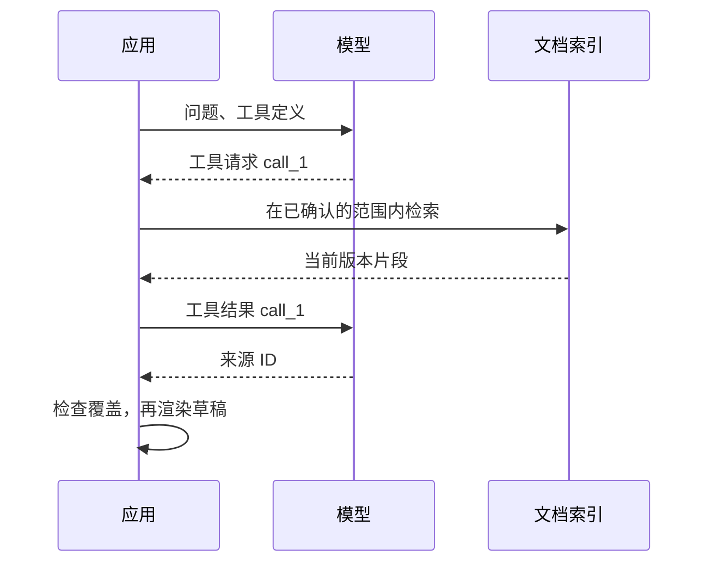

同一句“测试环境怎么发版”，手写函数会回答，接了模型的 Agent 却可能搜两次同一个词，还可能引用一份已经失效的手册。最难排查的一类错误是：终端上已经打印了正确的搜索结果，但第二轮模型像什么也没看见。工具有输出，模型有没有收到，要看请求里的消息序列。

这篇把一条任务从头跑一遍。任务很小：读团队发布文档，给用户一份带出处的清单草稿。第一步用可重复的模型替身观察每条消息。最后接入同一接口形状的真实模型适配器。清单到“待审核”为止，保存到团队系统会在[下一篇](/2026/11/18/document-agent-durable-write/)单独实现。

## 先定任务的交付条件

用户的问题和目标环境是两项输入。环境来自用户已确认的选择，权限组来自应用会话。测试环境清单要有“冒烟测试”和“构建编号”两项；生产清单要有“值班确认”和“构建编号”。这份必需项清单是业务规则，代码里的 `required` 显式维护。模型读到两份文档，不等于两个业务项都查齐了。

| 条件 | 程序行为 | 用户能拿到什么 |
| --- | --- | --- |
| 环境未知 | 调模型前返回 `needs_environment` | 澄清问题 |
| 资料匹配且必需项齐全 | `ready_for_review` | 有出处、带版本的草稿 |
| 权限内没有命中，或缺少一个必需项 | `needs_evidence` | 缺资料的状态 |
| 两份当前资料对同一项给出不同文本 | `conflicting_evidence` | 需要核对的主题 |
| 搜索服务异常 | `search_unavailable` | 可重试的服务错误 |
| 草稿引用本次执行中没出现的 ID | `invalid_draft` | 草稿停止交付 |

有时只用程序就够了。用户若从固定菜单选择环境、请求固定模板，后端可按主题直接读取手册并排版。这个例子保留模型，是为了让它处理口语提问、决定先查哪一个词，以及一次查不全时换个查询。哪些步骤必须出现在清单上，仍由程序决定。

## 第一轮和第二轮之间，差了一条什么消息？

下载 <a href="/assets/examples/document-agent/agent.mjs" download>agent.mjs</a>，用 Node.js 24 运行 `node agent.mjs`。没有安装依赖的步骤。默认模型替身直接返回与 API 同形状的响应项，所以每次可以看到同样的结果。

第一次发送给模型的是问题、确认的环境、必需主题，以及工具定义。其中 `search_docs` 只允许一个参数 `query`。模型选择工具时，返回的主要字段如下：

```json
{
  "type": "function_call",
  "name": "search_docs",
  "call_id": "call_1",
  "arguments": "{\"query\":\"发版\"}"
}
```

`arguments` 是 JSON 字符串。应用先解析，再检查允许的工具名、调用编号、参数字段和长度。调用搜索时，用程序内已确认的 `env` 和登录会话中的 `groups`。即使模型输出自带环境或权限字段，也会在参数检查时被拒绝。查询范围确定之后，才匹配关键词并截取最多四个片段。

接着保留这一轮的模型输出，把下面的结果项追加到同一个输入序列：

```json
{
  "type": "function_call_output",
  "call_id": "call_1",
  "output": "{\"hits\":[{\"id\":\"test-v2#smoke\",\"version\":\"v2\",\"topic\":\"smoke\",\"text\":\"测试环境发版前，冒烟测试必须通过。\"}]}"
}
```

这段只展示一个命中，方便看数据形状。默认运行还会返回构建编号那一条。第二次请求带着原问题、第一轮输出和工具结果；两条消息用同一个 `call_id` 配对。调试时如果日志有 `search` 却没有第二轮模型请求，先看异常或截止时间；如果第二轮也发出了，再核对消息里有没有对应的结果项。推理模型返回的推理项也要按接口约定一并带回。字段和请求细节见 [OpenAI Function calling 文档](https://developers.openai.com/api/docs/guides/function-calling)。



这里有两份容易混在一起的数据。`input` 是下次模型实际能看到的消息；`evidence` 是应用用来验收的 Map，键是本次搜索返回的片段 ID。后者还可以用来把来源定位到某版文档。对比日志里的 `search.sourceIds` 与下一轮请求中的工具输出，就能区分“应用查到了”和“模型拿到了”。

## 这个循环什么时候该停？

源码中的 `runTask` 最多调三次模型，最多执行两次搜索。第三轮可以交草稿，如果仍请求执行工具，程序会以 `budget_exhausted` 结束。相同参数再次提交会返回 `repeated_query`；同一个调用编号再次出现属于协议异常，返回 `invalid_tool_call`。真实模型适配器用 `AbortSignal` 给请求设置单次上限，运行时也计算剩余总时间。示例检索只在内存中执行。如果换成网络检索，要把搜索改成异步并给检索客户端传截止时间；在调用前看一眼时钟，无法取消已经阻塞的请求。

| 看见的执行记录 | 到哪里排查 |
| --- | --- |
| 模型轮次有调用，搜索事件缺失 | 工具名、参数、调用编号或预算被拒绝 |
| 搜索命中为空，模型正常返回 | 对照当前版本、权限范围和查询词 |
| 搜索有命中，验收仍少一个主题 | 确认丢在了召回环节，还是模型没选那个来源 |
| 连续两次请求同一个词 | 看上一条结果有没有回填，再看是否真的需要模型决定重试 |
| 模型请求超时 | 分开记录调用耗时和剩余预算，再判断是否重试或提示用户 |

限制“最多两次”是这个例子的产品选择。考虑把次数放宽前，先做一个实验：第一条只搜“冒烟测试”，第二条只搜“构建编号”。如果确实能补齐资料，再看额外一轮的延迟是否值得。频繁靠多轮才能凑齐固定项目，通常值得先改检索或直接按主题查询。

## 验收为什么只让模型交来源 ID？

如果让模型直接写清单，它可能在正确引用后面加一句错误的操作前提。这个版本让它交 `{"sourceIds":["test-v2#smoke","test-v2#build"]}`，正文取自应用已经见过的文档片段，顺序按业务约定排。程序检查每个来源是否在 `evidence` 内、每个必需主题是否刚好覆盖一次、已召回片段有没有互相冲突。这样可以分别复现三个故障：旧版 ID 并未进入证据、两个 ID 都存在但遗漏了构建编号、两条仍然生效的材料说法不一致。最后一种只能发现已经出现在本轮证据里的冲突，索引中的潜在冲突还要靠文档治理和检索覆盖来处理。

默认运行会先做几条断言，再打印结果。看 `trace` 的正常顺序：

```text
model round=1 calls=1
search round=1 callId=call_1 [test-v2#smoke, test-v2#build]
model round=2 calls=0
validate selected=2 required=2
ready_for_review
```

如果用生成文字替换原文摘录，至少保留逐项来源、所引用的版本和编辑后的文本。程序仍可检查引用范围与覆盖情况，语义是否被改反需要另一条评测或人工抽查。比如“通过后再发布”和“发布后再检查”用的是相近的词，实际顺序完全不同。

## 接真实模型前先过本地运行

`agent.mjs` 里的 `openAIModel` 用 `fetch` 接 Responses API。应用自己持有消息历史，适配器只负责发送请求、返回本轮输出；文档搜索、权限和验收继续走原来的代码。需要试实际请求时，在自己的终端设置 `OPENAI_API_KEY` 和 `OPENAI_MODEL`，选择支持函数调用和结构化输出的模型，再执行 `node agent.mjs --live`。这个入口会向 API 发送本篇随代码附带的示例问题和文档片段。默认运行和回归脚本使用模型替身。

回看自己的实现，可以先问一个很具体的问题：**从模型提出搜索到用户看到清单，我能否找到那个贯穿两轮的调用编号，以及最终引用的原始片段？** 能找到，就有了排查回路。接下来才是把草稿保存后的另一类问题。

[下一篇：写入成功，为什么任务还显示未完成？](/2026/11/18/document-agent-durable-write/) · [第三篇：把一次漏检索变成发布门禁](/2026/11/18/document-agent-regression/) · [开发指南](/agent-engineering/#practice)

如果工具结果里缺少关键证据，可以先做[召回、排序和上下文组装的排查练习](/2026/11/18/document-agent-context/)。

想把这个循环和大型 Coding Agent 的实现对照，可以读阿甘的[《最小 agent 循环的解剖》](https://arganzheng.life/anatomy-of-the-agent-loop.html)。
