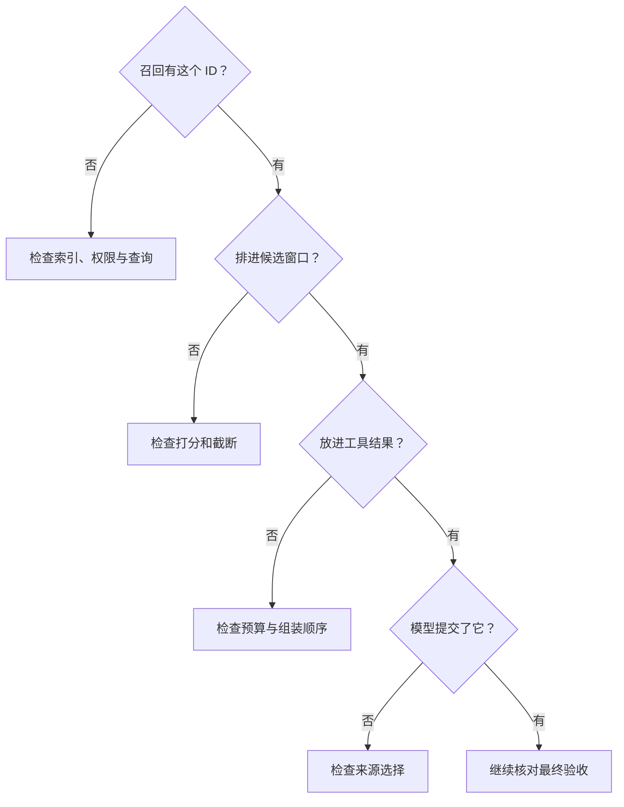

知识库里搜“发版”，当前版手册第三条就写着“测试环境发版前，冒烟测试必须通过”。可用户点生成清单，界面说“资料不全”。再把检索的候选数调大，结果还是一样。两次失败的原因不同：第一次冒烟段没进前两名，第二次它已经排进候选，却在组装工具结果时超出了长度上限。只记录“匹配到了三段”就很难看出这个区别。

[工具调用实战](/2026/11/18/build-a-document-agent/)把检索写成了一个短函数。这篇替换该函数，保留原来的工具接口和验收代码，观察同一段证据在几个阶段里的去向。

## 先确定要追哪一段

这次任务有两条必需证据：“发版前冒烟测试通过”和“发版后登记构建编号”。用发布手册里的版本号和小节定位它们，得到 `test-v2#smoke` 和 `test-v2#build`。例子还放了一个背景附录，里面反复出现“发版”，但它只解释为什么要归档。假如用词频排序，这条内容得分很高，却回答不了必需项。

| 文档块 | 环境与版本 | 作用 |
| --- | --- | --- |
| `test-v2#smoke` | 测试，当前 v2 | 冒烟测试必须在发版前通过 |
| `test-v2#build` | 测试，当前 v2 | 发版后登记构建编号 |
| `test-v2#appendix` | 测试，当前 v2 | 介绍归档背景 |
| `test-v1#smoke` | 测试，历史 v1 | 旧步骤，当前任务不能引用 |
| `prod-v4#approval` 等 | 生产，当前 v4 | 其他环境的规则，当前任务看不到 |

文档分块要保留能独立理解的条件。在这个例子里，“发版前”和“必须通过”需要与“冒烟测试”出现在同一段。来源 ID 也要能查回原文的小节及其版本。如果索引返回的只有“运行冒烟测试”这半句，在后面加更大的上下文预算也找不回丢掉的条件。真正排查时，先去对应版本的索引里查这个 ID，确认词和条件确实被解析进来。

## 把四份 ID 列表都记下来

检索入口先按环境、当前版本和会话权限缩小范围，才做查询匹配。示例用关键词出现次数打分，只为把排序过程暴露出来。每次搜索记录四组 ID 以及第一次超预算的原因。

| 阶段 | 日志字段 | 正确证据不在这里时，下一步看什么 |
| --- | --- | --- |
| 召回 | `recalled` | 当前版本是否入索引、环境和权限是否正确、查询有没有覆盖文档用词 |
| 排序截断 | `ranked` | 候选窗口有多大、背景或重复文档为什么排在前面 |
| 工具结果组装 | `packed`、`excluded` | 本轮真正发送了什么、哪个块被预算挤掉 |
| 来源选择 | `submitted` | 模型是否使用了已拿到的证据、验收发现缺了哪个主题 |

`packed` 对应工具调用篇里 `function_call_output` 的 `hits`。代码把装配记录与 Agent 的搜索事件逐次比对，确保日志里的“送出去了”和应用实际返给模型的 ID 一致。线上若只留 ID、版本和阶段，排障通常够用，正文可以通过受控的文档入口回查。用户界面只反馈缺少哪个可见的业务项。

### 第一次找不到 ID，就从那里下手

把 `test-v2#smoke` 沿下面四个判断往下追。只查到它在第一层出现，不能说明模型用过。在 `context.mjs` 里，`firstMissingStage()` 按这个顺序返回第一个丢失的位置。



## 五次运行，四种相同的「资料不全」

把 <a href="/assets/examples/document-agent/agent.mjs" download>agent.mjs</a> 和 <a href="/assets/examples/document-agent/context.mjs" download>context.mjs</a> 放在同一个目录，执行 `node context.mjs`。每次运行都追踪 `test-v2#smoke`，并断言最终任务状态。

| 试验 | 第一次缺失的位置 | 组装后的结果 |
| --- | --- | --- |
| 用“上线”字面搜索 | `not_recalled` | 0 段，11 字节 |
| 只取前两名 | `ranked_out` | 附录和编号，311 字节 |
| 取前三名，按排序依次放入 | `budget_excluded` | 附录和编号，311 字节 |
| 先放必需主题，模型故意漏选 | `not_selected` | 冒烟和编号，243 字节 |
| 先放必需主题，模型正常选 | `delivered` | 冒烟和编号，243 字节 |

第 2 次与第 3 次的返回内容完全一样。第 2 次里，冒烟段根本没进 `ranked`。第 3 次里，它在第三位，但加进去时整个工具输出会变成 426 字节，超出 360 字节的预算，所以被跳过。这两行日志已经足以决定下一步：加大候选数只能修到第二次，第三次要改组装次序或文档长度。

最后两次都送了冒烟段。故意漏选时，Agent 仍然返回 `needs_evidence`。这回检索侧已经交齐证据，问题在来源选择，应该保留这个输入，单独测模型与验收规则。只对比最后的状态，前四次都被记成同一种失败。

### 把预算降到 242，核对是哪个主题掉了

运行 `node context.mjs 242`，看 `reserve_required_topics` 这行。候选里还同时有冒烟和构建编号，`packed` 只剩 `test-v2#smoke`。`excluded` 告诉你，加入构建编号会到 243 字节，刚好多出一个字节。因为脚本只用 `smoke` 判断 `firstMissingStage()`，那一列还能打印 `delivered`，但整个清单的 `status` 是 `needs_evidence`。排查完整任务时，要逐个必需主题核对，不能用其中一段的送达状态代替整个任务。

## 为什么先给冒烟和编号留位置？

程序知道这张清单需要哪两个主题，就先从已排序的候选里取每个主题的一段，按剩余预算补其他证据。执行顺序类似这样：

```javascript
const priority = requiredTopics
  .map(topic => ranked.find(doc => doc.topic === topic))
  .filter(Boolean);
const order = [...priority, ...ranked.filter(doc => !priority.includes(doc))];
```

这条规则的前提是业务能定义必需主题，且索引元数据可靠。要做开放式问答，可以按文档或段落去重，避免同一章节的几个近似块挤掉其余证据，之后用真实问题评估覆盖。两份仍生效的资料有冲突时，尽量同时保留并交给验收或复核；预算不足以看全有争议的条件，就让任务停下来等资料。只留得分更高的一段，会把本来能发现的冲突藏掉。

预算是对 `JSON.stringify({ hits })` 的 UTF-8 字节数计算的，360 只是这个练习的阈值。部署模型时要按实际请求测 token，把系统指令、工具定义、历史、工具结果和输出空间都算进去。调大 `topK` 会改变候选名单，调大组装预算才会改变送入模型的证据量，两个设置最好分开记录。

## 改完怎么证明修对了位置？

可以按每个必需主题分别画三条线：有多少用例在候选中找到了它，有多少最终把它送给模型，以及送达后有多少被正确引用。三条都使用明确的分母。比如“送达后的引用率”只统计该主题确实进入工具结果的用例；权限错误另外记录，只要不该看到的片段出现在模型输入就应算一次失败。用这几项一起看，能区分“召回多了”和“清单更完整了”。

若要把这份示例改成自己的排障工具，先挑一个有明确正确来源的失败，用章标题和版本标出期望 ID；再保留那次查询真实的候选、截断和最终引用。一次只改一个阶段，记录哪条列表变化了。看到证据真的被送到模型，才值得继续比较提示词或模型。

[工具调用与证据验收](/2026/11/18/build-a-document-agent/) · [下一步：让草稿保存能恢复](/2026/11/18/document-agent-durable-write/) · [把漏检索固化成回归](/2026/11/18/document-agent-regression/) · [灰度中的退步怎么处理](/2026/11/18/document-agent-release/)

更多检索指标与线上样本的组织方式，可参考阿甘的[《检索评测与运营》](https://arganzheng.life/retrieval-evaluation-and-operations.html)。
