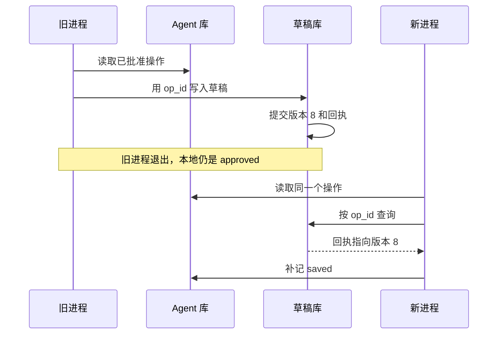
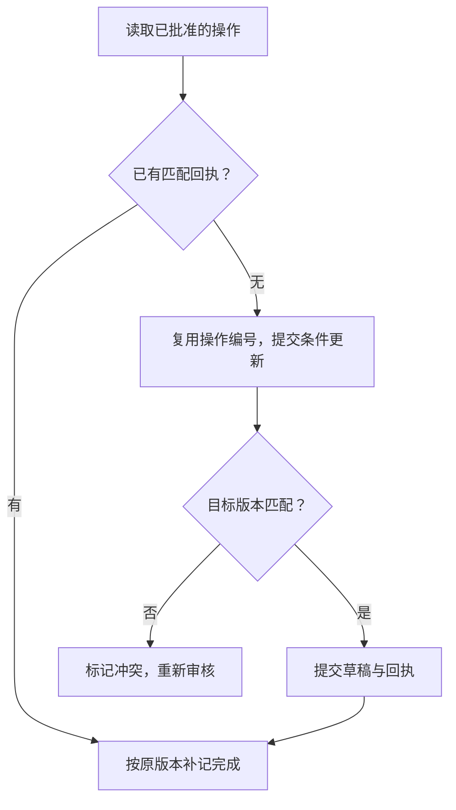

用户确认了发版检查清单，点了“保存草稿”。草稿库把版本从 7 改到 8，刚提交事务，Agent 进程就退出了。任务页仍显示“已批准”，刷新后再点一次，用户希望继续刚才的操作。这时如果起一个新操作，或只根据本地状态再写一次，就可能多生成一个版本。反过来，如果碰到所有超时都当作成功，也会漏掉那些根本没送到的写入。

[工具调用实战](/2026/11/18/build-a-document-agent/)做到生成一份待审核的清单。这里把审核后的清单写进一个模拟草稿库。例子在本地运行，两个库各自提交，因此能重现这个间隔：**草稿库提交成功，Agent 还没记下结果。**

## 任务、操作和版本各自记什么？

| 字段 | 由谁生成 | 生命周期 |
| --- | --- | --- |
| `job.id` | 应用 | 追踪这次保存任务，进程退出后仍可查 |
| `op_id` | 应用在批准时持久化 | 同一个已批准动作的所有重试共用 |
| `baseVersion` | 审核时从目标读取并冻结 | 表示用户同意修改的是哪个版本 |
| `receipt.version` | 草稿库在事务内写入 | 表示该操作实际生成的版本 |

工具协议里的 `call_id` 可以告诉你模型的哪次请求对应哪条结果。保存动作的 `op_id` 还必须在程序崩溃前落盘，并能被目标端用来查重和查询。模型重新生成一句“保存这份草稿”，系统也不能据此创造新的操作编号。

审批需要能回答“批准了哪一版草稿写入哪个目标”。示例冻结 `{ target, baseVersion, content }` 的序列化内容，保存摘要。生产应用还要记录批准人、审批时间和范围。草稿改动后，应生成一份新提案重新审核。执行前同时核对权限和内容摘要，外部目标也通过版本条件校验，避免覆盖别人刚保存的内容。

## 两个库各自知道什么？

`agent.sqlite` 的 `job` 表保存审批状态、操作编号、冻结载荷和最终版本。`draft-store.sqlite` 的 `draft` 表保存草稿，`receipt` 表按操作编号记录执行结果。目标端要在同一个事务里更新草稿和写回执，否则也会出现“草稿变了，查不到该操作”的间隔。

```sql
BEGIN IMMEDIATE;
-- 先按 op_id 查回执，有则核对摘要并返回。
UPDATE draft
SET version = version + 1, content = ?
WHERE id = ? AND version = ?;
-- 更新恰好一行才继续。零行表示审核时看的版本已失效。
INSERT INTO receipt(op_id, payload_hash, version) VALUES (?, ?, ?);
COMMIT;
```

以上 SQL 展示主支路。源码会在无更新时回滚，已有同一个 `op_id` 时返回原回执。查重与条件更新解决的是两类并发。两个 worker 即使都没在事务外查到回执，进入目标事务后还会再查一次，同一个操作只允许生效一次。两个**不同**操作若都想写版本 7，第一个能把版本推到 8，第二个条件更新失败，必须重新审核。



## 让进程在两个地方退出

下载 <a href="/assets/examples/document-agent/recovery.mjs" download>recovery.mjs</a>，用 Node.js 24 执行 `node recovery.mjs`。脚本会起子进程执行任务，在临时目录留下两个数据库，最后打印路径。使用的是 [Node.js 内置 SQLite 接口](https://nodejs.org/docs/latest-v24.x/api/sqlite.html)。

第一组故障用 `after-commit` 让 worker 在目标事务提交后退出。检查目标端已经是版本 8，`receipt` 只有一条；本地任务还是 `approved`。新的 worker 先查回执，发现原操作确实生效，于是只补记 `saved`。第三次运行看到本地完成状态，直接返回。第二组换成 `before-send`，worker 在任何外部写入之前退出。新进程查不到回执，按同一个操作编号保存，版本 8 变为 9。还有两组断言会检查过期目标版本和审批后篡改的载荷。

| 运行阶段 | Agent 库 | 草稿库 | 恢复路径 |
| --- | --- | --- | --- |
| 丢回执的进程退出后 | `approved` | 版本 8，已有回执 | 查回执并补记完成 |
| 原任务恢复两次后 | `saved` | 仍是版本 8 | 第一次走回执，第二次读本地状态 |
| 发送前退出的任务恢复后 | `saved` | 版本 9 | 查不到回执，用原操作编号提交 |
| 拿过期版本 7 保存 | `conflict` | 仍是版本 9 | 重新读取目标，重新审批 |

这里的版本号都是示例程序的实际断言。排查自己的写入路径时，至少收集三条证据：调用前持久化的操作编号、外部服务是否已有对应回执、任务最终保存的回执版本。任意一条缺失，都很难判断“下一次继续”会做什么。

### 顺着两次恢复读源码

从 `recovery.mjs` 的 `demo()` 开始。它启动独立子进程，进程在故障点以退出码 75 停下。重新进入 `worker()` 时，两种故障都看到 `job.state === "approved"`，所以接下来查的是同一个 `op_id` 的目标回执。



新版 worker 用 `readReceipt()` 查询时，`receipt-lost` 已有版本 8 的回执，所以输出 `via: "receipt"`。`before-send` 查不到回执，才进入 `applyDraft()` 并写出版本 9，输出 `via: "write"`。图里“没有回执就试写”有两个前提：这个示例的查询直接读目标库，目标端也在事务内按同一个编号去重。下文会讲这些前提不成立时怎样处理。

## 外部服务没这么配合怎么办？

示例里查回执直接读目标库，返回“没找到”可信；即使两个 worker 同时发起，目标端也有同一操作编号去重。真实 API 可能是最终一致的，可能没有按操作编号查询的接口，也可能把幂等窗口限制在短时间里。这时要从 API 的契约决定继续策略。

- **支持幂等键和有效期内重试。** 复用原键和原请求内容。进程恢复后先核对幂等窗口，改过的内容需要新审批和新键。
- **支持查询，但读可能滞后。** 空结果仍可能代表未同步。可以延后再次查询，或者在服务明确保证同键去重的窗口内提交。
- **无法查询，也没有幂等保证。** 把有歧义的任务保持为 `outcome_unknown`，让人核对目标状态。把网络超时统一当成“失败可重试”，会把未知的外部副作用重新执行一次。
- **已发生写入，需要撤回。** 重新评估目标当前版本，并走一条可审计的撤回操作。应用部署回滚之后，这份草稿还在外部系统里。

数据表持久化了业务事实，框架的 checkpoint 仍可帮助还原工作流。选框架之前先确认写入工具具备哪项语义。恢复时查一次回执，比重读所有模型消息更直接；如果外部不支持，上层框架没有办法凭本地日志确认那边是否写过。

[检索与上下文](/2026/11/18/document-agent-context/) · [下一步：把故障转成回归用例](/2026/11/18/document-agent-regression/) · [工具调用和证据验收](/2026/11/18/build-a-document-agent/) · [检查点与幂等](/2026/11/05/agent-checkpoint-idempotency/)
