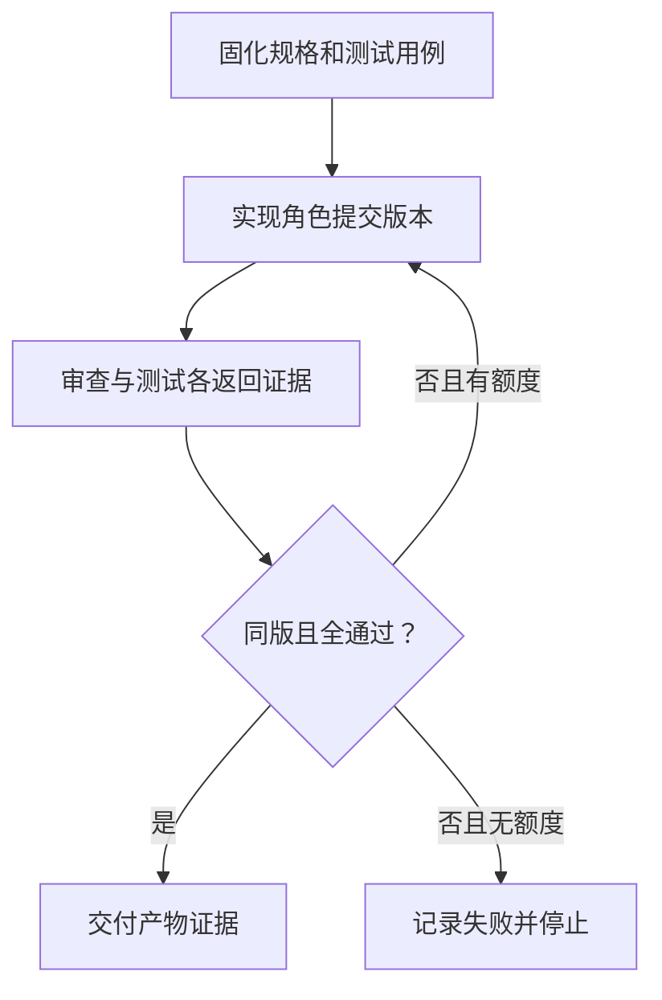

需求是「把一个整数库存调整到 0 到 9 之间」。实现、审查和测试角色都可能交回听起来正确的结果。Supervisor 要决定这些结果是否针对本次规格与同一份产物，并确定失败后回哪一步。

## 任务合同与角色划分 {#scope}

| 角色 | 输入 | 交付与验收 |
| --- | --- | --- |
| 需求 | 用户要求 | 规则、范围、验收例 |
| 实现 | 已确认规格 | 有版本的函数产物 |
| 审查 | 规格与产物版本 | 按要求逐项检查并给结论 |
| 测试 | 产物版本与测试集 | 实际执行结果、样本数与版本 |
| Supervisor | 上述状态和产物 | 一致性、预算控制和最终状态 |

示例角色是固定的本地函数，不运行未验证的任意脚本。用户可以换角色实现观察结果，所有交接仍保持同一合同。

## 架构和执行流程 {#architecture}



接入 LangGraph 时，四个角色可以成为 Node，State 放规格、产物版本和检查结果，Edge 按 Supervisor 的判定路由。持久化用任务 ID 关联检查点。接入真实代码库之前，应限定可读范围、允许的变更路径与测试命令，并纳入人工审批。

## 核心实现 {#implementation}

[下载多 Agent 开发示例](/assets/examples/agent-engineering/development.mjs)，使用 Node.js 24 执行 `node development.mjs`。首轮产物漏了下限。第二轮修完整，审查和测试都引用同一个版本。额外样本故意交回旧测试证据，Supervisor 拒绝交付。

```javascript
const acceptable = review.approved && test.passed
  && review.version === artifact.version
  && test.version === artifact.version;
```

## 运行结果与优化 {#results}

脚本验证第一轮不合格、第二轮交付，以及两轮版本不匹配后进入 `blocked`。真实队伍还可把规格和产物摘要一并写入测试记录。对比单 Agent 基线时，记录新增的质量提升、额外迭代次数和执行耗时，判断角色分工是否值得。

[返回四个案例](/2026/11/19/agent-engineering-cases/#development) · [下一个案例：企业级 Agent 平台](/2026/11/19/agent-case-platform/)
