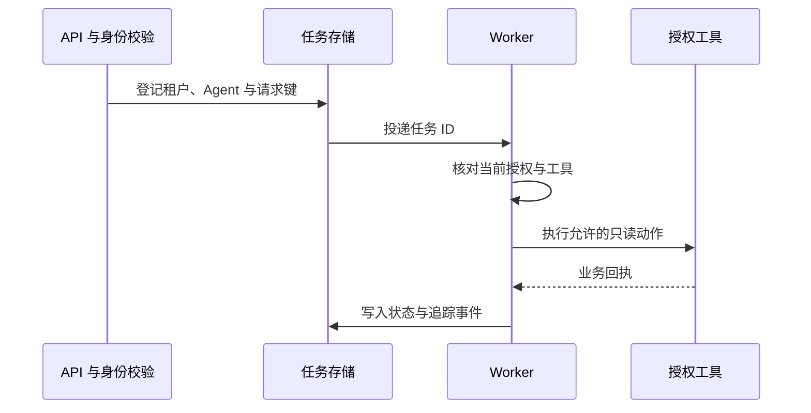

一个平台同时托管客服 Agent 和研究 Agent。两个租户可能提交相同的幂等键，用户排队以后权限也可能被回收。平台需要追踪从提交到执行的身份、允许的工具、任务状态与回执。

## 业务需求与验收 {#scope}

每个租户只能为被分配的 Agent 创建任务，Worker 在动作前重新读取授权。任务 ID 以租户、用户和请求键为命名空间。状态查询检查任务归属，运行记录保留任务 ID、事件类型和所用工具，避免混入正文。模拟器用同一进程里的 Map 和数组展示状态，真实实现把任务、投递及审计记录落到持久存储。

## 架构、选型与执行流程 {#architecture}



Agent 注册表定义能力、默认工具和版本。检索工具接入有租户边界的 RAG。需要接入另外部署的工具服务时，可以通过 MCP 连接，在工具服务重查允许的租户和数据范围。平台可以用 Supervisor 在多个业务角色间分派，租户权限由应用及工具服务判定。

## 核心实现 {#implementation}

[下载平台示例](/assets/examples/agent-engineering/platform.mjs)，使用 Node.js 24 执行 `node platform.mjs`。处理任务时用内部任务记录携带的身份和 Agent，从当前授权表取许可，读取成功后把事件与回执登记到任务。队列重复投递或任务已结束时，Worker 返回已有状态。

```javascript
if (!access.get(job.tenant)?.has(job.agent)) {
  job.status = 'denied';
  trace.push({ jobId: job.id, event: 'authorization_denied' });
  return job.status;
}
```

## 运行结果与生产差距 {#results}

脚本断言重复键只生成一项任务，两个租户的相同键不会冲突，越权查询无法取得任务，撤销权限后的在途任务被拒绝，重复投递不重复执行。真实平台还要原子登记任务与 outbox、管理 Worker 租约，并在外部写入时确认幂等回执。压测时分别统计排队、执行、Token 和人工接管，按租户与 Agent 类型观察异常。

[返回四个案例](/2026/11/19/agent-engineering-cases/#platform) · [继续阅读：前沿技术与趋势](/2026/11/19/agent-engineering-frontier/)
