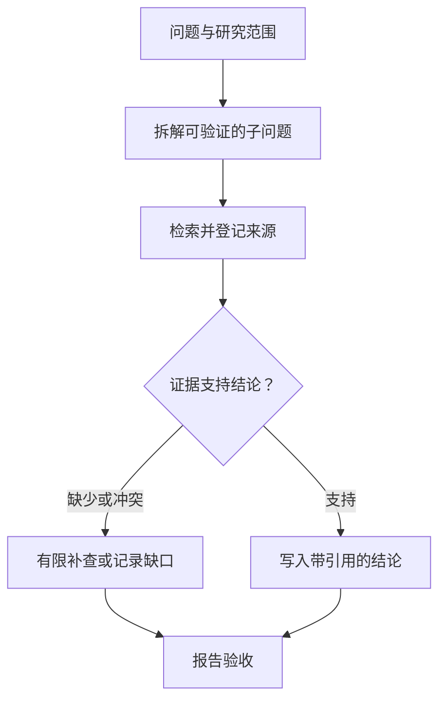

目标是回答「两个方案的覆盖范围和更新周期分别是什么？」研究系统很容易把转载误当成第二份独立依据，或用一个方案的更新记录补另一个的空白。这个练习把报告拆成独立结论，每个结论保存来源与版本，缺证据的地方明确留空。

## 需求、计划与交付物 {#scope}

先按覆盖范围和更新周期拆出四项任务。各项执行可以并行，最后按原计划顺序生成报告。每项需要至少一条原始来源，涉及对照的结论要检查来源组。可变规则或争议结论可以提高独立来源门槛。任务状态记录已处理的问题和证据，长期保存时设置资料的版本与清理周期。

## 架构、技术选型与执行流程 {#architecture}



用本地数组代替搜索工具和证据存储。真实场景可把 Search Tools 接到授权文档源，为来源设置获取时间及访问范围。子问题的产物使用 `{ topic, claim, citations, status }`，Reflection 读取具体缺口再检索，保留历史版本便于比较。

## 核心实现 {#implementation}

[下载研究示例](/assets/examples/agent-engineering/research.mjs)，用 Node.js 24 执行 `node research.mjs`。第一次检索仅有 B 方案周期的一段二手摘要，报告把它列为缺口。补充一份 B 方案的正式记录后重跑，该缺口消失。A 方案同一机构发布的摘要与转载只算同一来源。

```javascript
const primary = hits.filter(source => source.primary);
const independent = new Set(primary.map(source => source.publisher));
if (independent.size < minimumSources) return { topic, status: 'missing' };
```

## 运行结果与取舍 {#results}

脚本断言首次有三项得到证据，补材料后四项得到证据。把一份相同发布机构的文本复制多次，独立来源数仍然不变。对外部来源要区分发布者、内容镜像和互相转述。质量影响大的任务，还应检查来源是否真的支持结论、同一术语在不同文档里是否使用同一口径。

[前置知识：结构化计划](/2026/11/19/agent-deep-dive-plan-execute/) · [返回四个案例](/2026/11/19/agent-engineering-cases/#research) · [下一个案例：多 Agent 开发系统](/2026/11/19/agent-case-development/)
