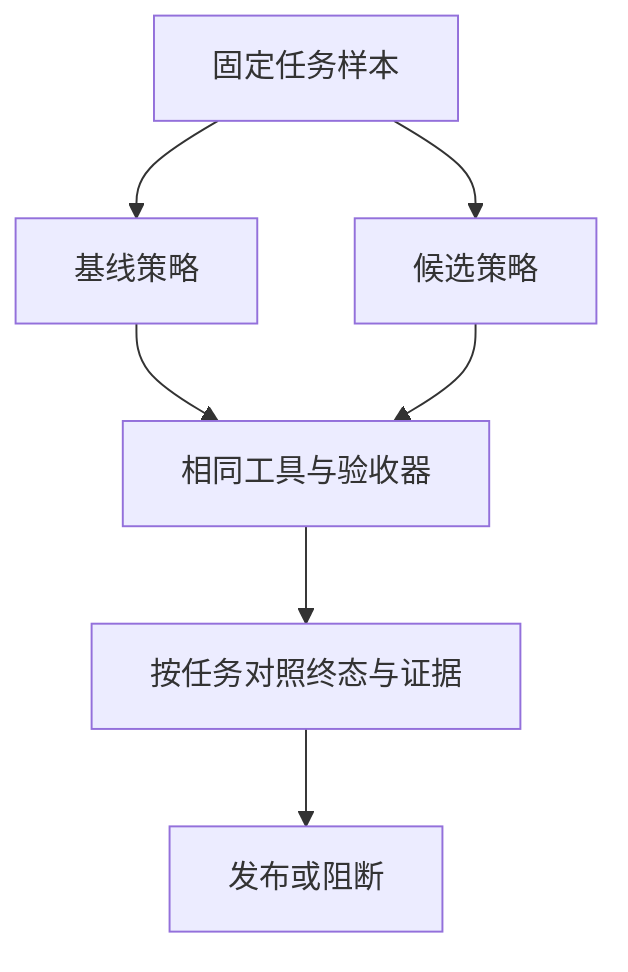

## 从一个客服问题写出验收任务 {#scope}

用户问「A12 还没到，可以取消吗？」系统读取此人有权看的订单，查询扫描和生效政策，交付可核对的建议。直接要求退款时转人工。「回答措辞看起来合理」不足以作为成功条件，案例为每条输入写出预期状态和允许发生的工具轨迹。

## 核心概念：结论、来源、人工接管 {#concepts}

订单状态、承运商扫描和政策来源是三个不同证据。任务验收要确保来源当前有效、属于本次授权查询、与最终结论对应。可联系人工时，界面应明确当前停在哪一步、用户需补什么资料。退到人工时避免返回其他用户的订单数据。

## 底层原理：把要求写成结果和过程断言 {#principles}

普通输入需要三条工具记录和三条引用。没有订单号时，澄清状态与空工具记录必须同时满足。他人订单的样本用另一合成身份，允许后端查并拒绝，但脚本会检查 Trace 和返回引用，防止产生错误的私有证据。配对比较时，每个基线和候选使用同样的任务、身份与目标数据。

## 系统架构：运行时与离线评测隔开 {#architecture}



运行时负责当前任务、工具身份和可交付判断。评测器从外部核对轨迹与结论。两个层次各要断言。运行时拒绝一份错误建议可以保护用户，但若基线原本可正常交付，候选仍构成回归。

## 完整执行：候选少查一步会怎样？ {#execution}

| 输入 | 基线 | 跳过扫描的候选 | 验收信号 |
| --- | --- | --- | --- |
| 本人 A12 | 完成 | 转人工 | 终态和必需证据退步 |
| 缺订单号 | 澄清 | 澄清 | 两者都没有工具调用 |
| 他人 A12 | 无法访问 | 无法访问 | 没有成功读取证据 |
| 要求直接退款 | 待人工 | 待人工 | 两者都没有写入 |

候选将扫描跳过后，运行时观察只包含查单和政策。验收器根据已交接状态仍要求扫描，因此返回 `missing_evidence`。防线拦住了错误答复，但发布对照依然应阻断这次改动。

## Python 实现：配对验收和故障注入 {#implementation}

下载 [support_acceptance.py](/assets/examples/agent-engineering/support_acceptance.py) 和 [agent_loop.py](/assets/examples/agent-engineering/agent_loop.py) 到同一目录，用 Python 3.11 或更高版本运行 `python support_acceptance.py`。

```text
ordinary: baseline=passed candidate=terminal_state
missing_order: baseline=passed candidate=passed
foreign_order: baseline=passed candidate=passed
refund_requested: baseline=passed candidate=passed
release gate: blocked; ordinary case regressed, no unsupported answer was delivered
```

脚本还注入两个拒绝分支：不当工具适配器夹带合成私有字段时，运行时剥离字段；假设日志记录器绕过这一步，离线验收会判定 `unexpected_evidence`。先前的 Node.js [简化客服示例](/assets/examples/agent-engineering/support.mjs) 可用于单独观察请求分流。

## 固定流程和可变策略怎样评估？ {#tradeoffs}

固定工作流可以对所有已交接订单必查扫描，为当前任务建立稳定基线。模型选工具在跨地区、多状态和用户表达复杂时可能减少无关调用。先比较任务完成、体感延迟、工具数与人工接管，再决定开放到哪一步。减少一次接口调用的收益，需要经过相同证据要求的检验。

## 工程实践：把线上失败接回测试集 {#results}

对真实业务保留数据版本、会话范围和失败原因。可以用脱敏后的等价样本重跑工具轨迹。关键地区、订单环节和授权场景单独对比，不让总成功率抵消越界或漏证据。对过期政策新增样本时，要同时观察召回列表、实际上下文和答案中的引用。

## 从客服验收走向多来源研究 {#next}

[运行机制示范篇](/2026/11/19/agent-engineering-foundations/) 提供这个案例使用的执行器。如果一个答案依赖更复杂的来源，继续读 [Research Agent](/2026/11/19/agent-case-research/)，检查原始来源和转载如何区分。
