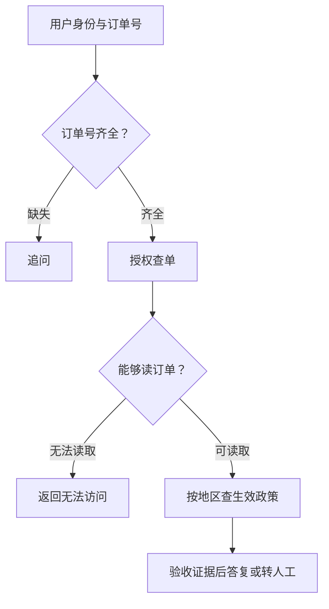

用户问：「A12 还没到，可以退款吗？」需要先核对订单是否属于当前用户，再用订单地区、配送状态和现行条款给建议。这个练习只做查单和问答，申请退款时交给人工队列。预期结果从程序的断言中可以核对。

## 需求定义与验收 {#scope}

| 任务 | 期望行为 |
| --- | --- |
| 本人查 A12 | 返回运输中和现行政策来源 |
| 缺订单号 | 追问，并且没有查单记录 |
| 请求别人的订单 | 拒绝，响应不包含目标记录 |
| 要求立即退款 | 保留订单及政策证据，返回人工路径 |

## 架构和选型 {#architecture}

入口传入已验证的用户 ID 和订单号。脚本用一个固定决策代替模型的 Function Calling，用本地小表模拟订单 API 和 RAG 索引。政策多时可以将检索实现换成关键词与向量混合检索，保留政策版本、地区和来源 ID 的契约。



## 核心实现和执行流程 {#implementation}

[下载客服示例](/assets/examples/agent-engineering/support.mjs)，使用 Node.js 24 运行 `node support.mjs`。脚本先核对订单号，再执行服务端的精确授权查询。查到订单后按地区筛选当前有效的政策。合格结果携带两种回执，分别证明订单状态和政策，有退款意图时返回 `handoff`。

```javascript
const receipt = readOwnOrder(session.userId, request.orderId);
if (!receipt) return { status: 'unavailable' };
const evidence = policy.find(item => item.region === receipt.region && item.active);
if (!evidence) return { status: 'needs_evidence' };
```

## 运行结果与优化 {#results}

例子按顺序断言 `complete`、`needs_order`、`unavailable` 和 `handoff`。把当前条款改为未生效，查看 `needs_evidence`，顺便检查历史版本仍未被引用。真实接入模型后，可以让用户话术进入意图分类，使用同一批样本测工具选择与引用质量。对运营而言，最有价值的记录通常是订单回执 ID、政策版本和人工原因。

[前置知识：工具调用实战](/2026/11/19/agent-deep-dive-tool-use/) · [返回四个案例](/2026/11/19/agent-engineering-cases/#support) · [下一个案例：Research Agent](/2026/11/19/agent-case-research/)
