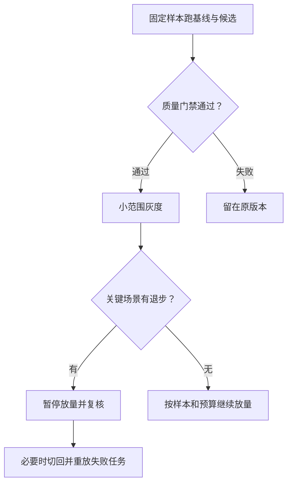

## 部署单元有哪些？ {#units}

API 接收请求和返回任务状态，Worker 处理队列，状态、回执、索引和遥测独立存放。镜像写入依赖锁、运行入口和健康检查。Kubernetes 上 API 可按请求量扩缩容，Worker 按队列积压和执行耗时扩缩容。优雅退出先停止领取任务，再落盘最新检查点。队列重新投递时用任务租约和操作编号核对已有工作。

## 一次发版记录哪些版本？ {#release}

应用、模型、Prompt、工具定义、索引版本、权限策略和状态迁移脚本共同决定任务行为。用发布记录区分配置包与某条请求实际命中的索引或模型。数据库迁移应考虑旧 Worker 和新 Worker 同时读取的情况，先部署兼容结构，再切消费者，最后清理旧字段。

## 为什么总成功率会掩盖问题？ {#metrics}

假设新增地区查询恢复两条成功请求，但原有地区的两条带权限上下文的任务失败，总成功率完全相同。按角色、地区、任务和工作区做配对比较。上线阈值记录人群、时间窗口、最小样本和允许的延迟预算。严重越权或未经确认写入单独阻断。性能方面沿排队、检索和模型分解延迟，评估缓存与模型路由对质量的影响。

## 回滚需要做哪几次核对？ {#rollback}

切回版本后先让同一条已知失败的请求重跑，核对实际模型、索引和最后验收。检查在途任务是否仍由旧或新 Worker 执行，有外部副作用时按回执核对是否已经发生。把事故样本加入回归集，同时核对重复任务与延迟指标。

[前置：故障恢复](/2026/11/19/agent-deep-dive-durability/) · [进阶：评估与回归](/2026/11/19/agent-deep-dive-evaluation/)
