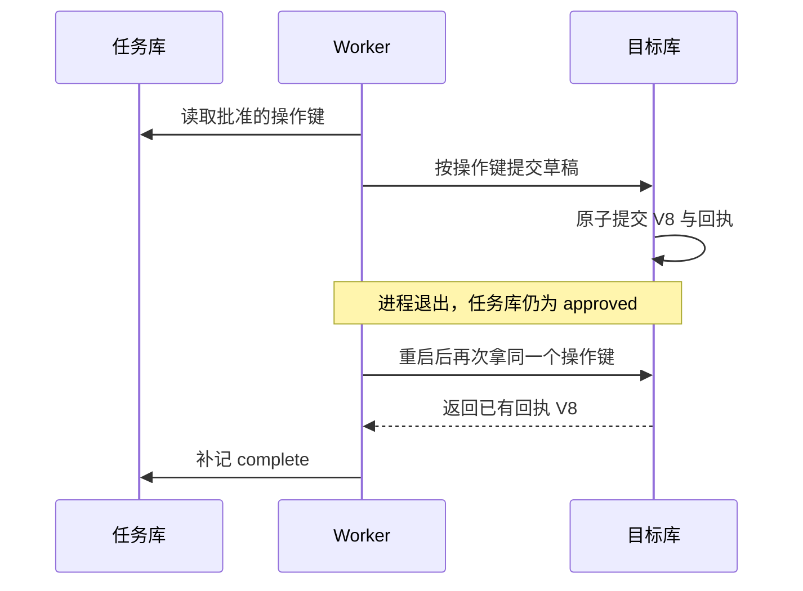

## 本地仍然 approved，目标端已经提交 {#problem}

负责人批准保存一份售后草稿。Worker 把草稿从 V7 写到 V8，事务已提交，但进程在更新任务状态前退出。用户刷新时仍看到「等待执行」。重启后如果直接生成新请求，同一逻辑动作可能被执行两次。程序必须判断准确发生了哪一步。

## 核心概念：任务、批准动作、版本和回执 {#design}

| 对象 | 拥有者 | 要解决的问题 |
| --- | --- | --- |
| Task / Checkpoint | 运行时 | 恢复到哪个阶段 |
| Operation ID | 审批应用 | 哪些重试属于同一逻辑动作 |
| Expected Version | 批准记录 | 批准的是目标端哪一版 |
| Receipt | 目标服务 | 哪一个动作已实际生效 |

审批要同时冻结主体、目标、内容摘要和期望版本。示例只有一个草稿，使用固定样本代替真实批准记录。

## 底层原理：条件更新和唯一约束各保护什么 {#principles}

同一个操作键的重试先匹配回执内容和版本。有回执就返回原版本。找不到时，在目标事务内条件更新期望版本，并插入唯一回执。这两步一起提交，避免草稿已改却没有凭据。唯一键处理同一个动作的重复投递，条件更新处理不同动作试图覆盖同一旧版本的竞争。SQLite 的 `BEGIN IMMEDIATE` 提前进入写事务，细节见 [SQLite 事务文档](https://www.sqlite.org/lang_transaction.html)。

## 系统架构：两端有各自的提交边界 {#architecture}



跨服务通常各自提交。Worker 只依赖目标提供的回执与条件写接口。目标端无法查询回执且不支持幂等时，超时结果进入人工核对，避免把未知结果当作未执行。

## 完整执行：提交后真正退出一次 {#execution}

初始目标版本为 7，任务已批准。脚本启动子进程，目标数据库提交后调用 `os._exit(75)`，程序来不及把任务改为完成。父进程重新打开两个文件读实际状态。下一次 Worker 用相同操作键拿到旧回执并补记完成。再运行一次，目标版本和回执条数都不变。

## Python 实验：检查两个数据库 {#implementation}

下载 [durable_receipts.py](/assets/examples/agent-engineering/durable_receipts.py)，执行 `python durable_receipts.py`。脚本使用临时目录和标准库 SQLite。

```text
after exit: ('approved', 8, 1)
after recovery: ('complete', 8, 1)
operation key does not match the approved content or version
target version changed
```

每行前两个值是任务状态和业务版本，第三个是回执条数。脚本同时断言同一个键不能换内容，不同键不能覆盖 V7 已失效的草稿。任务库内的状态和目标库中的可查询事实具备独立的核对点。

## 什么时候用一个事务，什么时候靠回执恢复？ {#tradeoffs}

任务状态和业务对象由同一个数据库管理时，可以把状态、业务修改和记录放到一个事务。它们由不同服务管理时，先定义业务端的唯一操作与回执，再在调用方做可恢复状态机。没有目标端幂等的接口要评估业务补偿或人工接管。自动重试的适用性取决于外部接口实际保证的语义。

## 工程实践：恢复演练需要哪些故障点？ {#verification}

在发送前退出时，目标没有回执，恢复应补做原动作。提交后模拟进程退出时，目标已有回执，恢复应仅补记。再加重复投递、过期版本、权限变更与批准后草稿修改等用例。监控分别记录重投数、命中回执数、版本冲突和未确认操作，方便值班区分自动恢复与人工核对。

## 将恢复规则接到发布过程 {#next}

[LangGraph 审批实验](/2026/11/19/agent-deep-dive-langgraph/) 解释节点怎样恢复。[发布与回滚](/2026/11/19/agent-deep-dive-deployment/) 则继续处理新旧 Worker 并存、状态兼容和重放核对。
