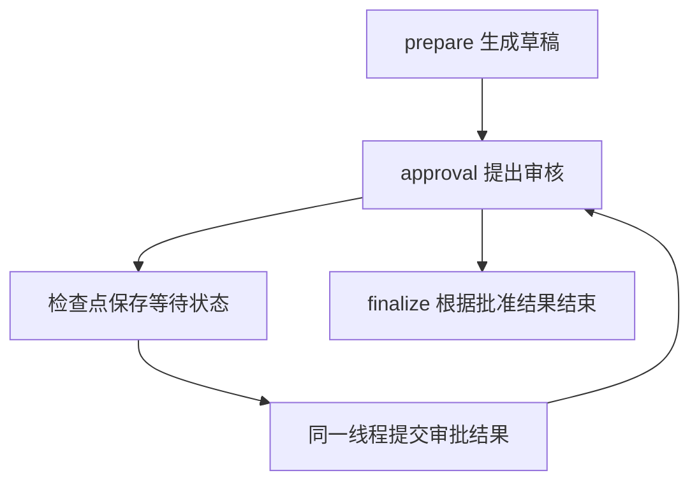

## 审批等待期间，线程怎样停下来？ {#problem}

申请草稿已经生成，负责人隔天才点击批准。HTTP 请求和原来的调用栈早已结束。应用需要恢复的是工作流状态和待执行节点。LangGraph 的 checkpointer 按执行线程管理快照，`interrupt` 让一个节点等待外部输入，之后用 `Command(resume=...)` 继续。关键问题是恢复时哪些代码会重新运行。

## 核心概念：State、Node、Edge、Thread {#design}

State 是图里的业务数据，示例包含订单、草稿、审批结果和终态。Node 读当前 State，提交自己的状态更新。Edge 决定控制流。Thread ID 用于定位检查点历史，上层仍要验证用户能不能恢复这个任务。Checkpoint 保存的是图的执行上下文，支付、订单等外部提交要另有业务回执。

## 底层原理：恢复会重进中断节点 {#principles}

本实验在三处放计数器。第一次执行完成 `prepare`，进入 `approval` 到达中断。恢复时 `approval` 从函数入口再次运行，`interrupt` 这次返回恢复值，随后才进入 `finalize`。如果把网络写动作放在 `interrupt` 之前，同一次审批恢复可能再执行那段代码。批准后把写入独立成另外的节点，并在业务服务用幂等键控制提交。

## 系统架构：审批节点之前准备，之后校验 {#architecture}



应用提交审批结果前应核对审批人身份、目标版本和草稿摘要。示例的 `finalize` 只写图状态，便于隔离框架行为。

## 完整执行：观察快照和节点计数 {#execution}

| 观测时点 | prepare | approval | finalize | 图的下一节点 |
| --- | --- | --- | --- | --- |
| 第一次 `invoke` 返回 | 1 | 1 | 0 | `approval` |
| 同一 thread 恢复 | 1 | 2 | 1 | 空 |
| 单独线程 B13 拒绝 | 另一份状态 | 另一条执行历史 | 终态 `closed` | 空 |

`get_state(config).next` 能观察待执行节点。示例再用第二条 thread 验证它的审批状态没有覆盖 A12。状态可恢复的前提是使用对应的线程标识和同一持久化接入。

## Python 实验：重进节点的证据 {#implementation}

下载 [langgraph_resume.py](/assets/examples/agent-engineering/langgraph_resume.py)，运行以下命令。验证环境使用 Python 3.13 和 LangGraph 1.2.23。

```bash
python -m pip install langgraph==1.2.23
python langgraph_resume.py
```

```text
paused: {'prepare': 1, 'approval': 1}
resumed: {'prepare': 1, 'approval': 2, 'finalize': 1}
isolated threads, langgraph 1.2.23
```

代码用 `InMemorySaver` 和业务无副作用的计数器演示单进程行为。框架细节参见 [LangGraph 官方中断文档](https://docs.langchain.com/oss/python/langgraph/interrupts)。

## 内存检查点、数据库和普通工作流的取舍 {#tradeoffs}

内存检查点适合单进程实验，退出进程后状态会丢失。部署时先确定任务是否跨进程、是否有并发恢复以及多久清理快照，再选持久化实现。流程只有一两个固定阶段时，一张任务状态表也能把审批和恢复表达清楚。图结构有并行、循环和子图时，声明式转移更方便观察。

## 工程实践：哪些代码放在中断前后？ {#practice}

中断前尽量使用无副作用的准备和审查数据。恢复请求要针对明确的暂停点，重查审批范围。若已有外部写入，使用同一批准操作键查回执，用业务状态决定补记或重试。升级框架版本时固定实验的节点访问与状态断言，防止依赖未核实的返回形状。

## 从图恢复走向业务恢复 {#next}

计划图适合组织控制流，见 [计划执行器](/2026/11/19/agent-deep-dive-plan-execute/)。下一篇 [写入回执](/2026/11/19/agent-deep-dive-durability/) 会真实退出子进程，检查图已批准但外部目标已经提交时该做什么。
