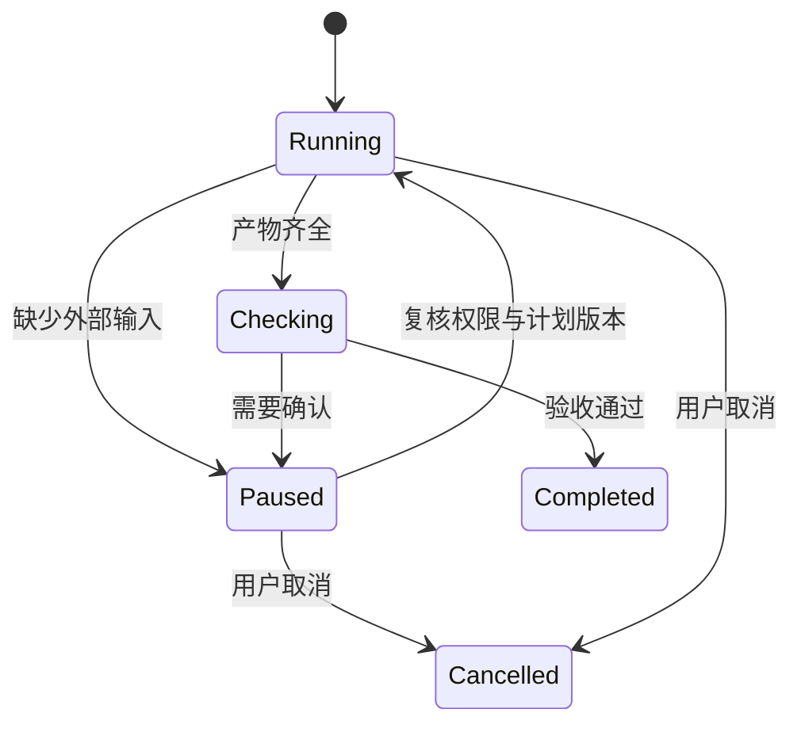

## 长任务的风险在中间变多了 {#problem}

研究任务开始时有三份资料，需要等另一组补第四份。等待期间可能遇到模型配置变更、授权撤回和索引更新。运行时要定义哪些内容以启动时版本为准，哪些需要在继续前刷新。交付时把核实时间和证据版本说清楚。

## 定义恢复和取消合同 {#design}

检查点保存任务目标、计划版本、相关证据 ID、已用预算和外部操作编号。对长时工作分段产出可复核结果，开下一段前验收上一段。任务级和步骤级截止时间分开。取消改变本地任务状态，也要处理远端任务迟到、已提交外部操作和先前收到的产物。



## 用检查点重放已知故障 {#implementation}

```python
def resume(state, now):
    if state["phase"] in {"cancelled", "completed"}:
        return state["phase"]
    if now >= state["deadline"] or not state["access_ok"]:
        return "handoff"
    if state["receipt"]:
        return "verify_receipt"
    return "resume_plan"

checkpoint = {"phase": "running", "deadline": 10, "access_ok": True, "receipt": "op-7"}
assert resume(checkpoint, 4) == "verify_receipt"
assert resume({**checkpoint, "access_ok": False}, 4) == "handoff"
```

用同一任务在多个步骤中断，恢复时核对预算是否继续扣减、是否重用合格产物及是否发现授权变化。后台运行期越长，版本漂移与迟到回报越多。先用简单任务度量中断恢复成功率，再引入并行、跨应用委派和计划更新。

[前置：生产级故障恢复](/2026/11/19/agent-deep-dive-durability/) · [回到前沿专题](/2026/11/19/agent-engineering-frontier/#long-running)
