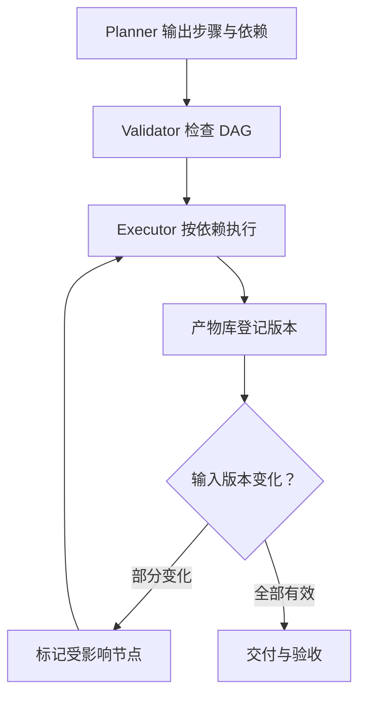

## 政策换版以后，需要把整个任务重做吗？ {#problem}

一次售后报告已经取得订单状态与旧政策。中间业务通知政策换版，模型重新生成计划。如果运行时只知道「再做一遍」，它会重复查订单和已完成的依赖，甚至忘记哪些外部动作已经生效。计划应当可以核对每个步骤依赖什么，哪些产物受到版本更新影响。

## 核心概念：Planner、Validator 与 Executor {#design}

Planner 输出可验证计划，包含步骤 ID、动作名、依赖和预期产物。Validator 拒绝未知动作、缺依赖和环。Executor 读取已经验证的依赖产物，调用工具并登记新产物。应用继续负责权限和预算。示例产物只有内容与版本，真实系统还应保存签发主体、数据范围和哈希。

## 底层原理：拓扑顺序和失效传播 {#principles}

有向边从依赖指向消费者。拓扑排序可先取入度为零的节点，每次取走一个，再减少下游节点的剩余依赖。有限图清空之前如果没有可执行节点，说明有循环。重规划只要标记变更根节点，按拓扑序传播到其依赖者。邻接表下拓扑过程由节点和边的规模决定，逐节点检查依赖可以避免反过来搜索整段历史。

## 系统架构：计划与产物分别版本化 {#architecture}



读取订单和政策可独立进行。验收节点读取两者的版本，交付节点依赖验收产物。生产实现通常会为每个任务同时保存计划版本、工具配置和产物来源。

## 完整执行：只重跑政策分支 {#execution}

第一次依次生成 `order → policy → verify → deliver`。政策变成 V2 时，`policy` 明确失效，后续两个步骤沿依赖也随之失效。订单仍有效，因此保留原引用。在同一张图里新增一步如果该步没有记录，也必须执行。示例只处理已有依赖图上的输入变化。若规划器更改某个节点的动作、依赖、参数或工具配置，调用方需把该节点明确标为已变更。

## Python 实现：执行并验证最小重跑 {#implementation}

下载 [plan_executor.py](/assets/examples/agent-engineering/plan_executor.py)，用 Python 3.11 或更高版本执行 `python plan_executor.py`。

```text
first: ['order', 'policy', 'verify', 'deliver']
after policy update: ['policy', 'verify', 'deliver']
verified artifact: Artifact(value='handed_off/review_required', version='order-v3+v2')
```

代码先用标准库 `TopologicalSorter` 验证拓扑，运行时维护 `invalid` 集合。每个节点首次发现自己的依赖在这个集合中，便将自己加入。读订单的对象保持原引用。脚本还断言循环计划无法进入执行。

## 显式计划与 ReAct 的边界 {#tradeoffs}

短链查询中，下一步常取决于当前观察，有界 ReAct 更直接。任务进度可预见、依赖多或者需要中间产物时，计划能建立更清楚的复用、取消和验收条件。固定的 DAG 也可以作为基线，只让模型动态决定个别检索分支。选型看错误计划拦截、重复工作、总耗时和交付质量。

## 工程实践：局部重规划要先检查外部副作用 {#practice}

模型更新计划时，已批准的外部动作记录应独立保存。一个已执行的写动作可能发生在计划中被移除的步骤里，移除不改变真实业务状态。先查回执，再决定是否进行业务补偿。并行执行时还应按任务版本核对迟到产物，避免旧结果覆盖新计划。

## 从计划执行进入角色交接 {#next}

[Agent 的运行机制](/2026/11/19/agent-engineering-foundations/#loop) 的每次反馈可以变成节点产物。[Supervisor](/2026/11/19/agent-deep-dive-supervisor/) 继续解释跨角色并行时如何核对任务标识与产物版本。
