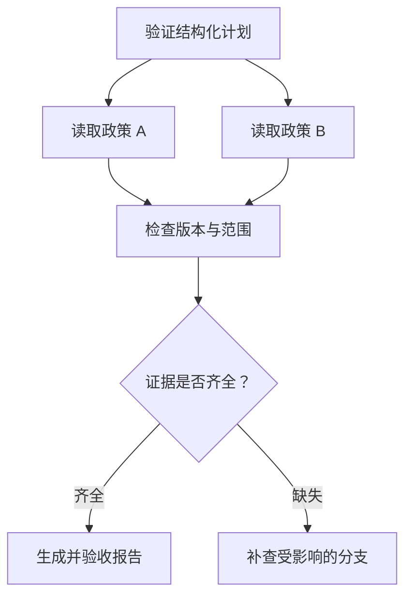

要比较 A、B 两份政策，先找到两份生效版本，再对日期和适用地区做核验，最后才能生成差异报告。这类任务可以在执行前确认依赖，运行过程中再按结果调整部分步骤。

## Planner、Executor 和 Validator {#design}

Planner 产出结构化步骤，写清 ID、依赖、允许动作、预期交付及预算。Validator 验证 ID 唯一、依赖可解析、没有环及权限越界。Executor 按就绪节点执行，保存产物引用。某一步失败时，先标记其可达下游节点，保留与失败无关且仍有效的结果。新计划沿用父任务 ID，变更步骤有自己的版本。



## 依赖什么时候允许执行？ {#implementation}

```python
def ready_steps(steps, done):
    return [step for step, dependencies in steps.items()
            if step not in done and set(dependencies) <= done]

plan = {"read_a": [], "read_b": [], "compare": ["read_a", "read_b"]}
assert ready_steps(plan, set()) == ["read_a", "read_b"]
assert ready_steps(plan, {"read_a"}) == ["read_b"]
assert ready_steps(plan, {"read_a", "read_b"}) == ["compare"]
```

提交计划前先做拓扑校验。运行时如果所有未完成节点都无法就绪，要结合失败记录区分依赖失败与状态异常。实际执行器还应管理并发和截止时间。涉及外部写入时，依赖完成也只证明数据准备好了，授权和审批仍在动作前校验。

## 重规划和取舍 {#tradeoffs}

假设 B 的版本在运行途中被收回。将「读取 B」和依赖 B 的比较与验收记为未完成，A 的已授权证据可以复用，前提是 A 的有效期还在。已有外部副作用的节点按回执判断，必要时进入独立的补偿流程。相较局部 ReAct，显式计划提供进度与依赖可见性，同时引入计划生成和维护成本。验收可以统计错误计划拦截率、受影响分支重跑量和最终交付率。

[前置知识：有界 ReAct](/2026/11/19/agent-deep-dive-react/) · [下一种模式：Supervisor](/2026/11/19/agent-deep-dive-supervisor/)
