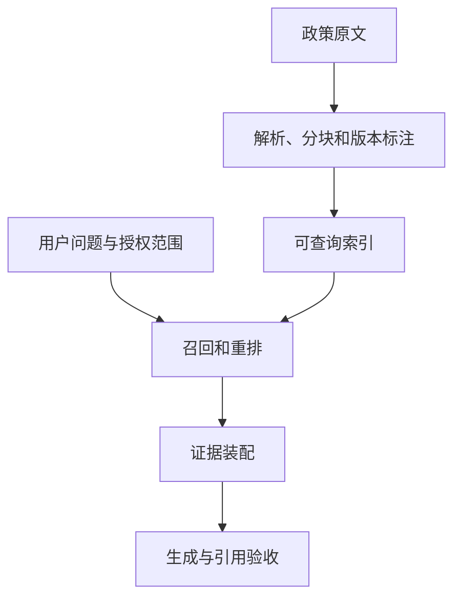
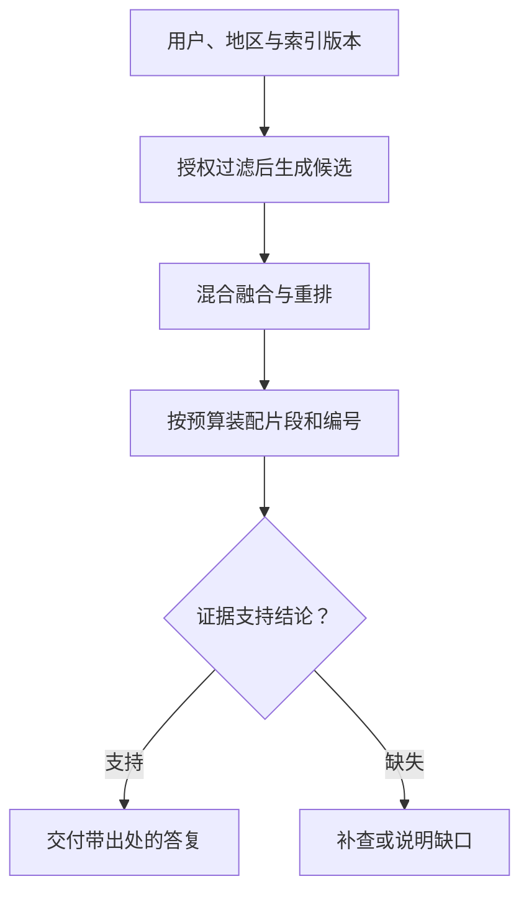

用户问「快递没到，能不能取消？」知识库里有一条现行政策说明何时能拦截发货。搜索却经常找到旧版退款条款，或返回一段包含「取消」但不谈配送状态的 FAQ。把路径拆开后，可以为每一次失败指出发生在哪一层。

模型能写一段听起来合理的售后说明，但当前用户适用哪个版本、是否已交接、哪条规则允许拦截，都得从外部拿到。检索增强生成（Retrieval-Augmented Generation，RAG）先从授权资料中找证据，把证据随问题交给模型，再检查生成结论是否得到支持。原始研究将模型参数中的知识与可检索的外部知识结合。本文讲的是常见的工程架构，各层可以独立更换和评估。[RAG 原始论文](https://arxiv.org/abs/2005.11401)

## 两条链路怎样在索引相遇？ {#overview}



离线一侧处理材料变更。文档入索引时保留片段 ID、原文位置和生效范围。在线一侧接收本次问题以及可信会话确定的地区、版本和访问范围，再去索引查找证据。两边通过同一套证据 ID 与元数据约定对接。应用可以查明回答引用的是哪条政策，也能追溯这个片段从哪一页或哪条表格记录产生。

在 Agent 中，检索可封装成一个只读工具，输入是查询和由应用绑定的访问范围，输出是带出处的证据与缺口。订单状态由订单服务提供，政策文本由检索提供。运行时将二者交给模型，才能判断该条款是否适用当前订单。

## 文档解析、分块和索引 {#ingest}

解析时抽取正文、标题层次、表头和脚注。给每块保留政策 ID、生效版本、地区、访问范围和更新时间。用「条件 + 结论」作最小有意义片段，像「未出库可取消」这样的规则不能把前半句丢在上一块。均匀长度分块适合快速设基线，有层级的政策优先按小节，长节再按段拆。父子分块用短段匹配，再按相同权限读取父段。

倒排索引用字面词匹配，利于精确查询政策编号。向量索引使用 Embedding 表示文本，利于「取消」与「中止配送」等语义匹配。余弦相似是可以独立复现的基线，数据增大时把近似近邻的召回率和响应时间一起测。向量数据库管理向量与元数据过滤，索引的生命周期还需要应用维护。

## 授权、两路召回、融合与重排 {#ranking}

第一步根据会话确定允许范围，候选里提前排除失效版本和跨租户片段。关键词与向量各自返回有序 ID，经融合累积名次，再挑较短列表给重排器逐对判断。复杂问题可以拆成更具体的查询，或者结合实体图补全跨文档关系。GraphRAG 的额外工作包括构图、验证关系、同步变化与管理授权，基础检索量化不足时可以先做好可复现基线。

假设 `faq-v4#cancel` 在关键词一路排第一，现行政策 `policy-v2#cancel` 排第二。向量一路把现行政策排第一。直接混合两个模型的分数会受量纲影响，RRF（倒数排名融合）只看每个列表里的名次。取平滑常数 60，现行政策得到 `1/62 + 1/61`，仅出现一次的 FAQ 得到 `1/61`。双路命中让现行政策排在前面，但仍要用问题和片段正文判断条款是否覆盖当前地区和配送状态。

```python
def fuse(*rankings, smoothing=60):
    scores = {}
    for ranking in rankings:
        for rank, item in enumerate(dict.fromkeys(ranking), start=1):
            scores[item] = scores.get(item, 0) + 1 / (smoothing + rank)
    return sorted(scores, key=lambda item: (-scores[item], item))

current = "policy-v2#cancel"
lexical = ["faq-v4#cancel", current]
semantic = [current, "policy-v2#intercept"]
assert fuse(lexical, semantic)[0] == current
```

这里输入的列表已在各路召回前按授权和版本过滤。融合前保存每路原始候选及其名次，才能判断相关证据是搜索词不匹配，还是某一路受过滤影响。重排对候选和问题整体打分，可从「适用环境」「有无完整条件」等真实失败里设计验收问题。

## 装配上下文与引用验收 {#packing}



应用保存实际发给模型的证据 ID。必要条款可提前预留长度，以防解释性段落占满窗口。回复引用必须在本轮证据集合内。要求按授权资源读回原文、显示章节和版本，有助于客服人工核对。更强的语义验收还要逐条判断引用里的文字是否支持该结论。

比如上下文只剩 380 tokens，FAQ 用了 260，现行条款需要 170。按候选顺序填充时，FAQ 先进入，条款便可能被丢弃。按任务验收要求预留当前版本的取消条件后，仍可把剩余空间给补充解释。下面的排查区分候选命中、实际送达和生成采纳三件事。

## 建一张能定位问题的评估表 {#evaluation}

| 失败现象 | 优先核对 | 可复现指标 |
| --- | --- | --- |
| 正确条款从未入选 | 索引版本、文档 ID、权限范围、查询改写 | 正确证据 Recall@k |
| 候选中有条款但位置靠后 | 各路排名、融合分数、重排前后顺序 | MRR 或 nDCG |
| 排名正确却没送达 | 实际装配的 ID、预算和裁剪顺序 | 必要证据送达率 |
| 引用存在仍答错 | 结论对证据、环境与版本支持 | 引用正确率、拒答率 |

先跑固定数据集，再把排序或分块做成单变量对比。线上按缺失环节收集失败，回流到相应的样本和指标。索引内容与权限策略也要带版本，否则很难把一次线上回答还原出来。

## 什么时候用 RAG、长上下文或微调？ {#choices}

材料少且已经随请求提供时，可以先直接放进长上下文，保留页码和出处。资料规模扩大、访问范围不同或更新频繁时，RAG 能只取当前有权使用的片段，用索引版本追溯答案。微调更多用于稳定行为，例如让输出符合领域格式。政策的生效时间和引用来源仍适合由外部材料提供。

固定检索链是易评估的起点。如果只有第一轮结果才能告诉你该查哪家承运商，Agentic RAG 可以依据观测发起补查。适合补查的条件、可查的数据源、最大轮次以及证据仍不完整时的交付方式都应明确。[Agent Planning 中的检索](/2026/09/08/rag-for-agent-planning/)

## 从证据被找到到结论被支持 {#summary}

先用一条有来源坐标的政策走通索引、候选、重排、送达和引用五步。回放失败时找到证据第一次消失的位置，再决定是修解析和分块、改召回与排序，还是改装配与验收。下篇从文档解析开始，看看一条带表头和脚注的政策怎样保留可检索结构。[文档解析](/2026/11/19/rag-document-parsing/) · [八项核心能力](/2026/11/19/agent-engineering-capabilities/#rag)
