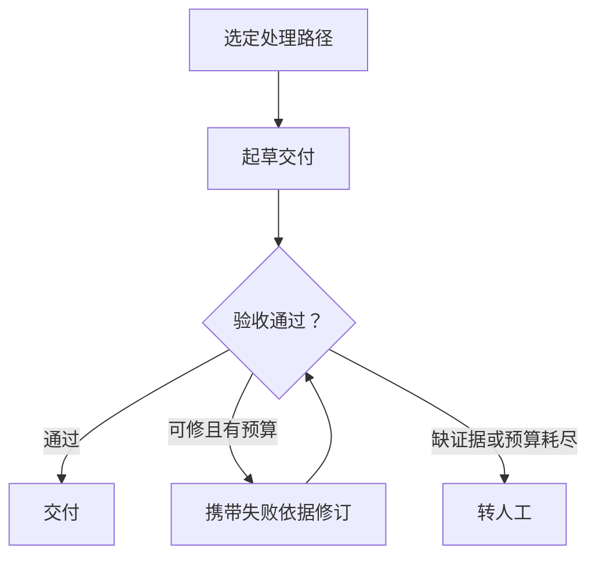

## 路由先决定去哪一条路径 {#router}

输入「能取消订单吗」既可能是规则咨询，也可能是要求实际取消。Router 输出任务类别和缺失的上下文，程序再检查类别、权限与边界。问普遍规则进知识库，带目标订单进查单，对写动作发起明确确认。新意图应先有兜底处理，再加入路由映射。上线记录分类结果和最后实际执行的路径，能区分分类错与下游工具错。

## 验收失败后，反思需要什么输入？ {#reflection}

Reflection 接收待修订产物和可定位的反馈。比如「第 2 条结论用了旧政策，查看现行条款 scope-v2」。反馈包含证据版本、失败断言和允许的修改范围。先由确定性检查处理缺失字段、审批和证据 ID，再用人工或模型辅助评审语义。没有新的证据或判断标准时，重复生成会花更多资源，且常保留原错误。



## 用有限循环串起来 {#implementation}

```python
def review_cycle(draft, verify, revise):
    errors = verify(draft)
    if errors:
        draft = revise(draft, errors)
        errors = verify(draft)
    return ("handoff", errors) if errors else ("complete", draft)

assert review_cycle({"stale": True}, lambda d: ["version"] if d["stale"] else [],
                    lambda _, errors: {"stale": False})[0] == "complete"
```

把修订前后的草稿和校验项按版本保存。比较带反思与直接交付的实现时，同时测修复成功、引入新错、模型额外用量和人工接管。规则非常明确的字段用程序直接修，开放文本再给模型修订。

[回到架构总览](/2026/11/19/agent-engineering-architecture/#reflection-router) · [进阶：评估与回归](/2026/11/19/agent-deep-dive-evaluation/)
