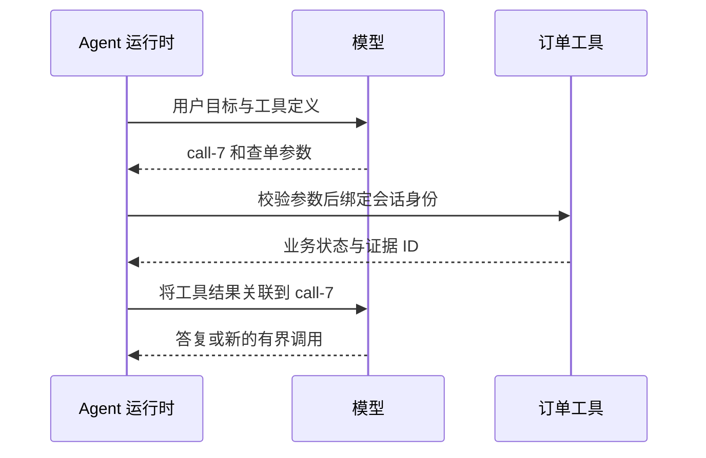

客服模型返回了一段 JSON，里面有订单号和工具名。在这之后还没有任何订单被读取。先画出从模型到业务接口的调用路径，在每次跨过信任边界时明确谁来检查数据。

## 工具定义与执行权限 {#contract}

给工具一个稳定名称、一段说明和可验证的参数形状。订单号在参数里，用户身份从服务器会话取得。应用在注册表里限制这个任务用得上的工具，执行时还要在数据接口按订单归属校验。工具回包只返回任务需要的状态、地区和版本，超时、权限拒绝和无匹配分别返回可识别状态。

## 一次调用是怎么串起来的？ {#flow}



不同模型接口对工具请求和工具响应的字段命名不同，适配层映射到自身的调用结构。一次模型响应可能提出多个动作，分别回填结果。对互相独立、无副作用的读取可以有限并发。写入按依赖或业务约束排序，调用编号用来给模型配对消息，外部写入的幂等键由应用另行持久化。

## 用程序执行一条工具建议 {#implementation}

```python
def execute(call, session, lookup):
    if call["name"] != "read_order":
        result = {"status": "unknown_tool"}
    elif not isinstance(call["arguments"].get("order_id"), str):
        result = {"status": "invalid_arguments"}
    else:
        order = lookup(session["user_id"], call["arguments"]["order_id"])
        result = {"status": "unavailable"} if order is None else {
            "status": "ok", "evidence_id": order["receipt"], "shipment": order["state"],
        }
    return {"call_id": call["id"], "result": result}

call = {"id": "call-7", "name": "read_order", "arguments": {"order_id": "A12"}}

def lookup(user, order):
    return {"receipt": "receipt-9", "state": "in_transit"} if (user, order) == ("u1", "A12") else None

assert execute(call, {"user_id": "u1"}, lookup)["result"]["evidence_id"] == "receipt-9"
assert execute(call, {"user_id": "u2"}, lookup)["result"] == {"status": "unavailable"}
assert execute(call, {"user_id": "u1"}, lookup)["call_id"] == "call-7"
```

在实际运行时拒绝重复调用编号，校验参数全量结构，不让用户输入的身份字段覆盖会话参数。检查重复读时可以比较归一化工具名与参数。重试保留总体耗时预算，并明确模型在多次失败后能给出什么结论。

## 上线后怎样定位工具失败？ {#debugging}

按顺序看模型提议、应用校验、服务回执、第二轮模型输入和结果验收。第一次失败在模型根本没有选工具时，检查工具说明和意图样本。工具回执已存在但模型少了证据时，核对调用编号和实际请求中的结果格式。工具生态用 MCP 接入后，也沿这几份记录定位问题。

[回到八项核心能力](/2026/11/19/agent-engineering-capabilities/#tools) · [进阶阅读：RAG 检索](/2026/11/19/agent-deep-dive-rag/)
