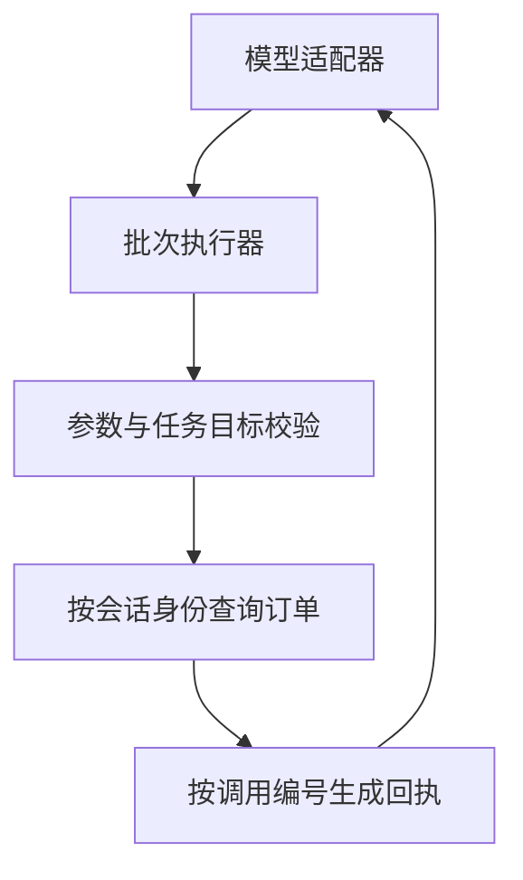
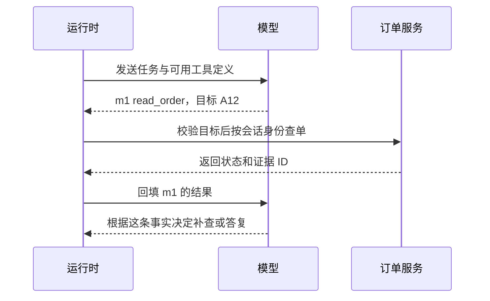

## 工具调用为什么经常在第二轮出错？ {#problem}

模型发出查单请求，业务接口也返回了订单，客服回复却说「无法查到」。先检查运行时是否把工具回执发到了同一条调用上。另一个常见问题出在请求入口，模型可以输出一个形状完全正确但超出任务范围的订单号。工具链要同时守住消息配对与业务权限。

直接在提示词里让模型「需要时查订单」，最多得到一句自然语言建议。要让程序接手，双方需要约定可调用的名称、参数和回执。Function Calling 定义了模型提出动作所用的接口，Tool Use 还包括工具发现、执行、回填和结果验证。

## 核心概念：三个编号与两种校验 {#contract}

工具定义包含名称、说明和参数形状。应用在注册表登记 `read_order` 的输入约定和处理函数，在请求时按会话权限、任务阶段和工具可用性选出一小组定义发给模型。模型根据工具说明选择名称并生成参数。说明要区分易混淆的动作，例如 `read_order` 查订单快照，`read_carrier_scan` 查物流扫描。传给模型的结构化定义与运行时的实际工具处理函数通过名字关联。

调用编号对应模型的某次提议，订单号指出业务资源，写入操作键把重试绑定到同一次批准。严格结构校验可以发现缺字段或类型错误，服务端仍要确认目标是否属于当前任务、登录主体是否有权限。工具注册和动态筛选可以独立演进。[Tool Schema 与 Tool Router](/2026/09/15/tool-schema-router/)

| 字段 | 由谁赋值 | 跨什么范围 |
| --- | --- | --- |
| `call_id` | 模型接口或提供方 | 一次提议与工具响应 |
| `order_id` | 用户或业务上下文 | 被查询的订单 |
| `operation_id` | 应用在审批通过后登记 | 一次批准动作的重试与恢复 |

## 底层原理：收到一批调用时先检查集合 {#principles}

对每个工具提议都生成带原编号的成功或结构化失败。可并行的读取可能反序完成，回填先按调用 ID 建索引，再比较期望集合与实际集合。需要分别检查缺失、重复与意外编号。长度相等仍可能把不同调用配在一起。JSON 解析之后要检查顶层形状、字段和业务范围。示例拒绝额外的 `principal` 字段，会话身份由应用单独传给后端。

## 架构：模型、执行器与业务后端的边界 {#architecture}



适配器负责外部 API 的字段映射。执行器保存当前运行已经接收的 ID。业务后端拥有最终身份规则和查单结果。工具定义描述输入形状，后端授权只接受应用传入的可信会话。

## 一次调用如何回填？ {#flow}



工具服务只看到执行查单所需的数据。运行时把服务响应归一为面向模型的回执，留下足够决策的状态和来源。拒绝或超时也要有明确状态，模型才能区分「当前订单无可用记录」与「服务暂时不可用」。

| 提议 | 执行器判断 | 回填状态 |
| --- | --- | --- |
| m1 读取 A12 | 当前任务目标且本人有权限 | `ok` |
| m2 附带身份字段 | 参数有额外字段 | `invalid_arguments` |
| m3 JSON 解析失败 | 无法读取参数 | `invalid_arguments` |
| m4 要求退款 | 本轮没有这个工具 | `unknown_tool` |
| m5 改查 B13 | 超出此次任务目标 | `invalid_target` |

在 OpenAI Responses API 中，模型返回的 `function_call` 带有 `call_id`，应用用同一个 `call_id` 构造 `function_call_output`。这种字段形状属于提供方协议，文章中的配对、授权和结果验证则属于应用运行时的职责。[OpenAI Function Calling](https://developers.openai.com/api/docs/guides/function-calling)

## Python 实现：乱序回执也能重新配对 {#implementation}

下面的代码展示结果如何按提议顺序重排。对应回执的完成顺序可能是 `m2`、`m1`，但 `m1` 仍必须拿到自己的订单数据。集合校验负责发现同样数量、不同编号的错误。

```python
def correlate(proposals: list[Proposal], results: list[Reply]) -> list[Reply]:
    expected = {item.call_id for item in proposals}
    replies = {item.call_id: item for item in results}
    if len(expected) != len(proposals) or len(replies) != len(results) or replies.keys() != expected:
        raise ValueError("results must match the proposed call IDs")
    return [replies[proposal.call_id] for proposal in proposals]
```

模拟器在发出调用前拒绝重复的提议编号，以免执行一半才发现无法区分回执。它也会用缺回执和乱序回执验证关联逻辑。可选的本地示例需要 Python 3.11 及以上，两个文件放在同一目录。[工具协议脚本](/assets/examples/agent-engineering/tool_protocol.py) · [执行循环](/assets/examples/agent-engineering/agent_loop.py)

## 串行调用、并行调用和固定查询怎么选？ {#tradeoffs}

异步可以减少独立读取的总等待，但会出现乱序、局部失败与更多在途任务。固定执行顺序对已知流程更容易审计。依赖之前的回执才能计算目标时应串行。允许模型一次提出多个动作时，运行时逐个校验风险，并确保每个动作都有可解释的终态。

## 工程实践：日志只记能定位断点的字段 {#debugging}

排查顺序是模型是否提议、运行时是否接受、业务服务是否返回、回填是否命中，以及模型请求里实际送出了什么。记录任务 ID、调用编号、工具类型、状态和耗时。参数带身份或订单正文时，保留经脱敏的关联标识。瞬时错误由工具层在任务预算内重试，业务拒绝返回清楚的状态。工具服务有副作用时还要追操作键和业务回执。

每次调用的超时与总任务预算分别管理，防止一批工具把剩余时间用完。对于写操作，若超时后不知道是否已提交，先用同一个操作键查业务回执。工具回传的正文仍是来自外部的数据，进入上下文前只留下当前任务需要且已确认可见的字段。[写入恢复与幂等](/2026/11/19/agent-deep-dive-durability/)

## 从动作协议继续到知识证据 {#next}

工具调用的核心是程序执行后送回可关联的事实。[运行机制示范篇](/2026/11/19/agent-engineering-foundations/#loop) 展示结果怎样驱动下一轮。[RAG 实战](/2026/11/19/agent-deep-dive-rag/) 继续讲工具返回的知识证据如何产生、如何走到交付。
