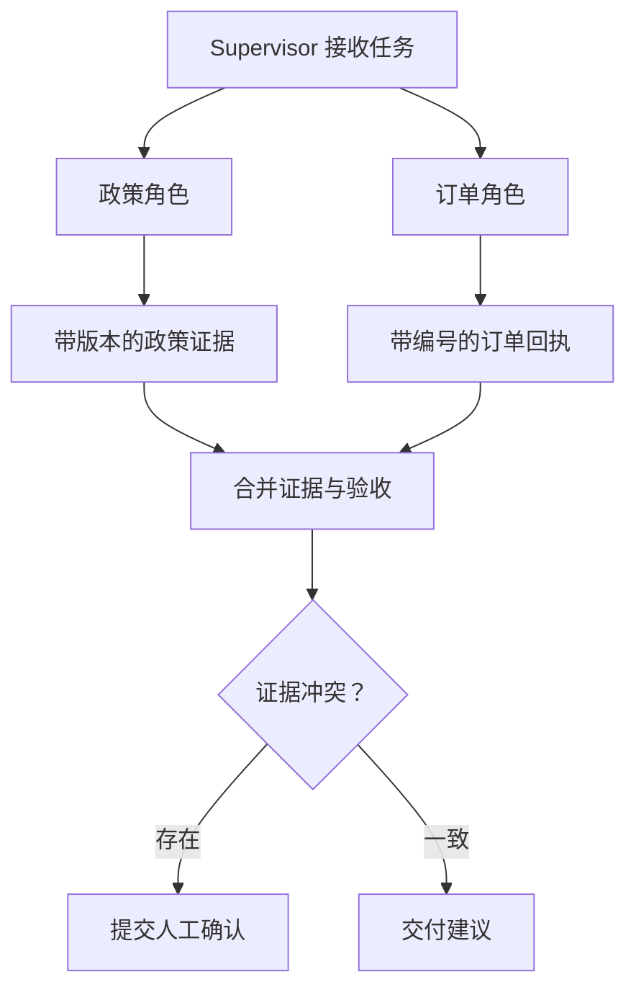

一次售后任务的路径通常可预知：确认订单、检查政策、给出处理建议。遇到国际退件、拆包或多个承运商时，资料和查询顺序可能因工具结果改变。架构选型先画出几条正常与异常路径，看哪里需要灵活决策，哪里需要可追溯的确定规则。

## 第一种路径，单 Agent 与固定工作流 {#workflow}

一个模型负责起草，程序安排查单、检索、验收。把每一步写成显式函数，抽取输入输出再加入状态。对于步骤已知的业务，这能独立验证「还没登录时禁止查单」「返回草稿前必有证据」等规则。单 Agent 指运行单元只有一个，它既可被固定工作流调用，也能有自己的工具循环。

## ReAct 与 Plan-and-Execute {#planning-patterns}

ReAct 每拿到一次观察，就在可用工具中重新选择下一步。例如查到承运商未知，下一次动作请求订单系统提供单号前缀。开放查找空间的同时，给每轮限制动作数、总时限和重复次数。Plan-and-Execute 先提出可检查的步骤和依赖，再逐项执行。有外部一步失败时，标记受影响的后续步骤，保留已验证产物，按变化范围改计划。

| 现象 | 先尝试 | 判断是否有效 |
| --- | --- | --- |
| 已知节点很容易漏掉校验 | 固定工作流 | 每次都经过确定性校验 |
| 中间结果决定下一工具 | 有界 ReAct | 搜索成功率上升，重复调用可控 |
| 多个子任务有复杂依赖 | 结构化计划和执行器 | 能拒绝缺依赖的步骤，失败后只重跑受影响部分 |

## Reflection 与 Router {#reflection-router}

Reflection 把草稿和明确的验收反馈送回一次修订。把验收器看成独立组件，比如检查每个结论是否有来源，审稿模型仅补充语义判断。保留修订前后产物，设定有限回合。Router 根据任务类型把请求交给订单流程、政策问答或人工队列。路由可以用规则，也可以让模型分类再由程序校验枚举和范围。置信不足要有退路，且分开监控误路由与下游执行失败。

## Supervisor、分层与点对点 {#collaboration}

同一角色背负很多工具、上游状态和权限边界时才考虑拆分。Supervisor 挑选角色、发任务、验收产物。分层架构在子团队内部继续划分职责，注意父子两个层级预算与超时如何传递。点对点可以直接移交，适合彼此有明确契约的自治角色，需处理转交环、结果冲突以及统一审计。



给角色的任务合同包括 `task_id`、允许访问的资源、期限和交付字段。把两个角色的证据复制进共享聊天记录会扩大上下文与访问范围，可以传结构化产物引用，由下游按权限取对应版本。在拆多个 Agent 之前，同一套固定样本能给出质量、成本和等待时间的基线。

## 状态机与 Human-in-the-Loop {#state-machine}

把「写退款申请」建模成明确转移。批准对应一份冻结的申请和目标版本。等待批准、外部请求成功和最终完成是不同的状态。下面的简化函数验证状态图，调用层要再校验操作者身份、审批内容及回执。

```python
TRANSITIONS = {
    ("draft", "request_approval"): "waiting",
    ("waiting", "approve"): "approved",
    ("waiting", "reject"): "closed",
    ("approved", "receipt_confirmed"): "completed",
}

def transition(state, event):
    try:
        return TRANSITIONS[state, event]
    except KeyError as error:
        raise ValueError(f"invalid transition: {state}/{event}") from error

assert transition("waiting", "approve") == "approved"
assert transition("approved", "receipt_confirmed") == "completed"
```

当等待人工的 Worker 停止时，恢复读取任务状态、审批范围及目标系统回执，随后由程序决定是否继续。流程到 `completed` 前，验收器应该能指出实际交了什么、查到了哪条回执。增加任何角色或回路之前，用同一批任务衡量收益及新增失败代价。

## 三种模式逐篇动手 {#deep-dives}

- [ReAct：工具观察如何改变下一步](/2026/11/19/agent-deep-dive-react/)
- [Plan-and-Execute：怎样检验任务依赖](/2026/11/19/agent-deep-dive-plan-execute/)
- [Supervisor：多 Agent 如何交接并验收产物](/2026/11/19/agent-deep-dive-supervisor/)

[前置知识：八项能力](/2026/11/19/agent-engineering-capabilities/) · [进阶阅读：开发框架与技术生态](/2026/11/19/agent-engineering-frameworks/) · [研究资料：ReAct](https://arxiv.org/abs/2210.03629)
