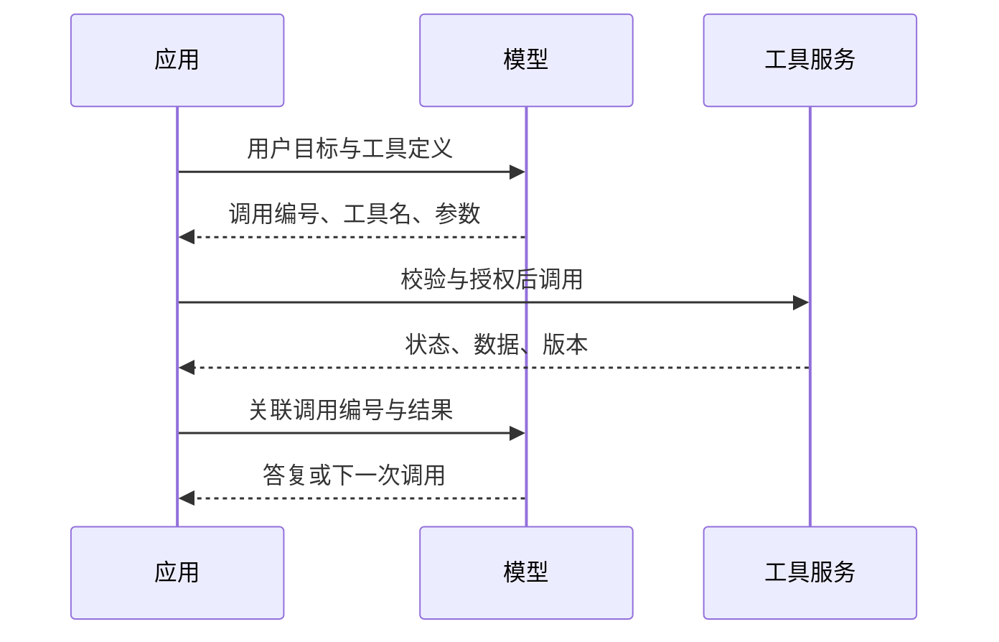

一条客服消息可能同时出现三种输入：「按上次的语言回我」「订单现在到哪了」「最新拒收政策怎么写」。第一个来自用户偏好，第二个必须读订单系统，第三个需要拿到当前生效的政策。把所有历史都拼进 Prompt，三个问题依旧各有一条需要核对的来源。

## LLM 与 Prompt Engineering {#model-prompt}

选模型先做同一批任务评测，检查工具选取、结构化结果通过率、输入长度、延迟和成本。用稳定的系统指令定义角色、任务范围、工具使用和证据要求。少样本示例适合演示难以单靠文字写清的判断，比如遇到缺信息先追问。Structured Output 约束字段和类型，程序继续校验值是否属于当前身份、工具和业务状态。给系统规则和必要证据优先留预算，再决定放哪些历史消息。记录使用的模型、Prompt 版本和实际 token，后续才能复现改动。

## Tool Use 与 Function Calling {#tools}

应用注册工具名称、说明、参数结构和风险等级。模型看到的是说明和参数定义，应用接收调用建议后，用会话身份重新判权，校验数据，再执行。工具回执用本轮调用 ID 关联，包含状态、可用字段及错误类型。超时、业务未命中和权限拒绝要有不同结果。MCP 可以接上统一的工具接口，业务规则仍需在可信服务内执行。



## RAG 从入库到证据引用 {#rag}

模型参数里的知识很难随内部资料同步变化。RAG 把可更新的外部资料纳入本轮输入，使结论能引用来源。以「拒收退款」为例，文档解析要保留章节、条款日期、适用地区和访问范围。表格中的表头与行要一起保留，分块时让例外条件和主体规则尽量出现在同一块。

| 方法 | 优先解决的情况 | 主要代价 |
| --- | --- | --- |
| 固定长度分块 | 文档结构弱，需要快速做基线 | 边界容易切开条件，可用重叠缓解 |
| 按标题、段落分块 | 规章、手册有明确章节 | 长章节仍需二次切分 |
| 父子分块 | 用细粒度片段匹配，展示时需要完整上下文 | 额外存储关联，装配时仍要做权限和预算检查 |
| 关键词检索 | 条款号、订单字段、错误码等精确标记 | 口语表达可能没有字面重合 |
| 向量检索 | 同义表达和自然语言问题 | 需要模型、索引和离线验证 |
| 混合检索、重排 | 既有生僻词又有语义查询 | 候选融合及重排增加延迟 |
| GraphRAG | 答案依赖实体关系或跨文档关联 | 构图和更新更贵，实体、关系也需验证 |

Embedding 把文本变成向量，余弦相似度比较两个向量的方向。下面三维数字仅演示归一化点积。真实索引用相同的嵌入模型生成查询向量和文档向量。语料大时可评估近似近邻索引的速度与召回损失，向量数据库还负责元数据过滤、索引更新等工程问题。

```python
from math import sqrt

def cosine(query, document):
    dot = sum(a * b for a, b in zip(query, document, strict=True))
    lengths = sqrt(sum(a * a for a in query) * sum(b * b for b in document))
    return dot / lengths if lengths else 0.0

assert cosine([1, 1, 0], [1, 1, 0]) > cosine([1, 1, 0], [0, 1, 1])
```

混合检索可以按各路排名合并候选，例如使用 RRF，把同一条文档在每路的 `1/(k + rank)` 相加。重排对查询和候选逐对打分，通常只放在较短的候选列表上。更复杂的查询可以先改写或拆成多个检索子问题，再合并去重。接进 Agent 后，工具结果要返回证据 ID、版本和短片段。程序核对每个引用确实来自这次授权检索，评审再检查证据是否支持结论。

一次失败就按四份清单查：授权后召回列表、重排名单、实际发给模型的片段、最终引用。离线看 Recall@k 和排序指标，端到端看引用是否支持结论、过期版本是否被拒绝、无证据时能否安全停止。调好其中一段，用固定问题重放确认收益能传到最终答复。

## Memory 记忆系统 {#memory}

对话历史提供近期上下文，摘要压缩历史，长期记忆保存未来可能使用的事实或偏好。让每条记忆有主体、来源、更新时间和删除规则。用户曾说「这次用英文」应先按当前任务处理。要把语言偏好跨会话复用，先确认适用范围，保留更新与遗忘路径。流程的当前节点、批准状态留在任务状态里，避免一条摘要左右实际执行。

## Planning 任务规划 {#planning}

先明确目标，再拆任务和依赖。比如「比较三份近期政策」可以并行找原文，之后才做版本核验和比较。计划中的每步带输入、依赖、允许的工具和预期产物。工具返回「文档已下线」时，应用标记该分支缺证据，只有在重规划仍符合授权和预算时才继续。Plan-and-Execute 适合依赖较多且需要检查中间结果的任务。

## Reasoning 推理与行动协同 {#reasoning}

多步任务可以要求模型输出可核对的判断、选用证据和待确认条件，用这些产物验收。ReAct 把下一步选择与新的工具观测交替进行。Reflection 可以让模型根据失败的验收项修一遍草稿。Self-Correction 必须有新证据或可判定的检查，否则同一个误读可能随重试一直保留。评估推理质量时保存能验证的步骤与依据，避免把内部推理文本或敏感数据当日志。

## Multi-Agent 协作 {#multi-agent}

先确定角色的输入、输出、权限和失败状态。Supervisor 负责分派和验收，Hierarchical 模式让子工作流继续调度子角色，Peer-to-Peer 让角色直接移交有界任务。并行角色各自拿到候选证据时，统一回传来源 ID 和版本。发现两个产物冲突时，由明确的决策方按版本规则裁决，证据不足交给人工。

## Environment 与外部交互 {#environment}

API 通常有明确参数和回执。Browser Use 读取页面结构，Computer Use 还可能依赖截图或可访问性信息，交互后要重新观察屏幕并核对目标。网页、附件和工具回包都可能包含意外文本，按外部数据处理。执行动作前核对目标账号、操作范围和批准状态，执行后以业务回执或读回结果判断完成。

## 按具体问题继续动手 {#deep-dives}

- [Function Calling：一次工具调用如何回填](/2026/11/19/agent-deep-dive-tool-use/)
- [RAG：正确的政策为什么没进入模型](/2026/11/19/agent-deep-dive-rag/)
- [Context、Memory 和 State 如何分工](/2026/11/19/agent-deep-dive-agent-state/)

下一篇把这八项能力放进不同架构，看程序或模型在哪个节点拿到决策权。

[前置知识：从 Chatbot 到 Agent](/2026/11/19/agent-engineering-foundations/) · [进阶阅读：架构设计](/2026/11/19/agent-engineering-architecture/) · [研究资料：RAG 论文](https://arxiv.org/abs/2005.11401) · [GraphRAG 文档](https://microsoft.github.io/graphrag/)
