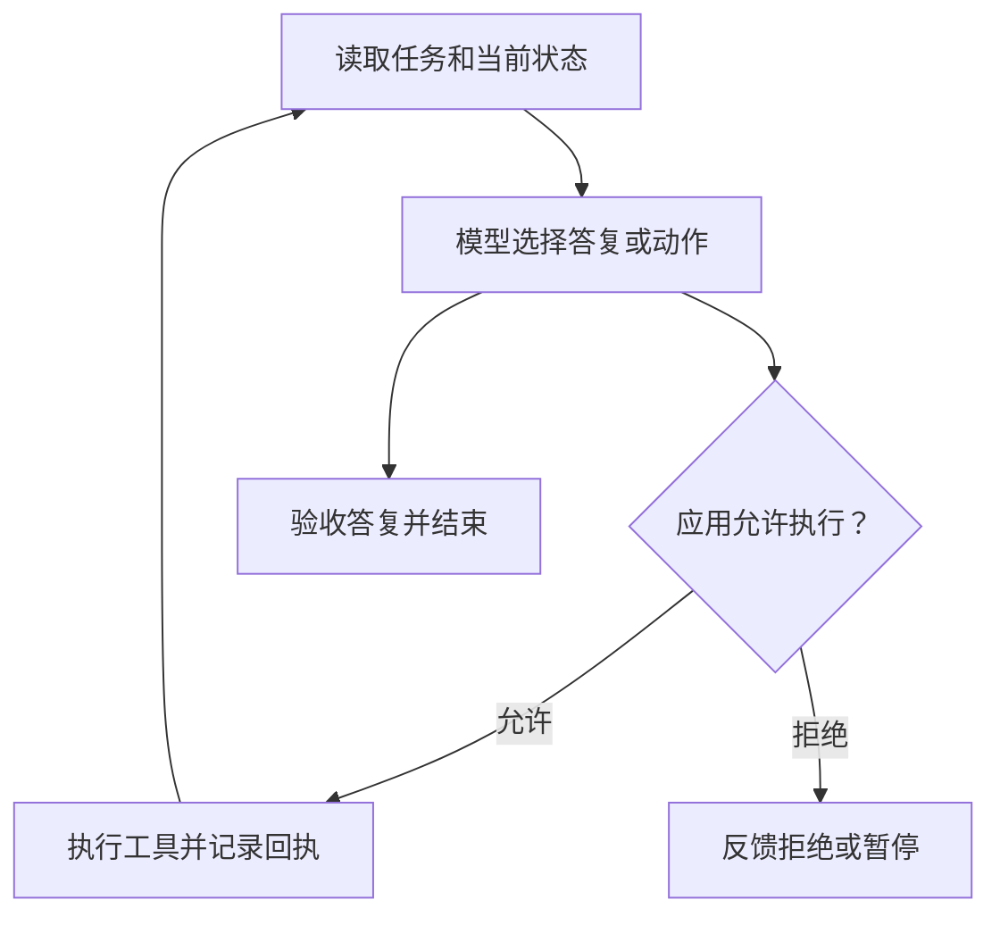

用户问：「订单还没到，能帮我看看是不是可以退款吗？」模型能解释退款政策，客服系统才能确认订单是谁的、目前发了没有、这条政策是否适用。再给模型一个查单工具，也只是获得了一个动作。系统还要决定在什么时候调用它，拿到工具结果之后如何继续，以及何时该结束或转人工。

## 先写任务的交付合同 {#task-contract}

把「让 Agent 处理售后」收窄成一条可以验收的任务：登录用户询问自己的订单时，系统返回订单状态、适用政策的出处及下一步建议。退款写入需要独立的人工确认。身份来自服务端会话，订单号是搜索目标，这两个字段来自不同的信任边界。

| 输入情况 | 合格输出 | 运行时可检查的证据 |
| --- | --- | --- |
| 登录且订单属于本人 | 订单状态和政策出处 | 工具回执的订单 ID 与身份检查通过 |
| 缺失订单号 | 追问订单号 | 没有发出查单或退款操作 |
| 订单属于其他人 | 返回无法访问，提供人工入口 | 工具在返回订单数据之前拒绝 |
| 当前政策和历史政策冲突 | 使用现行政策，证据不足则升级 | 引用指向生效版本，或任务结束于人工队列 |
| 用户要求直接退款 | 记录待批准的申请 | 支付系统没有发生写操作 |

这张表同时服务需求、系统设计和评测。开发调试时，可以用一条失败规则定位控制决策。比如缺订单号时仍然查单，先看运行时能否在调用工具前判断任务输入齐不齐。

## Chatbot、Workflow、Agent {#control}

| 形态 | 下一步由谁决定 | 售后例子 |
| --- | --- | --- |
| Chatbot | 应用调一次模型，再展示输出 | 根据输入解释通用退款流程 |
| Workflow | 应用规则决定节点及转移 | 登录 → 查单 → 查政策 → 生成答复 |
| Tool-using Agent | 模型在应用允许的动作集合里作选择 | 查到包裹疑似丢失后，临时决定查询物流异常说明 |
| 多 Agent 系统 | 编排器与各角色在不同层分担决策 | 售后角色委派给只读物流角色，再验收其回执 |

单 Agent 和多 Agent 表示有哪些运行单元。自治程度描述运行单元可以独立决定几类动作、探索多少步、跨多长时间。一个单 Agent 可以在受控环境里有较高探索性，多个角色也可以按固定规则交接。

## 执行循环里的五种职责 {#loop}



感知来自当前输入、工具回执和环境状态。模型根据可见信息产生下一动作的建议，程序检查权限、参数和预算。工具执行后，应用把可用的结果和来源回填给模型。可以观测的中间产物包括工具选择、结构化决策和状态迁移，可以用这些信息解释系统怎样走到结果。

下面是一段可直接用 Python 3 运行的最小循环，固定函数代替模型。第一次建议查订单，拿到回执后才进入结果验收。把两次决策都改成查单，即可看到步数上限生效。

```python
def next_action(state):
    return "finish" if "shipment" in state else "read_order"

def run(read_order, decide=next_action):
    state = {}
    for _ in range(2):
        action = decide(state)
        if action == "finish" and "shipment" in state:
            return {"status": "complete", "evidence": state["shipment"]}
        if action != "read_order":
            return {"status": "invalid_action"}
        state["shipment"] = read_order()
    return {"status": "budget_exhausted"}

assert run(lambda: "order_12: in_transit")["evidence"] == "order_12: in_transit"
assert run(lambda: "ok", lambda _: "read_order")["status"] == "budget_exhausted"
```

真实应用的读订单函数会校验会话身份，带出回执里的环境、数据版本和查单范围。模型能够提出动作，行动权仍来自应用给工具授予的权限。

## 从函数调用到 Agentic Systems {#evolution}

Function Calling 让模型把动作表达为程序可读的调用参数。工具循环允许它基于结果再次做选择。更长的任务引入预算、计划、持久状态和恢复。跨团队的复杂任务还需要显式交接，定义接手方看见什么、允许做什么、怎样返回结果。每加一层，工程投入都应该对应一个具体问题。

如果每次要查的字段和执行顺序都已知，固定流程可以给出可预测的行为。遇到需要根据中间结果决定是否补查、从哪类证据入手的任务，可以只在那个节点开放选择。下一篇把这些选择拆成模型、工具和数据等具体模块。

[进阶阅读：核心技术与能力体系](/2026/11/19/agent-engineering-capabilities/) · [延伸阅读：Function Calling](/2026/09/15/function-calling/)
