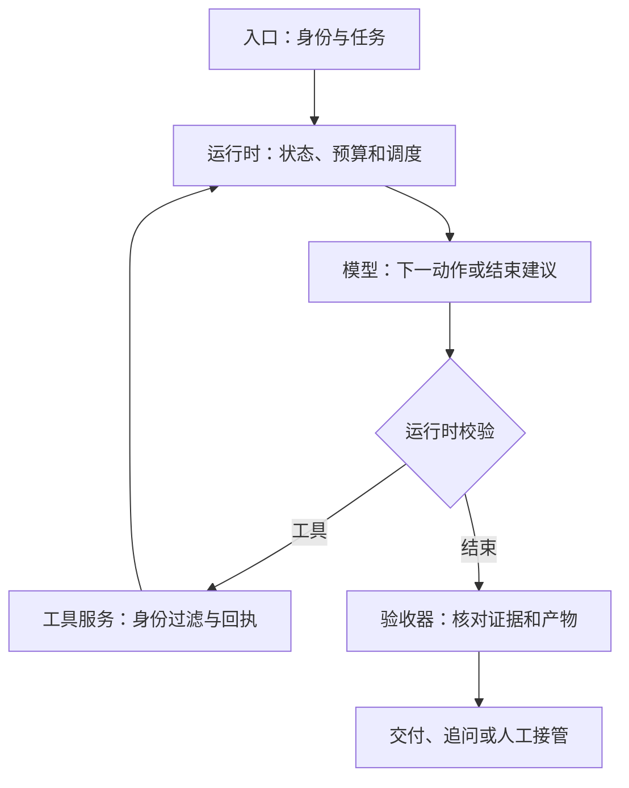
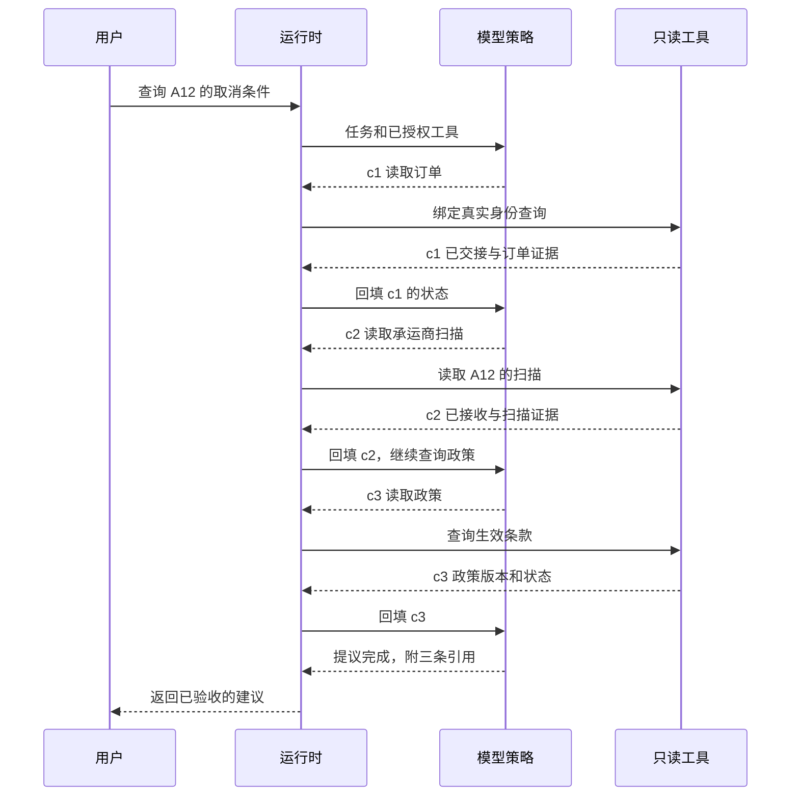

用户输入「A12 的快递还没到，我能取消吗？」客服应用已经知道当前登录人。订单接口能告诉它包裹是否交接给了承运商，但订单状态是 `handed_off` 时，还需要补查承运商扫描记录。模型第一轮提出查单，第二轮才看到 `handed_off`，此时决定是否查扫描。最后，系统要交付带证据的建议，并明确是否需要人工处理。

这篇沿同一个请求看执行器怎样获得证据、允许下一步以及决定结束。理解机制时，可以先跟着时序图和回合表走一遍，再按需对照本地模拟器。

## 一个售后问题，为什么要跑多轮？ {#task-contract}

一次模型调用能把退款条款讲成自然语言。但订单归属、扫描状态以及此刻生效的政策都属于外部事实。传统做法可用程序固定执行「查订单 → 查扫描 → 查政策」。当承运商数据始终必要，这个顺序简单、便于回归。现在只有部分订单需要扫描。如果以后还有跨境转运、分包和异常状态，查哪些系统会越来越依赖中间结果。

先写交付合同，再决定把哪一段交给模型选择。

| 情况 | 用户收到什么 | 应能验证什么 |
| --- | --- | --- |
| A12 属于本人且已交接承运商 | 订单状态和政策建议 | 回答关联查单、扫描、政策三条证据 |
| 尚未提供订单号 | 澄清问题 | 查单次数为零 |
| 查不到本人的订单 | 转人工或通用的无法访问提示 | 未向模型暴露其他用户的记录 |
| 一次工具超时 | 有界地重试该次读取 | 同一读取有两次不同调用记录 |
| 用户要求直接退款 | 转入人工处理 | 本次执行没有退款写操作 |

对当前案例，认证和验收规则已经明确。可变部分是在合法工具集合内，按观察补哪一条证据。越复杂的任务越需要提前写下最终产物，例如一组能读回的资源 ID、一个经过验证的文件或一份有关联证据的结构化报告。

## Agent 的定义与控制权 {#control}

本文讨论的 LLM Agent 是一种任务执行系统。运行时提供状态、已授权的行动空间和完成条件，模型根据当前输入与新观察提出动作，动作结果进入后续决策。可以通过同一请求中下一步由谁控制，区分三种常见形态。

| 形态 | 主要决策方 | 售后任务中的表现 |
| --- | --- | --- |
| Chatbot | 应用发起单次回复 | 解释通用政策 |
| Workflow | 程序按预定义节点转移 | 用状态字段固定决定是否查扫描 |
| LLM Agent | 模型基于观察提出下一动作，运行时裁决 | 根据订单和上下文选择查扫描、政策或请求澄清 |

这三种形态可以在同一服务内组合。例如把查证据的部分做成有限工具循环，把退款写入做成独立审批流程。自治程度由允许的动作、可探索的步骤、持续时间和委派范围决定。调用工具次数和可触及范围可以分别限制。对工作流与 Agent 的表述沿用 [Anthropic 的架构区分](https://www.anthropic.com/research/building-effective-agents)。

## 底层原理：观测、动作与状态转移 {#loop}

用三条状态关系描述一个执行回合，`S` 表示运行时状态，`U` 是任务输入，`A` 是动作，`O` 是外部观察。

```text
visible_context = assemble(U, S, allowed_tools)
A = decide(visible_context)
O, S_next = execute_and_reduce(A, S)
```

- **感知** 把用户输入、授权工具和已核验的回执装配成模型本轮可见的上下文。上下文可随 token 预算裁剪，持久任务状态仍可独立恢复。
- **推理与规划** 根据已见证据提出下一动作。复杂任务可额外输出结构化计划，例如先查两个独立系统，再合并结果。计划中的依赖、动作和完成条件能由程序检查。
- **行动** 运行时对建议校验工具名、输入、身份、预算和前置条件。执行结果只有通过关联检查后才成为当前任务的观察。
- **反馈** 读回工具结果，按调用编号绑定到本次决策，更新已完成证据和失败计数。下一轮装配器根据新状态重建输入。

模型可以提议结束。验收器以服务端实际执行得到的证据为准。假设模型输出「当前政策为 V2」且写了一个形状正确的来源 ID，验收器还要检查该 ID 属于本次授权查询，引用的内容和范围与当前结论一致。

以第二轮为例，运行时持有的状态是「订单已交接，扫描与政策尚待查证」。本轮输入可以只保留订单状态和允许调用的工具。扫描返回「承运商已接收包裹」后，执行器记录证据和来源，再组装下一轮输入去查适用政策。这个流程允许压缩对话，保留任务恢复所需的完整事实。若回执缺失，状态应保留「扫描未知」，因此无法通过最终验收。

`call_id` 解决一次模型提议和响应的配对问题。业务对象 ID 指向订单或外部资源。写动作的幂等键标识同一个已批准动作的所有重试，通常跨进程存活。这三个 ID 属于不同生命周期，不能共用。具体字段形状由模型 API 的适配层转换，见 [Function Calling 官方说明](https://developers.openai.com/api/docs/guides/function-calling)。

## 系统架构与数据边界 {#architecture}



| 模块 | 接收 | 输出 |
| --- | --- | --- |
| 入口 | 用户请求、服务端会话 | 作用范围明确的任务 |
| 模型适配 | 目标、可见证据、工具描述 | 结构化工具建议或候选交付 |
| 执行器 | 建议、真实会话、预算 | 回执和错误类型 |
| 状态 | 规范化的观察、动作计数、剩余预算 | 下一轮模型输入所需的事实 |
| 验收器 | 产物、现行规则、签发证据 | 交付、缺证据、需人工等状态 |

最重要的数据边界是模型和工具服务之间。模型可选择已登记的工具，服务端从会话确定访问主体，查询前过滤。工具返回的文档和说明仍是外部数据。让它们参与抽取和分析，也要把应用规则与数据来源分开。

## 跟踪一条任务的完整执行 {#execution}



| 回合 | 建议 | 实际回执 | 运行时现在能确认什么 |
| --- | --- | --- | --- |
| 1 | `c1 read_order` | `order:A12:v3` | 已交接，需要扫描证据 |
| 2 | `c2 read_scan` | `scan:A12:17` | 有承运商接收记录 |
| 3 | `c3 read_policy` | `policy:cancel:v2` | 当前政策要求审核 |
| 4 | `Finish` | 验收三项证据 | 可以返回建议和证据 |

第一次读取超时的时候，它的回执仍有调用编号和状态，下一次尝试有新的调用编号。证据集合只纳入状态为 `ok` 的合法回执。读订单就返回权限不可用时，循环结束，不请求扫描或政策。没有足够证据的完成提议则进入人工处理。

## 实现一个有界的 Python 执行器 {#implementation}

最值得对照代码的是结束分支。任务需要哪些证据取决于前面观察到的事实，例如不同配送阶段所需证明不同。执行器从成功回执取证据，逐项检查交付条件。

```python
if isinstance(decision, Finish):
    evidence = {item.tool: item.evidence for item in successful}
    required = required_tools(successful)
    if not all(evidence.get(tool) for tool in required):
        return result(Status.HANDOFF, "missing_evidence")
    expected = set(evidence.values())
    if set(decision.citations) != expected:
        return result(Status.HANDOFF, "invalid_citations")
    return result(Status.COMPLETE, "verified", decision.citations)
```

这段代码先检查任务需要的证据是否齐全，再检查声明的引用。示例的交付物是已有结构化事实和证据 ID，真实系统如果添加自由文本，仍应额外验证关键结论是否得到引用支持。

把决策上限设为两轮时，订单和扫描都已经查到了，政策仍待查证，模拟运行会以 `turn_limit` 结束。这给出了一个比「有没有产生答案」更严格的判断：系统能否在证据不全时停止并报告原因。可选实验见本地合成数据和断言脚本。[Python 执行器](/assets/examples/agent-engineering/agent_loop.py)

## 什么时候用固定流程、ReAct 或计划执行？ {#tradeoffs}

用同一组订单、同样的工具延迟，以及相同的成功标准比较。

| 方案 | 如何决定下一步 | 主要代价 | 适用起点 |
| --- | --- | --- | --- |
| 固定流程 | 节点由代码和条件分支决定 | 新业务分支要显式维护 | 路径稳定、经常审计 |
| 有界 ReAct | 每次工具观察影响下一动作 | 回合数和选择可能波动 | 探索短链、证据逐步出现 |
| Plan-and-Execute | 先写可检查的依赖步骤，再执行 | 计划维护及重规划开销 | 子任务多，依赖和中间产物能检查 |

在本文有限样本上，固定流程可以直接处理 `handed_off`。循环把模型或决策层接入的边界展示出来。需要更多非固定分支时，用带预算的模型策略替换 `choose`，以同一批业务任务评估是否带来收益。ReAct 的论文讨论把推理、行动和观察交替结合的设计。线上解释可使用结构化动作、观察和验收原因，来源见 [ReAct 论文](https://arxiv.org/abs/2210.03629)。

## 失败、停止与自主性边界 {#practice}

| 失败 | 第一条排查证据 | 建议的结果 |
| --- | --- | --- |
| 工具超时 | 阶段耗时、尝试次数和调用编号 | 在剩余预算内重试已知无副作用的读取 |
| 连续选择同一读取 | 工具名、规范化参数与已成功记录 | 拒绝重复，保留诊断原因 |
| 证据不足就提议完成 | 必需主题与已见证据 | 缺哪种证据就指出哪种，必要时人工接管 |
| 工具结果来自其他调用 | 提议与回执的关联编号 | 不加入任务状态 |
| 用户要求退款写入 | 真实身份、动作和目标 | 采用独立的审批和回执路径 |

脚本的截止时间在同步调用前后检查，能阻止超时结果继续驱动下一步。它无法中止一个阻塞中的注入函数。生产适配层还要给 HTTP 或模型调用设置单次超时及取消，并沿用任务剩余期限。保留三类配额：决策回合数、单动作的尝试上限以及任务总时限。涉及外部写入时，再持久化业务操作键，恢复时先查目标回执。

追踪时保存任务、工具、错误类型、耗时和版本，不把订单正文或身份凭证塞进全量日志。做性能对比先拆排队、模型、工具和验收。固定分支可以直接用函数，独立读动作可以在授权内并行，任何优化都用固定样本比较结果正确率和耗时。

## 从执行循环走向后续模块 {#evolution}

能把一次失败还原到具体决策、工具调用、回填或验收，才有办法继续优化。工具调用负责动作接口，[Function Calling 实战](/2026/11/19/agent-deep-dive-tool-use/) 会详细演示 `call_id`。记忆和上下文决定模型能看见什么，规划和 ReAct 决定下一步何时可变，LangGraph 等框架为运行状态和恢复提供实现。一条 [智能客服案例](/2026/11/19/agent-case-support/) 展示如何把这些部分组合成可验收的交付。

### 按问题继续读

| 想继续解决的运行问题 | 阅读入口 |
| --- | --- |
| LLM、Chatbot、Workflow 和 Agent 怎样演进？ | [从 LLM 到 Agent](/2026/09/15/from-llm-to-agent/) |
| 感知、推理、规划、行动与反馈如何分工？ | [八项核心能力](/2026/11/19/agent-engineering-capabilities/) |
| 一次模型提议如何变成有回执的行动？ | [Function Calling 执行流程](/2026/11/19/agent-deep-dive-tool-use/#flow) |
| 本轮上下文和持久状态分别由谁管理？ | [Context、Memory 和 State](/2026/11/19/agent-deep-dive-agent-state/) |
| 下一步取决于观察还是已有计划？ | [ReAct](/2026/11/19/agent-deep-dive-react/) · [Plan-and-Execute](/2026/11/19/agent-deep-dive-plan-execute/) |
| 系统怎么判断任务已完成？ | [客服案例的过程与结果验收](/2026/11/19/agent-case-support/#principles) |
| 超时、失败和重复循环怎么处理？ | [执行器的停止条件](#practice) · [写入后的回执恢复](/2026/11/19/agent-deep-dive-durability/) |
| 自主性的权限和批准边界在哪里？ | [Agent 安全边界](/2026/11/19/agent-deep-dive-security-gates/) |
