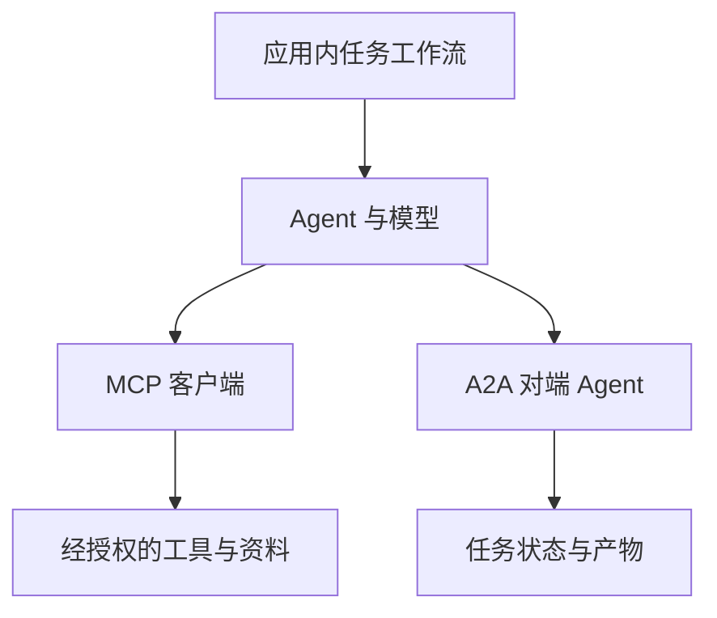

做第一个 Agent 时，有时卡在模型和工具接不起来，有时卡在等待人工之后无法继续，还有时只是旧知识库解析得不好。这三类问题发生在执行链的不同地方。先跑通一条最小任务，找到需要外部组件接管的部分，再决定依赖。

## 组件、运行流程与适用边界 {#frameworks}

| 组件 | 运行时怎么用 | 适合在哪一步接入 | 需要自己补齐 |
| --- | --- | --- | --- |
| LangChain | 将模型、消息、工具与中间件接进 Agent 循环。用 Runnable 理解组合和调用边界 | 快速建立会选工具的客服助手 | 授权、应用状态及业务验收 |
| LangGraph | Node 更新 State，Edge 决定下一节点，Checkpoint 保存可恢复状态 | 需要循环、分支、暂停审批或长任务 | 定义状态契约、幂等写入与恢复规则 |
| LlamaIndex | 用数据连接器读资料，经处理与索引产生可检索节点，再把证据交给查询链或 Agent | 知识问答主要受文档入库和检索质量约束 | 业务权限、索引版本与任务状态 |
| AutoGen | 消息由 Agent 或团队接收并触发下一位角色，按终止条件收束 | 阅读或维护多 Agent 对话和分工实现 | 共享产物、预算、失败终止和生产边界 |
| CrewAI | Crew 中角色执行任务，Flow 显式组织事件和状态 | 有清楚的角色任务，想先检验协作路径 | 评估交接质量，并确定失败后如何重新入队 |
| Semantic Kernel | 插件暴露函数，Agent 或编排层根据输入调度能力 | 需要对接既有插件体系或维护相应系统 | 自定义授权、业务状态和结果校验 |

AutoGen 和 Semantic Kernel 的用户还可以沿微软的官方迁移说明了解 Microsoft Agent Framework。读既有项目时，先确定使用的是哪个框架版本和哪套调用接口，再选择部署或迁移策略。

## 同一条客服请求，怎么分层实现 {#workflow}

1. 用 LangChain 风格的模型和工具适配层让模型提议 `read_order`，将实际执行交给受控服务。
2. 如果政策资料多，增加 LlamaIndex 风格的入库和检索层，根据用户所在地区返回带版本的条款。
3. 引入需要审批的申请时，用 LangGraph 风格的状态图维护任务。将等待人工设为显式状态，恢复时沿同一个任务标识继续。
4. 多部门需要各自处理时，才增加角色团队。每位 Agent 交回带版本的产物，父任务对产物做最终验收。

下面按明确的输入、输出组织节点。示例只使用纯 Python 说明运行时接口，接入框架时可以保留状态结构。实际项目要把节点和转移声明在所选运行时内，并在审批前持久化当前草稿标识。

```python
def route(state):
    if not state.get("order_id"):
        return "ask_order"
    if state.get("requires_review") and not state.get("approval_id"):
        return "await_review"
    return "deliver"

assert route({}) == "ask_order"
assert route({"order_id": "A12", "requires_review": True}) == "await_review"
assert route({"order_id": "A12", "approval_id": "approval-5"}) == "deliver"
```

## MCP 与 A2A 连接的是谁 {#protocols}

MCP 的 Host 管理客户端连接，Client 与 Server 交互，Server 可以暴露 Tools、Resources 或 Prompts。工具是可调用动作，资源提供上下文，提示模板可作为工作入口。调用者先确认工具服务、连接方式和授权范围，再实际执行。

A2A 用于不同 Agent 应用交互。一个研究 Agent 可通过对方声明的能力和访问要求发起任务，再根据状态取得交付产物。Agent Card、Task 和 Artifact 分别用于描述能力、进展和交付对象。调用方要记录远端任务的关联 ID、截止时间和数据范围，便于取消、审计或核对迟到结果。



## 上框架之前做什么对照 {#tradeoffs}

用同一条请求执行两个实现，保留请求 ID、工具参数、状态变更、回执与耗时。框架的价值可以落在很具体的指标上：等待人工期间能否恢复、能否追查每个动作、需要维护多少自定义接口。控制流简单时，少量函数即可满足需求。后台任务要跨进程、多节点共享状态时，采用有明确持久化语义的运行时更省重复开发。

[前置知识：架构设计](/2026/11/19/agent-engineering-architecture/) · [进阶阅读：工程化与生产实践](/2026/11/19/agent-engineering-production/)

资料：[LangChain 与 LangGraph](https://docs.langchain.com/) · [LlamaIndex](https://docs.llamaindex.ai/) · [AutoGen](https://microsoft.github.io/autogen/) · [CrewAI](https://docs.crewai.com/) · [Semantic Kernel](https://learn.microsoft.com/semantic-kernel/) · [Microsoft Agent Framework](https://learn.microsoft.com/agent-framework/overview) · [MCP 规范](https://modelcontextprotocol.io/specification/) · [A2A 规范](https://a2a-protocol.org/latest/specification/)
