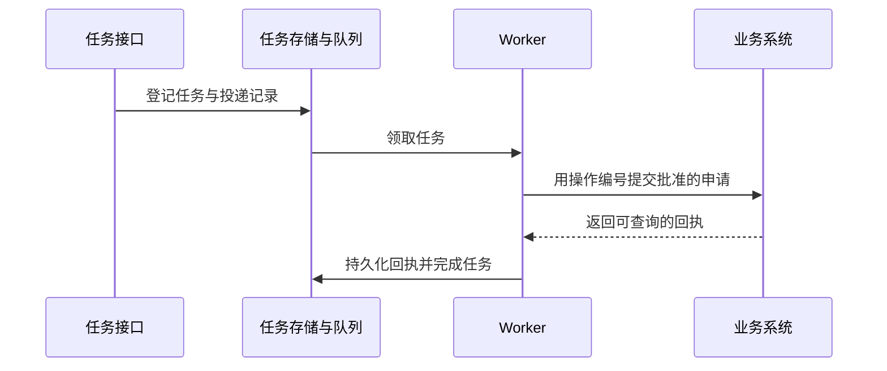

用户点了「提交退款申请」，浏览器超时了。客服页面刷新以后需要知道任务是否还在跑，Worker 重启后需要判断申请是否已经写进业务系统。生产级 Agent 的很多困难都出现在这些边界上。

## 项目结构与 API 合同 {#service}

一个可维护的项目至少能区分入口、任务服务、工作流、模型适配、工具适配、策略、存储和评测。HTTP 入口负责认证和形状校验，业务服务生成任务 ID，工作流只接收明确的状态与依赖。锁定依赖和模型配置版本，把配置变动纳入发布记录。FastAPI 或其他 HTTP 框架负责服务层和接口契约。

| 接口或实体 | 行为 | 调用方如何验证 |
| --- | --- | --- |
| `POST /jobs` | 验证用户、登记任务、返回任务 ID | 相同幂等键与相同请求得到同一个任务 |
| `GET /jobs/{id}` | 查询当前状态与已交付的产物 | 按任务所属主体鉴权 |
| 任务事件流 | 推送进度、追问、待批与完成事件 | 断流后用事件游标重连，或查询权威状态 |
| `POST /jobs/{id}/approvals` | 核对待批产物和批准范围，记录审批事件 | 审批者、内容摘要、目标版本相匹配 |

流式返回面向界面交互。浏览器断开期间，长任务可以继续由独立 Worker 执行。界面通过任务 ID 重新订阅进度。取消要定义为状态转移，写入提交后收到取消时，仍然要核对回执与可用的补偿路径。

## State、Session、Checkpoint 与持久化 {#persistence}

Session 连接同一用户的多次交互，State 记录一次任务的进度，Checkpoint 是可恢复的状态快照。用数据库存当前节点、输入版本、产物引用、预算、已批准动作和外部操作编号，快照避免保存不必要的全文。会话恢复后重新检查身份与资源范围。批准过的动作把摘要、目标版本和操作编号冻结，执行前再检查权限是否仍然生效。

## 异步、队列、Worker 与故障处理 {#worker}

API 可以把任务写入数据库与 outbox 的同一事务，由投递器再发给队列。Worker 抢占租约，定期续期并在完成后持久化产物。即使同一任务被重新投递，同一个外部动作也沿用原操作编号。任务级设置总时限，单次调用使用更小的超时。临时故障可以带退避重试。持续故障触发熔断，按预先定义的方式降级到只读查询或转人工。



目标系统支持外部幂等键时，Worker 可以在重试前先查回执。下面展示简化决策，实际工具也应在自身事务里用唯一约束限制同一操作编号只生效一次。

```python
def apply_approved(job, service):
    if job["status"] != "approved":
        raise ValueError("approval is required")
    receipt = service.find_receipt(job["operation_id"])
    if receipt is not None:
        return receipt
    return service.submit(
        job["draft"],
        idempotency_key=job["operation_id"],
        expected_version=job["target_version"],
    )
```

如果目标系统不能查询且不支持幂等，调用超时后的状态可能是「结果未知」。冻结自动写动作，交给人工核对或通过业务记录确定结果。面向用户区分等待、处理中、待接管、已交付与失败。

## Docker、Kubernetes、灰度与回滚 {#deployment}

用相同镜像构建 API 和 Worker，按需配置入口，迁移数据库时保持跨版本兼容。容器滚动更新前让 Worker 停止领取新任务，给在途任务时间保存状态。Kubernetes 等编排环境可分别按接口流量与队列深度扩缩容。灰度发布记录应用、模型、Prompt、工具、权限策略和索引版本。先选受控工作区，比较同样的任务类型及关键用户切片。回滚后重放原失败样本，确认命中的索引和实际结果。在途任务和已提交外部操作需要额外核查。

## 延迟、吞吐量与成本 {#performance}

把总耗时分成排队、模型首响应、工具调用、持久化和验收。优化前先确认最慢的一段。读取独立资料可有限并发，共用一处外部写目标时应用并发控制。缓存只读结果时带上租户、权限范围、数据版本及过期策略。模型路由可让短分类走便宜模型，把受影响比例和质量跌幅同时写入评测。把每次任务成本记成模型、检索、外部工具和重试总成本，分别观察每次尝试与每次成功交付。

[前置知识：框架与生态](/2026/11/19/agent-engineering-frameworks/) · [进阶阅读：评估与可观测性](/2026/11/19/agent-engineering-quality/) · [深入阅读：检查点与幂等](/2026/11/05/agent-checkpoint-idempotency/)
