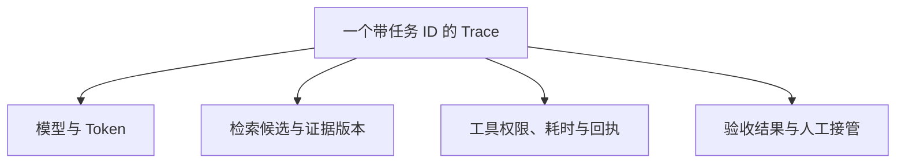

客服候选版本在测试集上答对了更多条，却有一条把其他用户的订单字段带进模型上下文。回答碰巧没有复述字段，日志仍应把这次请求判为越权。上线条件要覆盖整个执行轨迹，也要能解释失败首次出现在哪里。

## 评测样本同时检查结果和过程 {#evaluation}

从用户真实目标出发，记录输入、身份、环境版本、期望状态、必须出现和禁止出现的行为。样本覆盖常规、缺信息、证据冲突、越权、工具超时和中断恢复。用程序判定结构、权限、回执和状态转移。语义是否贴合依据可以用人工评分或模型辅助评审。人工先校准代表样本，保留评分准则和常见误判。

| 评估对象 | 指标或检查方式 | 示例 |
| --- | --- | --- |
| 任务成功 | 明确可交付分母和终止状态 | 已登录且证据齐全的订单查询返回可验证答复 |
| 工具调用 | 选择、参数和权限断言 | 查订单前完成授权，拒绝时无返回载荷 |
| 多步决策 | 逐步核对依赖、预算和必要检查 | 政策冲突时走人工，未批准时无写入 |
| RAG | Recall@k、排序质量、引用正确性 | 有效地区条款应进入实际模型输入 |
| 推理质量 | 检查证据、判定依据和缺失条件 | 引用的条款应确实支持退款结论 |
| 可靠性 | 失败注入、恢复与回归 | 模拟提交后丢回执，确认只生效一次 |

用固定数据版本、模型配置与相同样本对照基线和候选。小样本报告计数及变化，重复跑随机模型时保留多次结果。关注同一任务上哪些改善、哪些退步，并按角色、地区和任务类型查看关键切片。

```python
def release_gate(rows):
    if any(row["forbidden_access"] for row in rows):
        return "block"
    regressions = [
        row["case_id"] for row in rows
        if row["critical"] and row["baseline_passed"] and not row["candidate_passed"]
    ]
    return {"status": "review" if regressions else "eligible", "regressions": regressions}

assert release_gate([{"forbidden_access": True}]) == "block"
```

## 安全控制放在动作边界 {#security}

把用户输入、网页、知识片段与工具回包视为需要校验的数据，系统策略从受控配置读取。遇到外部文本试图改变权限或指导额外动作时，运行时仍按已登记的工具范围工作。查数据库由服务端鉴权和过滤，工具参数使用约束字段。高风险动作先冻结目标、内容和受影响资源，再走独立审批。需要执行脚本时按任务隔离环境，凭证和网络访问按实际职责配置。对输入和输出做业务过滤，敏感字段在留痕前按最小范围脱敏。审计时记录谁授权、做了什么、目标是什么和结果凭据。

测试环境可以放只含合成数据的错误文档，断言工具权限、结果过滤和审批行为，使用明确预期的无害动作。上线门禁对越权、未批准写入、泄露和破坏性状态迁移单独计数。

## Trace、监控和日志各看什么 {#observability}

一个请求 Trace 里可以按模型调用、检索、工具、审批和验收拆 Span。任务 ID 和外部操作 ID 让人从用户问题找到对应事件。日志记录错误类型、资源版本和回执引用。指标聚合延迟、Token、工具错误率、成功率、在途任务及人工接管率。看一条任务为什么失败用 Trace，判断某个区域是否系统性退步看切片指标和重放样本。



OpenTelemetry 用于统一采集及导出遥测。LangSmith 或 Langfuse 可以承载 LLM 应用的执行轨迹和评估数据。先列出团队要回答的排障问题，再配置采样、留存与查看权限。线上默认保存必要标识，重放敏感任务时用授权范围内的脱敏数据。

## 把一次线上失败接回开发闭环 {#feedback-loop}

保全该请求当时的模型、Prompt、索引和权限策略版本。复现前写下期望，逐步比较工具选择、授权查询、候选证据、上下文与最终验收。找到第一处偏差后，用最小可复现样本覆盖它，同时保留一条端到端用例。修复后比较基线与候选，通过发布门禁再灰度。灰度出现异常时回滚并重放原请求，检验实际生效配置。若误判来自业务验收本身，回到生命周期第一步重新明确任务边界。

[前置知识：工程化与生产实践](/2026/11/19/agent-engineering-production/) · [进阶阅读：四个项目案例](/2026/11/19/agent-engineering-cases/) · [理解评测集](/2026/09/15/agent-benchmark/)

资料：[OpenTelemetry GenAI 语义约定](https://github.com/open-telemetry/semantic-conventions-genai/blob/main/docs/gen-ai/gen-ai-spans.md) · [LangSmith](https://docs.langchain.com/langsmith/home) · [Langfuse](https://langfuse.com/docs) · [OWASP Prompt Injection](https://genai.owasp.org/llmrisk/llm01-prompt-injection/) · [OWASP Excessive Agency](https://genai.owasp.org/llmrisk/llm062025-excessive-agency/)
