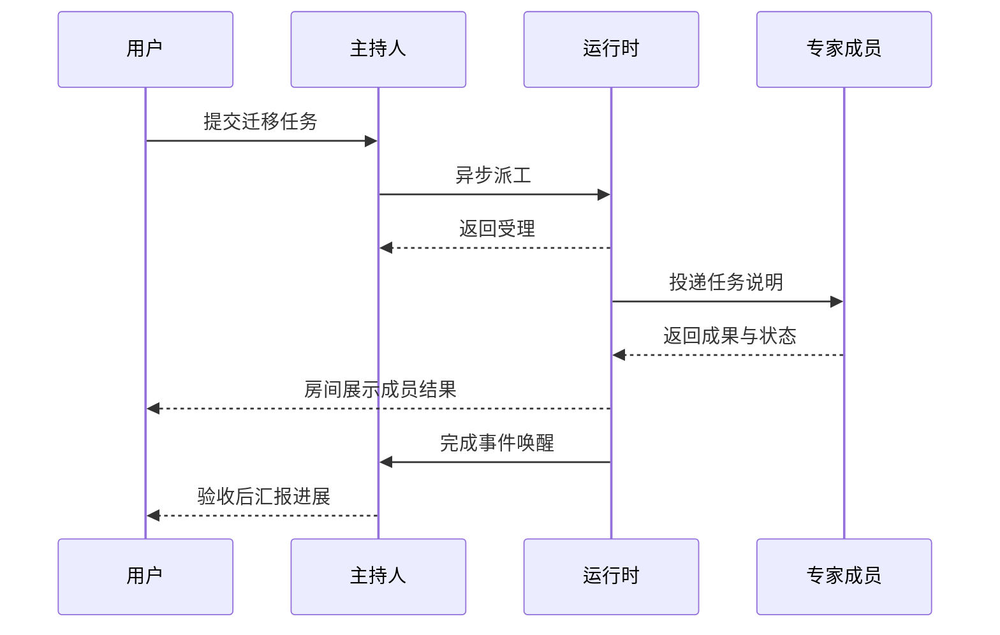

研发负责人丢给助手一个问题：“下周准备废弃旧接口，查一遍谁还在调用，顺便把迁移说明写出来。”调用方排查可以分给一个 Agent，兼容性测试可以交给另一个。等结果出来，负责人又补了一句：“支付链路先排除，这次只处理测试环境。”

派两份活容易。难的是识别后来那句话在改什么：两个成员还在查原范围吗？已经提交的结论依然有效吗？当其中一个成员完成、另一个正在跑测试，系统应该给出阶段结果，还是宣布整件事做完？这些问题落在任务的归属、状态和验收上。把三个助手放进同一个聊天室，只呈现了这套系统最外面的一层。

腾讯云 Octop 的团队模式提供了一份可以对照的公开设计。它把一个长期存在的主持人、异步工作的专家成员和任务完成后的回叫放在一起。结合 Anthropic 的研究 Agent 实践，正好能看出这种结构解决了什么，又在哪些场景下会增加负担。以下接口迁移是讲解用的假设案例，Octop 的具体行为以文末固定版本设计文档为准。

## 先拆开对话、任务和运行

对话延续的是用户交流的脉络。“刚才那件事”“把支付排除”都要靠对话上下文才能读懂。任务是一份有范围和完成标准的承诺。运行则是某个执行者为了完成任务发生的一次尝试，失败后可以换执行实例，或带上修正后的范围重新开始。

如果三者都用对话 ID 表示，系统很难准确处理前面的补充要求。一次对话里可能还有另一件独立的工作。把这条补充应用到整场会话，会误伤旁边的任务。工程上可以沿着下面的关系存数据。

| 层级 | 记录什么 | 对接口迁移案例的意义 |
| --- | --- | --- |
| 会话 | 谁在交互、入口、最近消息 | 理解“刚才那件事”指的是迁移计划 |
| 主任务 | 目标、范围及其版本、交付标准 | 新范围排除支付，证据必须来自测试环境 |
| 子任务 | 受派人、独立边界、依赖和产物 | 盘点调用方和测试兼容性分开追踪 |
| 尝试 | 实际执行者、输入版本、结束状态 | 旧范围的结果允许留档，合并时需要重新判定 |
| 交付物 | 文件或报告引用、验证记录 | 能核对清单里的每条结论从哪来 |

前台回复“已开始处理”，含义是任务已受理。工作单元回传结果，请求的是一轮新决策：够不够交付、要不要补查、是否存在必须向用户澄清的冲突。两种消息可以出现在同一个聊天界面，它们在运行时走的是不同路径。

## Octop 如何把主持人与成员接起来

Octop 的公开团队设计里，用户面对主持人。主持人整理任务后异步派给成员，成员以各自工作区里的专家身份执行。运行时按被调用成员组织收件任务。同一个成员的任务串行，不同成员能够并行；主持人的回叫则按来源会话序列化，避免几个完成事件同时推进同一主持人上下文。成员回复可以进入房间时间线，平台随后唤醒主持人处理收尾。

下面只画一次异步派工的主路径。成员的前台消息和平台发出的完成事件各有用途：前者让人知道工作进展，后者让协调程序获知可以做下一次判断。

这里有两个值得细看的边界。第一，主持人会把用户意图改写成成员能够执行的任务，成员仍可获得必要的房间背景。在自己的应用里，可以把原始聊天、派工说明和受信任的权限参数分别存放，并按各自用途下发。第二，Octop 的设计文档把界面上停止主持人当前流和取消成员任务分开描述。对用户来说，两者可能长得很像，产品应说清楚停的是聊天输出，还是已排队、正在执行的整个操作。

同一份设计还说明在途派工跟踪器有进程内状态，重启后相关锁会消失。评估长任务可靠性时，应逐项核对队列、工作进度、回执与互斥信息各存在哪里。仅从界面看到任务能并行，无法判断一次重启后还能恢复到哪里。

## 一份能被验收的派工应该长什么样

“你帮我查一下调用方”很容易让两个成员重复做相同工作。更有效的描述包括工作目的、输入版本、明确排除项、允许使用的工具和验收证据。下面是迁移场景中的两份任务，属于本文的工程示例。

| 成员 | 任务与边界 | 交回的证据 |
| --- | --- | --- |
| 依赖盘点 | 基于指定提交查测试环境调用，排除支付，同时保留未查到的线索 | 文件及行号、服务名、未归类入口 |
| 兼容验证 | 用同一提交检查旧接口兼容性，测试仅覆盖约定的环境与消费者 | 测试范围、执行结果、未覆盖分支 |
| 主持人 | 核对两份结果的范围版本，解释冲突，决定是否补派 | 已确认、待核实、明确排除的清单 |

用户排除支付后，主持人可以把范围从第一版更新到第二版。尚未开始的任务按新版投递；正在执行的任务用取消或过期标记处理；已经完成的报告先检查其环境和范围，能复用的证据仍可关联。合并程序要看成果的版本和出处，避免把回来的最后一条消息直接当最新结论。

这里的验收也应该拆成事件和规则两层。成员完成意味着它已经提交一份结果。主任务完成则取决于关键问题有没有覆盖，产物是否符合范围，阻塞项是否已经消解。如果兼容测试失败但依赖表已经产出，可以先交阶段性结果，对未满足的完成条件给出清楚说明。用户此时能继续决策，主持人也不必反复调用两个成员。

## 并行化的收益，要从工作依赖上算

一个请求需要找三类彼此独立的资料，多开上下文可能扩大搜索面。一个请求需要先定位调用方、再根据定位写回归测试，第二步就依赖第一步。把两项硬拆成同时运行，后者往往只能猜测，最后多了一轮重做。

Anthropic 在公开的 Research 工程文章里描述了主 Agent 并行分派搜索、收集结果并综合的架构。这个场景的优势在于探索分支较独立，成员能先整理各自材料，再把小得多的成果交给主 Agent。把这种做法搬到修改同一个代码库的任务时，还要考虑文件写入冲突、快照一致性和最终测试。下面的判断适合在选架构前使用。

| 任务形态 | 优先尝试 | 需要核对的代价 |
| --- | --- | --- |
| 验证项固定，各项独立 | 代码做并行工作流 | 单项耗时、依赖端限流 |
| 搜索方向随输入变化，可分区探索 | 主 Agent 派工给多个成员 | 重复取证、上下文与综合成本 |
| 多个阶段依赖同一份实时状态 | 主流程依序推进，局部并行 | 阶段重跑、过期结果和状态一致性 |
| 多个执行者要修改同一文件或数据 | 先分配写入边界，再合并验证 | 冲突处理、授权和验证成本 |

评估时可以拿同一批任务跑单 Agent 和团队版，固定模型与工具条件。除了最终质量，记下完成时间、模型调用量、重复工作和人工纠错次数。对独立分支，耗时由最慢的分支、排队和合并共同决定；对强依赖分支，要加上前置工作。看到整体耗时没有改善时，先检查任务是否真的能重叠，再看并发配置。

最后可以问一个比“要不要多 Agent”更实用的问题：如果其中一个成员现在离线，程序能否说出谁在做什么、哪些证据已经查到、哪些结论还不能交付？这几个答案能在运行记录里找到，再考虑给任务加更多执行者。

## 参考资料

- [TencentCloud/Octop 的团队模式设计，固定到阅读时的提交](https://github.com/TencentCloud/Octop/blob/30f4aecd2e14e7eeee639b8c6c33c9f404463df8/docs/expert-teams.md)
- [腾讯技术工程的 Octop 团队模式解读，公开转载](https://www.aixq.cc/84874.html)
- [Anthropic 如何构建多 Agent Research](https://www.anthropic.com/research/multi-agent-research-system)
- [阿甘博客的多 Agent 编排、handoff 与 A2A](https://arganzheng.life/multi-agent-orchestration-handoff-and-a2a.html)

[接着读 Coding Agent 的项目记忆与本体](/2026/11/19/coding-agent-project-ontology/)
