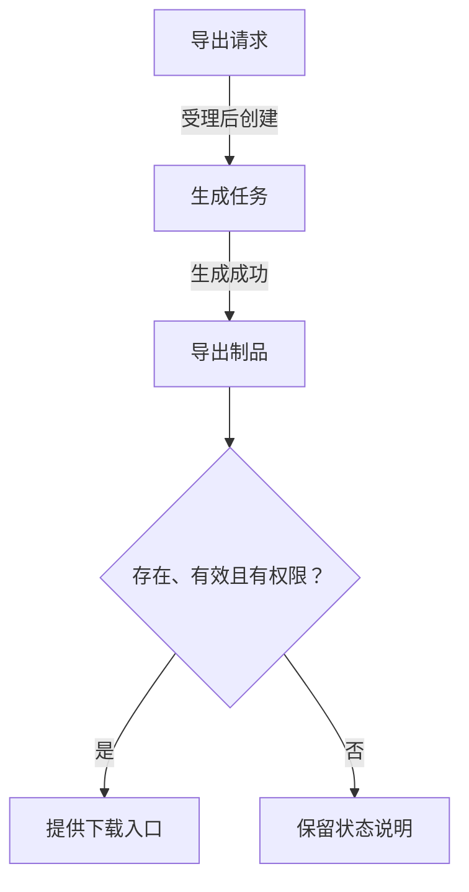

有个异步报告导出接口。旧任务处理完会在日志里写一条“success”，第二天 Coding Agent 修下载页时从历史记录搜到了这条经验，于是把接口一返回成功就显示“下载已就绪”。现网里这条请求只是进了队列，生成文件还有一段流程。用户看到的下载按钮连过去，目标文件尚不存在。

把更多历史塞回模型，也许能同时搜到“队列”“生成”“下载”几个词。真正让这个修改可靠的，是知道成功对应哪个对象、由哪个系统确认、在哪个状态才可以给下载链接。对熟悉项目的人，这些区别经常藏在代码、设计文档与踩坑经验之间。对 Agent，需要主动把它们组织出来。

腾讯技术工程的公开文章把这个问题放在研发 Loop、Memory 和 Ontology 中讨论。本文用一个独立的异步导出例子来解释三者的关系，再对照长任务 harness 与工作流记忆的公开资料，看看项目可以从哪里开始。导出流程和字段是本文的说明案例。

## 记忆让旧事可找，语义让旧事有范围

Memory 可以存一条历史经验：某次导出按钮过早出现，修复时等文件生成后才允许下载。这条内容值得保存，也应该能查回当时的提交、测试和环境。两个月后接口拆成两套，旧经验够不够用，取决于它适用的是哪个接口版本、哪种导出任务以及当时对“文件生成”的定义。

这里说的 Ontology 是一份共享的项目概念模型。它刻画系统里有哪些对象、它们之间有什么关系、每种状态在什么条件下成立。工程上可以从一个审阅过的结构化词表和几条规则开始。团队需要跨系统复用、自动检查或维护复杂关系时，再决定是否使用专用图模型或约束语言。

| 保存的内容 | 例子 | Agent 在什么时候用 |
| --- | --- | --- |
| 可重新查询的实现事实 | 当前提交里负责组装下载链接的模块 | 改代码前，用工作区现状核对 |
| 共享概念与规则 | 已受理表示调度服务接受了任务；可下载需要有效制品 | 解释需求、选择工具、写验收断言 |
| 有范围的历史经验 | v2 的一次回归暴露了按钮过早显示 | 找到同类问题与已有测试 |
| 可复用的工作方法 | 排查时先查任务状态，再复查制品是否存在 | 组织一次定位的顺序 |

这些信息经常被混在同一次关键词检索里。匹配“导出完成”可以找到老 PR，仍要查当前模块定义；找到当前模块实现，还要对照业务规则，判断原实现是否恰好就有问题。语义层的价值在于让这个查证过程具有一致的入口。

## 从一个导出任务，拆出对象、关系和不变量

导出用户请求和真正的文件是两个对象。请求可以已受理，却还在排队；它也可能已经生成过文件，但链接已过期。用一个 `success` 字段表示全流程，会同时丢掉状态所在的对象和时效。一个小模型可以先抓三个概念。

- **导出请求。** 由入口接收，携带发起人、请求时间和导出类型。
- **生成任务。** 由 worker 执行，负责从排队走到成功或失败，运行记录能回查。
- **导出制品。** 任务生成的文件或其引用。是否可下载取决于制品存在、访问权限和有效期。

有了关系，才能谈不变量。比如“只有当前用户有权访问且制品仍有效时，页面才可提供下载入口”。这条规则要同时约束 API、前端和测试。状态查询工具读取的是生成任务，制品查询工具读取的是文件状态与权限，模型需要知道每个结果能证明什么。把承诺放在 API 契约和测试里，Agent 每次改动都有同样的验收边界。

如果项目只在一个模块里维护这个流程，可以先保留一份决定记录和几个关键测试。要接入多个仓库时，再建立稳定的概念 ID，把文档、实现、责任人、测试和历史事件连上。关系更丰富以后，引用的来源和版本也更重要：一条错误关系被团队长期复用，会比一次对话里的误解影响更广。

## 从一次故障抽取什么，怎样让下一次受益

假设本次修复已经通过评审，此时可以从变更里提取一条候选经验。它至少要有事实、适用范围、验证凭据和失效条件。可以这样记录，字段仅作为例子。

| 字段 | 这次要保存的内容 |
| --- | --- |
| 结论 | v2 受理响应不足以判定下载就绪 |
| 适用条件 | 异步导出、v2 接口、保留现有的制品服务 |
| 引用 | 合并提交、状态契约、生成中及已过期两条回归 |
| 更新条件 | API 版本、制品授权或过期规则发生变化时重新确认 |

这个工作可拆成三个时间点。执行中保留程序真正看到的状态和输出。提交时抽取候选经验，由规则或人确认它有来源而且说清范围。未来读取时按项目、版本和当前任务判断是否使用。对于有冲突的记录，先找更新后的契约和测试，必要时将旧经验标成已替换，给历史调查继续保留来源。

Anthropic 关于长任务 harness 的公开文章讨论了跨会话续接，做法包括在仓库中留下可检查的进度和提交记录。这解决的是接班时怎样弄清工作做到哪里。Agent Workflow Memory 研究关注从过去任务中归纳可重用的流程。EvoOntology 则把语义结构放到数据任务中，对概念、关系和工具如何协同提供了实验。三者都可以借鉴，各自实验的任务范围应保留。

## 怎样评估它是不是真的更懂项目

读懂通常体现在它能用正确的依据做选择。可以选三组同一类修改，保持模型、工具与任务预算一致。

| 对照 | 给 Agent 的材料 | 看什么 |
| --- | --- | --- |
| 当前仓库 | 代码、文档、测试 | 能否自己定位状态归属，花了多少次查找 |
| 加历史经验 | 在同一份工作区上提供已验证案例 | 有没有更快找到相关测试，是否误套旧版 |
| 加语义规则和范围 | 再提供对象、关系与版本约束 | 是否能提出正确的边界，以及能否在冲突时找当前事实 |

样本至少包括一次“旧经验仍适用”和一次“旧经验已经失效”。还可以留一条不同异步流程的修改作为独立验证，观察 Agent 能否把这次学到的查证思路用到新任务。指标可以看首次定位是否正确、变更通过哪些回归，以及在证据冲突时是否过早下结论。保存量和召回量记录下来即可，它们不能替代结果正确性。

当团队准备给 Coding Agent 教项目时，可以先挑一个反复被改错的概念，问清它属于哪个对象、有哪些前置条件、靠什么证据判断状态。把答案写进项目契约和回归，再把那次历史故障连上。后续每条记忆都有一个可以查证的落点，这份知识才能随代码演进。

## 参考资料

- [腾讯技术工程的 Coding Agent 本体与 Memory 实践，公开转载](https://shuwu5.cn/article/6552.html)
- [Anthropic 的长任务 Agent harness 工程实践](https://www.anthropic.com/research/effective-harnesses-for-long-running-agents)
- [Agent Workflow Memory，ICML 论文](https://proceedings.mlr.press/v267/wang25bx.html)
- [EvoOntology，数据 Agent 的本体研究](https://arxiv.org/abs/2609.15779)
- [阿甘博客的 Agent Memory 与人工介入](https://arganzheng.life/agent-memory-and-human-in-the-loop.html)

[接着读多 Agent 的派工与验收](/2026/11/19/agent-orchestration-after-delegation/)
