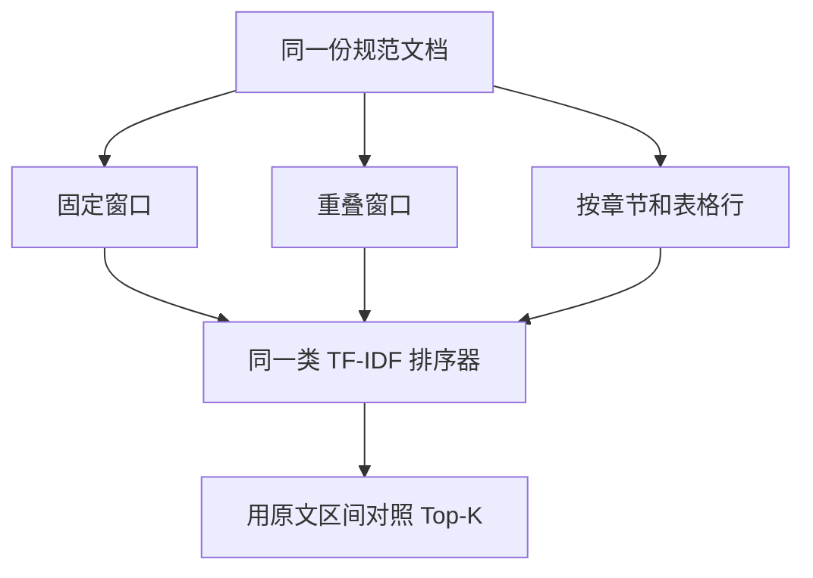
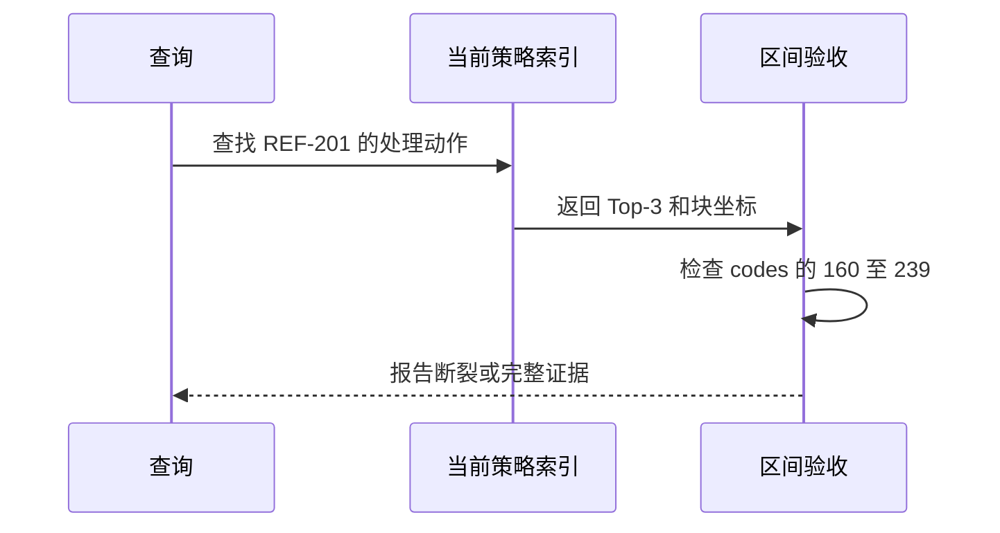

## 搜到了关键词，为什么还不算找到证据？ {#problem}

查 `REF-201` 时，固定窗口第一个候选命中了正确文档与错误码，也带着 `Wait for payment`。完整动作却是 `Wait for payment settlement.`。把下一块一起交给模型，可能还夹带 REF-210 的处理步骤。修复方式取决于被遗漏的是语义单元，还是正确的单元存在但排序太低。

## 用同一坐标比较不同分块策略 {#concepts}

每个块保存文档 ID、规范文本起点与终点。Chunk ID 可以随策略而变，手工标注的证据围绕规范区间稳定存在。在本实验中，命中一段证据要求**至少一个候选块完全覆盖它**。把两个不完整碎片拼起来有机会生成答案，但评测不把这种结果算作完整证据。多个独立证据允许分别出现在不同块里。

`Evidence Recall@K` 是所有标注片段中被 Top-K 覆盖的比例。全证据题数要求该题的所有片段都被覆盖。`MRR` 对第一个命中正确片段的名次取倒数后求均值，所以第一条证据在前面、第二条漏掉时 MRR 仍可能很高。两条无证据样本单独记录返回候选的次数。

## 窗口、步长与重叠如何改变成本 {#principle}

最大块长 `L` 和重叠宽度 `O` 决定步长 `S = L - O`。一个长为 `N` 的段落，在无空区间且只取必要窗口时，输出块数是 `1 + ceil(max(0, N-L)/S)`。长文里在固定窗口下，累计输入长度近似放大 `L/(L-O)`。例如每块 18、重叠 6，长文的近似倍数是 1.5，实际会因为首尾及结构边界变化。

结构感知可以先按标题、表格行划组，然后只在超出预算的组内滑动。小组可能产生大量短块，块数会多于固定长度切分。结构正确时，它能减少不相关段落混合。实验用正则分词，它的 token 数方便比较切分成本。真实预算需用嵌入模型的 tokenizer，而不是直接沿用 18。

## 切分、索引和证据评测如何隔离 {#architecture}



这里固定语料、查询、访问条件、打分方法与 Top-K。各策略的片段集合不同，因此会用各自的片段重新计算词项文档频率。比较的是这套切分策略的完整检索表现。若要只隔离边界的作用，还可以增加不排序的理论可覆盖率，或固定一套 IDF 作为额外消融。

## 追踪 REF-201 的三个结果 {#execution}



固定窗口最高分候选的区间是 `[103, 228)`，差最后 11 个字符。重叠窗口的第二名 `[141, 285)` 终于覆盖了整条规则，同时把下一条错误码带入了上下文。结构感知返回完整的表格行 `[160, 239)`，只含这条规则并排在第一名。

## Python 实验与实际结果 {#implementation}

下载 [统一实验材料](/series/rag-context/#rag-lab)，运行：

```bash
python rag_lab.py chunk
python rag_lab.py chunk --explain refund_201
python rag_lab.py chunk --size 24 --overlap 8 --top-k 5
```

`windows()` 用每个词在原文中的起点计算切点。区间终点在下一词开始前，保留原片段的标点和空白。验收将文档 ID 与范围一起比较。

```python
def covers(chunk, span):
    doc, left, right = span
    return chunk.doc == doc and chunk.start <= left and chunk.end >= right
```

以下为脚本默认参数实测，Top-3、最大 18 个实验 token，重叠策略宽度 6。统计索引里的活动文档覆盖所有地区与可见范围，实际查询先筛选相应子集。

| 策略 | 活动块数 | 累计实验 token | 证据覆盖 | 全证据题数 | MRR |
| --- | ---: | ---: | ---: | ---: | ---: |
| 固定窗口 | 24 | 371 | 7/16 | 3/12 | 0.458 |
| 重叠窗口 | 32 | 509 | 13/16 | 9/12 | 0.625 |
| 结构感知 | 37 | 431 | 16/16 | 12/12 | 1.000 |

这组小样本有意放进表格和分节语义。它支持重跑这组失败，外推到不同产品文档前应扩充样本。三组都有 2/2 无证据题返回候选，因此还需要答案验收。

## 什么时候需要父子块、语义切分和重叠？ {#tradeoffs}

规则切分适合清楚的政策、API 手册和表格。父子检索可以用小块精确召回，再用父节补充总则或例外；扩张时重新检查预算和权限，避免把未授权的邻段一并带过去。语义切分用模型判断句间主题变化，适合没有标题的长文本，带来额外离线计算与边界漂移。固定窗口仍适合先做能复现的基线。

小块可能提升命中合同条款的精度，但会割裂条件和例外。大块可能保住上下文，同时带入高频噪声。应同时观察全证据题数、候选去重、装配长度和在线模型成本。

## 排查断裂、重复与来源回查 {#practice}

第一次没有命中时，先查全索引有没有任一块能覆盖标注区间。如果索引没有完整块，调重排或 Top-K 不能恢复这个块。如果覆盖成立，再比较排序与上下文装配。遇到前几名都是同一段的重叠窗口，可以测按证据区间合并重复的收益，并检查是否挤掉不同来源。

代码中的章节策略使用结构边界作为起点，强制长区段继续切分。生产还要区分原文偏移和显示片段、标题上下文要不要加入编码文本、索引升级能否保留历史引用。相关检索评价可参看 [Stanford 信息检索教材](https://nlp.stanford.edu/IR-book/)。

## 固定切分，继续比较编码器 {#next}

下一篇 [Embedding 向量化](/2026/11/19/rag-embedding/) 固定结构感知分块与评估集，只改表示方法，检查错误码和自然语言问法怎样影响排序。回看 [文档解析](/2026/11/19/rag-document-parsing/) 可定位块无法正确回查原始版面的情况。
