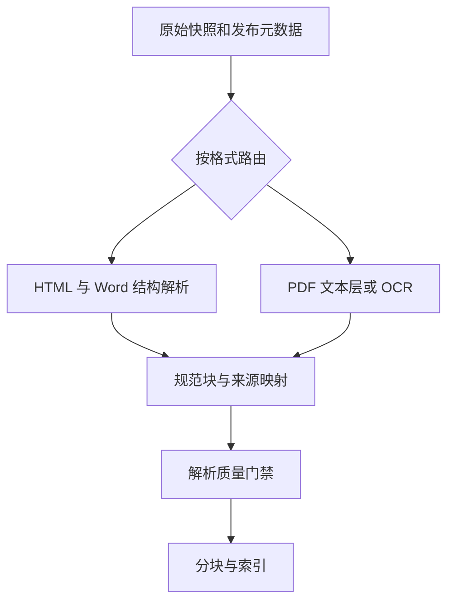
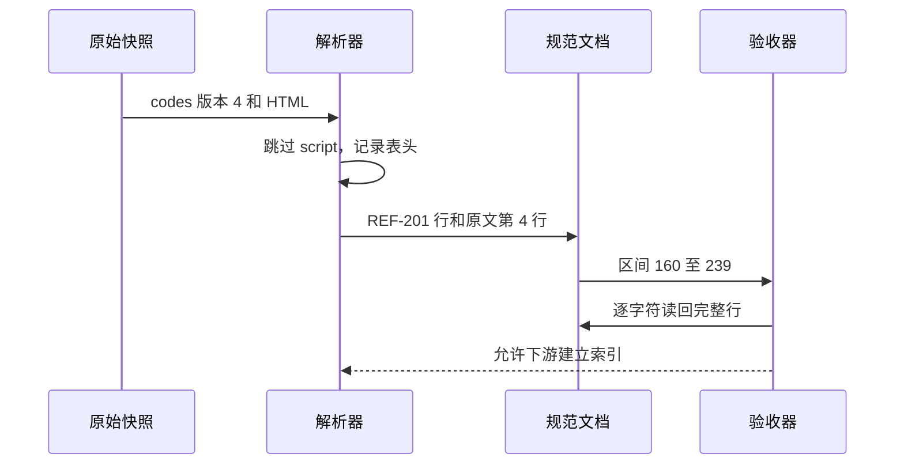

## 表格里有答案，为什么索引里只剩一个错误码？ {#problem}

售后手册列了 `REF-201`、支付处理中、等待结算。错误的提取结果可能只保留第一列，也可能按列读取，把这一行的错误码和下一行的操作拼起来。这样的数据进入向量索引以后，查询可以稳定命中错误码，却拿不到正确动作。直接替换模型或扩大 Top-K，无法恢复入库时已经丢掉的表头。

数据预处理的交付物是**可回查、关系完整、版本明确的规范文档**。本系列从一份合成英语售后知识库开始。文档还包含其他地区、历史版本和仅内部可读的条款，便于观察解析质量与访问范围各自影响哪一步。

## 原始文档、规范文本与来源坐标 {#concepts}

原始文档是来自发布系统的版本快照。规范文本把标题、段落、行记录等结构转成可索引内容。引用时需要同时知道规范文本的坐标和原文的坐标，二者的单位与含义不同。

| 字段 | 实验中的含义 | 生产环境的补充 |
| --- | --- | --- |
| `document_id`、`revision` | 原资料的稳定 ID 和版本 | 加内容哈希或快照 ID，可重查同一次解析 |
| `kind` | 标题、段落、表格行 | 可记录单元格、标题层级、列表层级和版面角色 |
| `source_line` | 原始 HTML 或 Markdown 的起始行 | PDF 用页码与坐标框，扫描件再加识别置信度 |
| `[start, end)` | 规范字符串的字符区间 | 同时标记规范化版本；对外接口约定字符、字节或 UTF-16 |
| `region`、`scope`、`active` | 访问范围、地区、生效状态 | 以服务端鉴权规则和源版本为准 |

比如规范文本里的 160 是 Python 字符索引，不能用它直接切原始 HTML 字符串。规范化会删除标签、去除导航并折叠空白；带表头的文本甚至包含从另一行复制来的词。

## 从版面到结构，保留什么，删除什么 {#principle}

**HTML 的顺序来自标签。** 以正文容器为入口，跳过导航、脚本和样式，保留标题、段落和表格。表格的一行用表头和行值组成字段对，否则下游只有一串并列词。页面内容如果由 JavaScript 加载，应使用可追溯的接口快照或渲染后的正文，保留抓取时间和原始 URL。图片的 `src`、`alt` 与行号单独登记，正文里的图注按普通段落保留。

**Word 的顺序来自主文档流。** `iter_inner_content()` 按段落和表格交错的顺序返回对象，分别遍历 `paragraphs` 和 `tables` 会把两者拆开。标题样式可用于重建层级，`body_block` 加表格行号可定位证据。普通 DOCX 的页码要由排版环境计算，因此实验使用块序号。合并单元格、嵌套表格、批注和页眉需要各自的处理策略。

**PDF 的顺序来自几何。** PDF 可先绘制右栏再绘制左栏。只按纵坐标排序时，两栏相邻的行还会被交错。这里用 `--column-split` 明确给出栏界，跨栏标题或表格把页面分成若干带，带内按左栏、右栏读取。对有画线的表格先提取网格，再排除已被表格占用的普通文本行，防止同一行重复入库。复杂版面要对每页识别栏界、图注与表格区域。多页表需要核对列位置、重复表头和跨页断行后再合并。

**扫描页从图像生成文本层。** 先检查原生文本层。实验把无文字且有图像的页面送去 OCR，生成临时 `TextPage`，再用同一对象提取文字和坐标。有页码或水印的混合页可能通过原生文字检查，用 `--ocr-page` 显式覆盖。图表、流程图或截图可记录页码、位置框、图注与关联章节。只有关键结论存在于图像时，再针对区域 OCR 或解析图表。OCR 文本要带来源方法，置信度门禁需要提供词级置信度的 OCR 输出。

删除导航应按来源区域，例如 HTML 的 `nav` 或 PDF 中跨页高频重复的页眉，避免误删段落里的日期与条款号。不要直接删除标点、负号、连接符或否定词。像 `REF-201` 的连字符、48 hours 的数字单位和 `cannot` 都直接影响语义。字符规范化尤其容易改变偏移，故应完成所有转换后再分配规范坐标，同时保留原文定位。

## 离线入库架构怎样保住证据 {#architecture}



统一实验的检索语料仍使用 HTML、简化 Markdown 和纯文本。格式实验从同一份 `codes` 政策生成 DOCX 和 PDF，复用 `eval.json` 的证据验收。三种格式各自的规范偏移可能不同，同一个格式内的偏移都能切回完整证据。

## 追踪一行退款表怎么进索引 {#execution}



实验中第一条错误码在 HTML 的第 4 行，规范坐标 `[160, 239)`。它被写成 `Code: REF-201 | Meaning: Pending payment | Action: Wait for payment settlement.`。`Action` 来自表头，后面的动作来自这一行第三格。脚本也验证脚本区中的 `REF-999` 和导航不会出现在规范文本里。

## Python 实现与验收命令 {#implementation}

下载 [统一实验材料](/series/rag-context/#rag-lab) 和 [parse_formats.py](/assets/examples/rag/parse_formats.py)，用 Python 3.11 或更高版本执行。格式样本从实验语料现场生成。

```bash
python rag_lab.py parse --document codes
python -m pip install PyMuPDF==1.26.7 python-docx==1.2.0
python parse_formats.py demo --output-dir formats
python parse_formats.py parse formats/codes.docx
```

再将 [Tesseract 英文训练数据](/series/rag-context/#rag-ocr-model) 放到 `tessdata/`，运行扫描页的验收。需要中英文混排时，安装 `chi_sim` 和 `eng` 两份数据，并传入 `chi_sim+eng`。

```bash
python parse_formats.py demo --output-dir formats --ocr-language eng --tessdata tessdata
python parse_formats.py parse formats/codes.pdf --column-split 300 --ocr-language eng --tessdata tessdata
```

代码分成三个阶段。第一步，`html_blocks()`、`docx_blocks()`、`pdf_blocks()` 各自输出文本、原文定位和待复核事项。第二步，`table_rows()` 验证表头非空且唯一，逐行对齐列名和单元格。相同行号重复并不说明内容重复，行号必须和表格所在的页或块一起解释。

```python
joined = " | ".join(
    f"{header}: {value}"
    for header, value in zip(headers, values, strict=True)
)
```

第三步，`parse_file()` 把每块规范化后再分配 `[start, end)`，块之间插入一个换行。因此块偏移可检查 `result["text"][start:end] == block["text"]`，原文定位在块的 `source`。源快照哈希与解析使用同一份字节数据。金标准来自 `eval.json`，而不是从每一种格式的结果重新标注。

| 输入 | 实际回查到的 REF-201 位置 | 复核结果 |
| --- | --- | --- |
| HTML | 源码第 4 行 | 导航和脚本区的假错误码被排除 |
| Word | 正文第 2 块，第 2 行 | 保留 Code、Meaning、Action |
| PDF 文本页 | 第 1 页，第 2 行，边界框 `[50, 144, 550, 168]` | 双栏按左栏、右栏读，表格保留字段 |
| PDF 扫描页 | 第 2 页，OCR 文本框 | 实测读出 `Wait for payment settlement.`；关闭 OCR 时标记待复核 |

## 三种处理方式怎样选 {#tradeoffs}

| 输入状况 | 起步方案 | 主要代价 |
| --- | --- | --- |
| 结构良好的 Markdown、HTML | 保持层级与表格字段的规则解析 | 要明确输入子集，防止模板变化导致静默缺块 |
| 文本型 PDF、双栏、有表格 | 几何版面和表格区域提取 | 页级规则与表格合并需要维护 |
| 扫描件、复杂版面 | OCR 与版面识别，必要时人工复核 | 计算开销与识别错误上涨，需要保留原图 |

按页选择解析器。大部分文件是原生文本时，没有必要为所有页调用 OCR。对扫描页先试可重复的 OCR 基线，只有表格或阅读顺序错得多，才引入更复杂的模型，并用同一批错例衡量收益。

## 入库如何防止静默丢证据 {#practice}

售后系统更新一份政策时，以发布系统的稳定 ID、版本、地区、可见范围和生效时间为准。文件作者、标题等内嵌属性用于回查。入库先记录快照哈希、解析器版本和配置，再检查空文档、每页文字量、表列数、数字单位、异常替换字符和重复页眉。多个来源都包含同一段文字时保留版本与权限上下文，去重粒度限定在可互换的证据上。

线上搜到条款编号但答错动作时，先从候选的来源位置抽查原文。发现表格字段错配时检查合并单元格和表头继承。遇到 OCR 把 `0` 识别成 `O`，先裁切所在单元格复跑并和编号词表核对，复核通过后才入库。对于被识别成文本却阅读顺序错乱的页面，优先检查栏界和跨栏对象。解析器升版先做新旧证据和权限对照，再原子切换索引版本。

延伸阅读见 [pypdf 文本提取](https://pypdf.readthedocs.io/en/stable/user/extract-text.html)、[PyMuPDF 页与 OCR 接口](https://pymupdf.readthedocs.io/en/latest/page.html)和 [python-docx 表格结构](https://python-docx.readthedocs.io/en/latest/user/tables.html)。

## 把规范区间交给下一层 {#next}

规范文档能正确读回来，并不保证候选会包含整条规则。下一篇 [Chunking 实验](/2026/11/19/rag-chunking/) 固定同一份规范文本，观察不同窗口怎么把 `REF-201` 的处理动作切断。[分层故障排查](/2026/11/19/agent-deep-dive-rag/) 再把索引症状和线上证据联系起来。
