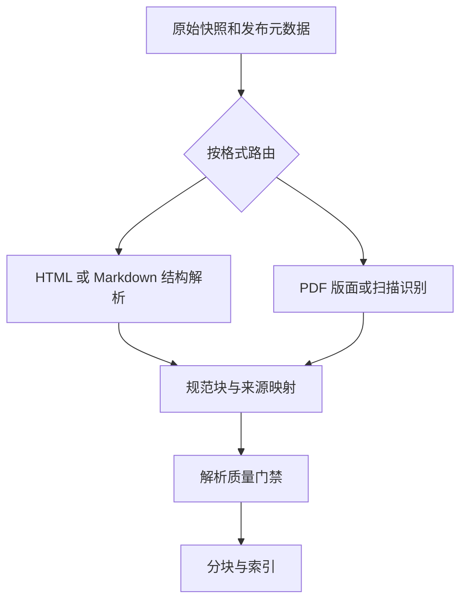
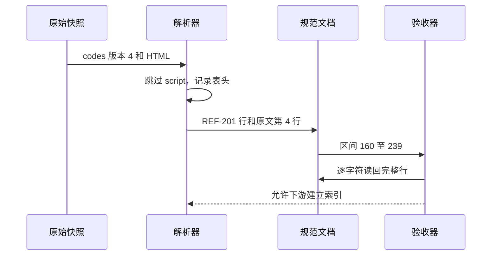

## 表格里有答案，为什么索引里只剩一个错误码？ {#problem}

售后手册列了 `REF-201`、支付处理中、等待结算。错误的提取结果可能只保留第一列，也可能按列读取，把这一行的错误码和下一行的操作拼起来。这样的数据进入向量索引以后，查询可以稳定命中错误码，却拿不到正确动作。直接替换模型或扩大 Top-K，无法恢复入库时已经丢掉的表头。

数据预处理的交付物是**可回查、关系完整、版本明确的规范文档**。本系列从一份合成英语售后知识库开始。文档还包含其他地区、历史版本和仅内部可读的条款，便于观察解析质量与访问范围各自影响哪一步。

## 原始文档、规范文本与来源坐标 {#concepts}

原始文档是来自发布系统的版本快照。规范文本把标题、段落、行记录等结构转成可索引内容。引用时需要同时知道规范文本的坐标和原文的坐标，二者的单位与含义不同。

| 字段 | 实验中的含义 | 生产环境的补充 |
| --- | --- | --- |
| `document_id`、`revision` | 原资料的稳定 ID 和版本 | 加内容哈希或快照 ID，可重查同一次解析 |
| `kind` | 标题、段落、表格行 | 可记录单元格、标题层级、列表层级和版面角色 |
| `source_line` | 原始 HTML 或 Markdown 的起始行 | PDF 用页码与坐标框，扫描件再加识别置信度 |
| `[start, end)` | 规范字符串的字符区间 | 同时标记规范化版本；对外接口约定字符、字节或 UTF-16 |
| `region`、`scope`、`active` | 访问范围、地区、生效状态 | 以服务端鉴权规则和源版本为准 |

比如规范文本里的 160 是 Python 字符索引，不能用它直接切原始 HTML 字符串。规范化会删除标签、去除导航并折叠空白；带表头的文本甚至包含从另一行复制来的词。

## 从版面到结构，保留什么，删除什么 {#principle}

HTML 先保留 DOM 中的块和层次。对表格，以表头和行值组成字段对。PDF 的文本层主要服务页面排版，字符绘制顺序未必是阅读顺序；先判断页面是否有可靠文字，再按栏、行、区域重建阅读顺序。多页表格要识别重复表头，将后续页的行关联到它们。实在只有扫描像素时再进入 OCR，保留页码、位置框和低置信度记录。可参看 [pypdf 的文本提取说明](https://pypdf.readthedocs.io/en/stable/user/extract-text.html)。

删除导航应按来源区域，例如 HTML 的 `nav` 或 PDF 中跨页高频重复的页眉，避免误删段落里的日期与条款号。不要直接删除标点、负号、连接符或否定词。像 `REF-201` 的连字符、48 hours 的数字单位和 `cannot` 都直接影响语义。字符规范化尤其容易改变偏移，故应完成所有转换后再分配规范坐标，同时保留原文定位。

## 离线入库架构怎样保住证据 {#architecture}



教程脚本跑 HTML、简化 Markdown 和纯文本三条路径。图中的 PDF 与 OCR 是生产架构中的分支。复杂表格、合并单元格和双栏要用可处理版面的解析器，之后也输出同一种规范块契约。

## 追踪一行退款表怎么进索引 {#execution}



实验中第一条错误码在 HTML 的第 4 行，规范坐标 `[160, 239)`。它被写成 `Code: REF-201 | Meaning: Pending payment | Action: Wait for payment settlement.`。`Action` 来自表头，后面的动作来自这一行第三格。脚本也验证脚本区中的 `REF-999` 和导航不会出现在规范文本里。

## Python 实现与验收命令 {#implementation}

下载 [统一实验材料](/series/rag-context/#rag-lab)，用 Python 3.11 或更高版本执行。

```bash
python rag_lab.py parse --document codes
python rag_lab.py parse --document return-window
python rag_lab.py verify
```

在 `PolicyHTML.handle_endtag()` 中，每遇到一个单元格结尾，先把该格内容绑定到所在行。行结束后，用表头描述每一列。片段中的 `strict=True` 可以在字段数量不一致时拒绝拼接。

```python
joined = " | ".join(
    f"{header}: {value}"
    for header, value in zip(self.headers, values, strict=True)
)
```

接着 `parse()` 逐块追加规范字符串。块之间统一用一个换行，因此坐标推进为块长度加一。所有程序期待的证据由 `eval.json` 提供，通过唯一匹配绑定规范区间。若在同一版本里找不到该文本、找到两次，或文档不在该问允许的范围内，数据加载立即失败。

## 三种处理方式怎样选 {#tradeoffs}

| 输入状况 | 起步方案 | 主要代价 |
| --- | --- | --- |
| 结构良好的 Markdown、HTML | 保持层级与表格字段的规则解析 | 要明确输入子集，防止模板变化导致静默缺块 |
| 文本型 PDF、双栏、有表格 | 几何版面和表格区域提取 | 页级规则与表格合并需要维护 |
| 扫描件、复杂版面 | OCR 与版面识别，必要时人工复核 | 计算开销与识别错误上涨，需要保留原图 |

按页选择解析器。大部分文件是原生文本时，没有必要为所有页调用 OCR。对扫描页先试可重复的 OCR 基线，只有表格或阅读顺序错得多，才引入更复杂的模型，并用同一批错例衡量收益。

## 入库如何防止静默丢证据 {#practice}

实践中以文件快照、解析器版本和规范化配置记录产物。入库门禁可以检查空文档、表列数、数字单位、异常替换字符、跨页重复率和抽样引用的回查正确性。解析器升级时先对比规范块与来源坐标，再重建相关索引。失败的文件留在隔离队列，避免旧版与半成品并存。

当前脚本解析的是指定 HTML 标签和带标题、段落及代码围栏的简化 Markdown。生产输入如果出现复杂内嵌标签、Markdown 表格、多级表头、页内跨栏和合并单元格，需要单独的解析与样本验收。技术文档里的标准命令常在代码块里，需要先定义这类文档的保留规则。

## 把规范区间交给下一层 {#next}

规范文档能正确读回来，并不保证候选会包含整条规则。下一篇 [Chunking 实验](/2026/11/19/rag-chunking/) 固定同一份规范文本，观察不同窗口怎么把 `REF-201` 的处理动作切断。[分层故障排查](/2026/11/19/agent-deep-dive-rag/) 再把索引症状和线上证据联系起来。
