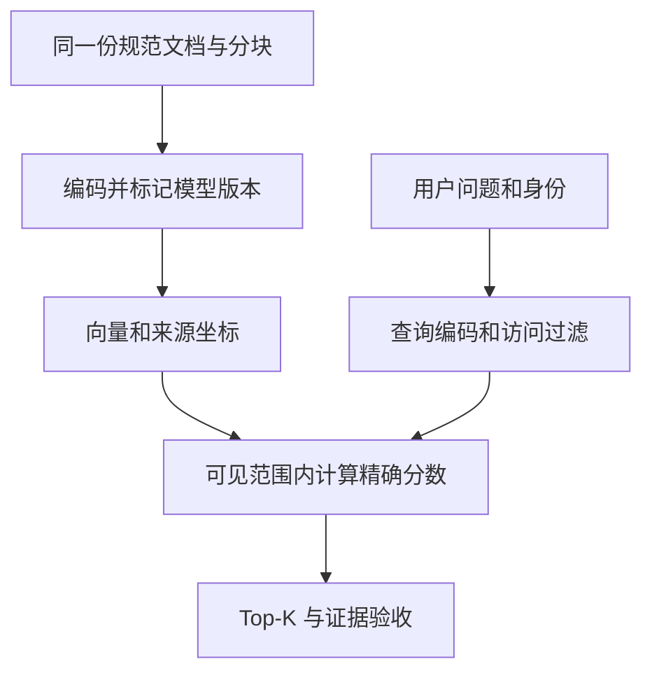
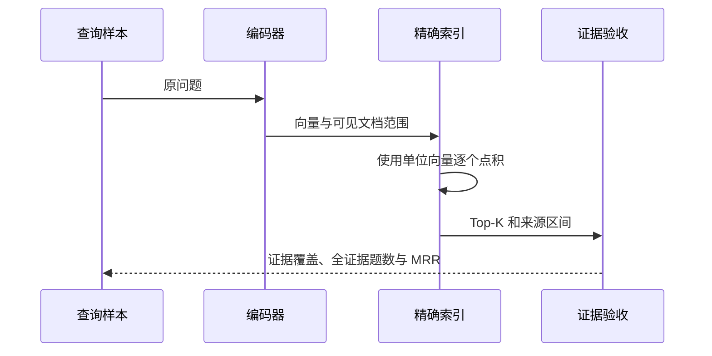

## 为什么错误码和自然语言要分别测？ {#problem}

客服问 `REF-201` 是什么意思时，其字符串本身是很强的检索信号。换成「承运商交接以后还能拦截包裹吗」，用户和政策可能分别用了 `stop`、`intercept`。词频只看重合，稠密向量可以学习词和上下文间的关系，但有时也会把不同编号视作相近。一次选型需要让不同问法进入相同的验收框架。

## 稀疏向量、稠密向量与检索目标 {#concepts}

词频和 TF-IDF 通常以词项为维度，只保存非零权重。稠密编码器用模型输出固定维度的数组，比较向量时通常不直接操作词项。双塔检索允许分别编码查询和文档；两塔可以共享参数，也可以不同。文档可以离线编码而线上只编码用户查询，这是它比逐对交叉编码更容易扩大候选规模的原因。

训练时常把一条查询分别和正样本、若干负样本打分，再用 softmax 计算正样本在候选中的概率。损失取这个概率的负对数。优化时，梯度会提高正样本分值、降低混淆样本分值。相似退款码可作为难负样本，让「意思相近但处理动作不同」体现到排序里。收集负例时还要核对它是否也能回答问题，避免把真实证据错误地作为负例。通用模型上线前仍需测内部编号、政策版本、地区和否定条件。

## 从分词、池化到余弦相似度 {#principles}

以 TF-IDF 为例，本实验对每个可见文档集合统计块级文档频率 `df(t)`，并用 `tf(t,d) × [1 + ln((1+N)/(1+df(t)))]` 为词项加权。越常见的词权重越低。无词项时返回空向量，避免除零或将没有匹配的文档当作候选。

稠密编码器先把文本切成子词 ID，再让每个位置的表示结合上下文。同一个词在「扣款待结算」和「退款已结算」中的位置向量会受周围文字影响。平均池化先用注意力掩码排除填充位置，再对其余位置向量求均值，得到固定的维度。另一些模型用特殊位置向量或投影层。池化方式、截断长度和查询及文档前缀都应和训练约定一致。

点积把同一维度的乘积求和，同时受夹角和模长影响。余弦在分母用各自的 L2 模长抵消这个影响。

<math display="block" aria-label="q 和 d 的余弦相似度等于点积除以两向量模长的乘积">
  <mi>cos</mi><mo>(</mo><mi>q</mi><mo>,</mo><mi>d</mi><mo>)</mo><mo>=</mo>
  <mfrac>
    <mrow><mi>q</mi><mo>·</mo><mi>d</mi></mrow>
    <mrow><mo>‖</mo><mi>q</mi><mo>‖</mo><mo>‖</mo><mi>d</mi><mo>‖</mo></mrow>
  </mfrac>
</math>

例如查询向量为 `(1, 0)`，候选 A 为 `(2, 0)`，B 为 `(3, 4)`。点积把 B 排在前面，分数 3 对 2。余弦把 A 排在前面，分数 1 对 0.6。归一化后模长为 1，因此可用矩阵点积得到余弦。平方欧氏距离在单位向量上等于 `2 − 2 × 点积`，也给出相同排序。如果训练目标使用未归一化的点积，应先实验验证模长是否承载有用信号。参见 [Stanford 向量空间检索教材](https://nlp.stanford.edu/IR-book/) 与 [Sentence Transformers 相似度说明](https://sbert.net/docs/sentence_transformer/usage/semantic_textual_similarity.html)。

## 离线文档编码与在线查询怎样对齐 {#architecture}



向量长度相同并不意味着在同一空间。换编码器、语言模型、归一化方式或提示前缀时，要对文档和查询按对应配置重建。索引至少记录模型标识、权重版本、输入模板、tokenizer、截断策略、维度和相似度。

## 完整执行：把表示误差和搜索误差分开 {#execution}



先用同一组向量对所有允许文档逐个打分。这个精确 Top-K 是以后评估 ANN 的参照。如果精确搜索已找不到证据，应先查表示、分块、截断和访问过滤。这样不会把编码的问题误判成近似搜索问题。

## 标准库基线怎样运行？ {#implementation}

从 [统一实验材料](/series/rag-context/#rag-lab) 下载三文件，用 Python 3.11 或更高版本执行：

```bash
python rag_lab.py embed
python rag_lab.py embed --explain return_and_refund
```

代码先按实验词法分词，再将词频或词频乘 IDF 后归一化。查询期间会取可见片段，同一个范围复用索引。这个词法保留英语连字符编号，中文检索需要适合中文的分词或其他表示。

```python
def cosine(left, right):
    return sum(weight * right.get(term, 0.0) for term, weight in left.items())
```

在相同的 37 个活动块和 Top-3 下，本轮输出如下。

| 表示 | 证据覆盖 | 全证据题数 | MRR |
| --- | ---: | ---: | ---: |
| 词频向量 | 14/16 | 10/12 | 0.861 |
| TF-IDF | 16/16 | 12/12 | 1.000 |

对 `return_and_refund`，脚本可打印每个候选的区间和命中的第几段证据。分数的量纲只在同一种方法内部使用，融合排序时不要直接相加。

## 本地运行两个预训练模型 {#dense}

另下载 [dense_compare.py](/assets/examples/rag/dense_compare.py)，和前三个文件放同一目录。模型首次运行需下载公开 ONNX 权重，不需要模型服务或 API 密钥。建议建 Python 虚拟环境。模型缓存齐全后，可以加 `--offline` 重跑。

```bash
python -m pip install fastembed==0.9.1
python dense_compare.py --cache-dir rag-model-cache
python dense_compare.py --cache-dir rag-model-cache --offline --explain intercept
```

脚本使用 FastEmbed 的 `passage_embed` 和 `query_embed` 走各模型的编码入口，校验向量有限且非零，再归一化。完成编码后只对有权限的候选做精确点积。比较模型为 `BAAI/bge-small-en-v1.5` 与 `sentence-transformers/all-MiniLM-L6-v2`，均为英语模型。依赖与权重说明见 [FastEmbed 支持模型](https://qdrant.github.io/fastembed/examples/Supported_Models/)。

以下是 FastEmbed 0.9.1 在 CPU 的实际输出。两种稠密表示使用相同分块、权限范围和 Top-3，搜索都为精确点积。

| 编码器 | 维度 | 证据覆盖 | 全证据题数 | MRR |
| --- | ---: | ---: | ---: | ---: |
| BGE small EN v1.5 | 384 | 15/16 | 11/12 | 0.917 |
| all-MiniLM-L6-v2 | 384 | 16/16 | 12/12 | 0.944 |

在 `return_exception` 中，BGE 把包含 30 天窗口的块排第一，但这个块在 “excluded” 后截断。完整例外在 `return-window[95:164]`，未进入其 Top-3。MiniLM 把完整例外排第二，故该题取得两段证据。复查时用 `--explain return_exception`，直接对照分数和区间。它区分了块已存在和块没排进候选这两种问题。

实测使用 Python 3.13、FastEmbed 0.9.1 与 ONNX Runtime 1.32.0。权重来自 Qdrant 的 [BGE 快照](https://huggingface.co/Qdrant/bge-small-en-v1.5-onnx-Q/tree/aa8f8b060edb00e03bfdd08813a2949946c8ba55) 和 [MiniLM 快照](https://huggingface.co/Qdrant/all-MiniLM-L6-v2-onnx/tree/d13954661f83248295ba75c1ed411eef3b7b936e)。脚本首次下载使用模型注册表的当前权重，表格对应这里记录的快照。

这批合成问题短，错误码和政策用词与文档高度重合。TF-IDF 在此表现很好。实际业务还要测同义改写、长文截断、相近编号和版本冲突。

## 中文查询如何检索英文政策？ {#multilingual}

同一编码器要让「退货标签在哪里创建」和对应的英语政策靠近，同时拉开「创建标签」与「追踪标签」这类容易混淆的动作。多语言模型可以用翻译对、跨语言查询和相关文档对学习这种对齐。以 Multilingual E5 为例，检索时需要分别添加 `query: ` 和 `passage: ` 前缀，包括非英语输入。前缀约定因模型而异，按模型卡和推理库入口确认。参见 [Multilingual E5 模型卡](https://huggingface.co/intfloat/multilingual-e5-base)与 [多语言 MiniLM 模型卡](https://huggingface.co/sentence-transformers/paraphrase-multilingual-MiniLM-L12-v2)。

实验增加了 6 条中文和 2 条西语查询。它们用 `source_id` 复用原英文题的权限和证据，各自提供对应语言的标准答案。库里的文档仍是英语。固定 Top-3 与同一套分块，英语 MiniLM 和多语言 MiniLM 都输出 384 维。然后对多语言模型的查询与文档同时乘同一固定随机矩阵，再归一化，将输出降到 128 维。随机投影用于观察降维，生产中优先按模型提供的降维接口和自己的评估验收。

```bash
python rag_lab.py embed --query-set crosslingual
python dense_compare.py --cache-dir rag-model-cache --query-set crosslingual --explain zh_return_exception
python dense_compare.py --cache-dir rag-model-cache --query-set crosslingual --model sentence-transformers/paraphrase-multilingual-MiniLM-L12-v2 --project-dim 128
```

| 表示 | 维度 | Top-3 证据覆盖 | 全证据题 | MRR |
| --- | ---: | ---: | ---: | ---: |
| TF-IDF（现有英语分词） | 词表大小 | 1/10 | 1/7 | 0.143 |
| 英语 MiniLM | 384 | 2/10 | 2/7 | 0.214 |
| 多语言 MiniLM | 384 | 8/10 | 5/7 | 0.786 |
| 多语言 MiniLM，随机投影 | 128 | 8/10 | 5/7 | 0.714 |

相同的 384 维下，两种模型的跨语言覆盖差了 6 段证据。降到 128 维后仍覆盖 8 段，但首个证据的排名整体有所下降。具体看中文的退货例外题，多语言模型将包含 30 天窗口的块排到第一，Top-3 仍缺定制商品的例外。用 `--top-k 5` 复跑时，多语言模型覆盖提升到 9/10，全证据题从 5/7 增至 6/7。两种稠密模型也都给无证据题返回了候选。实测权重见 [多语言 MiniLM 的 ONNX 快照](https://huggingface.co/Qdrant/paraphrase-multilingual-MiniLM-L12-v2/tree/faf4aa4225822f3bc6376869cb1164e8e3feedd0)。

## 何时用词项、用向量或两者一起？ {#tradeoffs}

售后系统的订单号、错误码、产品编号适合走精确检索，口语问法可用双塔补召回。跨语言客服应按语言、编号类和多证据题分别报指标，再看编码延迟和部署体积。对 100 万个向量，384 维 float32 原始矩阵约为 1.54 GB，128 维约 0.51 GB，索引结构、元数据和副本另计。维度减少能节省内存和点积开销，是否保留近邻关系需要用同一批候选验证。

排障时先打印实际输入和 tokenizer 长度，检查文档末尾是否在进入编码器前被截断。检查查询与文档索引的模型版本、前缀、池化方式和归一化是否配套。脚本的 `unit()` 会拒绝零向量和非有限值，`visible_passages @ query_vectors[query]` 在允许的索引子集内得到精确排序。模型升级时重建索引，保留旧版本用于对照和回滚。

转向 ANN 前确定精确检索是否能满足数据量及延迟。保留检索对照，避免索引配置变化与换模型同时上。线上可以离线批量编码，查询按稳定的模型和权限策略缓存，按同一配置写索引和回滚。

## 候选返回了，答案仍要验收 {#next}

有向量近邻不等于有可引用的业务证据。基线在 2/2 无证据题上仍给出候选。要在候选、上下文与最终答复之间分别核对范围、版本和证据。接下来可回 [RAG 系列的 ANN 路线](/series/rag-context/#rag-ann)，或先读 [混合搜索与 RRF 的现有笔记](/2026/09/15/hybrid-search/)。如果结果像是把规则切断了，回看 [分块实验](/2026/11/19/rag-chunking/) 的区间诊断。
