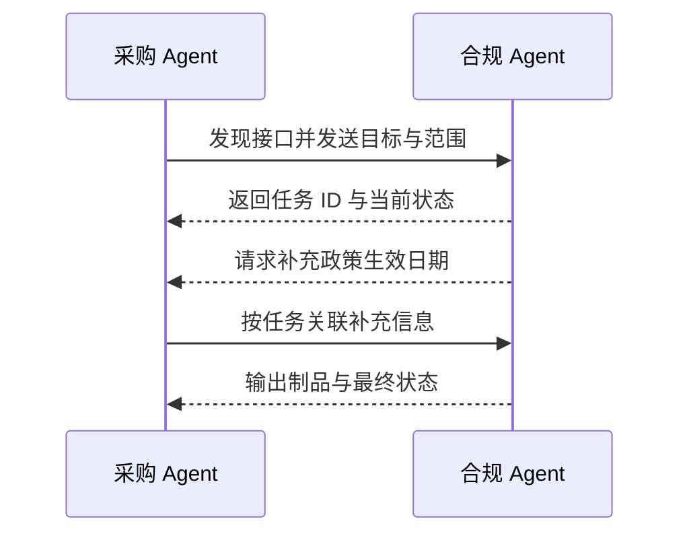

## 委派的是一个目标和交付条件

采购 Agent 需要另一地区的合规团队核对政策。对方独立运行、持有当地知识库，并可能请用户补充生效日。A2A v1.0 定义 Agent 之间的发现、消息和任务契约。调用方可通过已配置位置、目录或约定的 `/.well-known/agent-card.json` 发现 Agent Card，并读取技能、可用接口和安全要求。卡片是接入说明，实际授权需要按远程服务政策判定。

## 一次消息如何变成可跟踪任务

`SendMessage` 可以收到直接的 Message，也可以得到 Task。直接答复适用于短交互。任务用于持续追踪状态和产物。协议将操作语义与具体绑定分开，应用选择双方支持的接口后按绑定编码与发消息。

本地请求为核验华东地区两个条款，远端返回 `task-17` 和一个上下文 ID。若状态提示需要输入，调用方先把「生效日期」交给适当的用户或服务，再携带任务关联继续。远端完成时交付 Artifact，例如含地区、政策版本和允许共享的引用表，原始材料可保留在远端访问域。流式传输可给状态或制品更新。若断线，可在支持和授权条件下重新查询或订阅，再按业务版本处理可能重复到达的事件。

| 对象 | 职责 | 需要保留什么 |
| --- | --- | --- |
| Agent Card | 发现与调用说明 | 可信来源、接口与版本 |
| Message | 用户或 Agent 的交互内容 | 消息身份与任务关联 |
| Task | 一项工作的状态 | 任务 ID、终态以及待补条件 |
| Artifact | 任务产出的结果 | 制品标识、证据来源和验证状态 |

## 跨服务边界要保留本地验收

远端成功状态说明远端按其契约交付，调用方仍核对当前需求、可见范围与结果完整性。取消任务也可能出现已完成、无法取消或结果尚未知的情形，应查实际终态。用同一白名单验证路由、身份和允许输出，分别覆盖即时回复、长任务、缺输入、断开和明确终止。A2A 协作可以与远端内部 MCP 接入组合，二者分别承担任务与工具接口。

## 小结

Agent Card 描述接入，Message 处理交互，Task 表达进度，Artifact 交付结果。可靠的跨服务协作还需要持久关联、权限判断和可核查验收。

## 参考资料

- [A2A v1.0.0 规范](https://a2a-protocol.org/v1.0.0/specification/)
- [A2A v1.0 变更说明](https://github.com/a2aproject/A2A/blob/main/docs/whats-new-v1.md)
