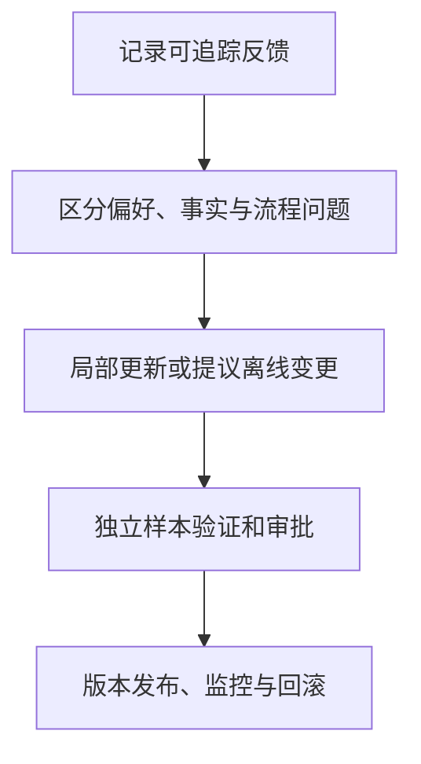

## 反馈进入系统有四个不同去向

用户说「这份报告优先写结论」。系统可更新本轮草稿。若用户明确这是一项长期偏好，可写入有范围的记忆。类似反馈成规模出现，可以离线比较提示或路由策略。模型训练则是另一条带数据治理和验证的路径。把四种更新通道分开，便于解释和撤销。

## 一个坏反馈怎样避免反复放大

某批用户喜欢短答，评分上涨，但合同例外被省略。优化前先区分风格满意度与事实验收，独立评估例外覆盖。旧证据和旧策略仍留可追踪版本。明确哪些反馈可写入当前用户记忆，哪些仅作为待评估建议。撤回偏好后保证派生摘要和未来调用不再复用。

## 成熟度与验收

记忆读写、版本化提示与离线回归已有可用工程做法。复杂系统持续自行发现并正确修复策略，仍需谨慎验证。验收使用独立留出集、关键约束、来源/权限核对和成本统计。每个上线改动都应能关联反馈、策略版本、评估结果和回滚条件。

## 小结

先判断反馈的对象和适用范围，再选择记忆、配置或训练路径。系统改进依赖独立验证和可回滚版本。

## 参考资料

- [LangGraph：Memory](https://docs.langchain.com/oss/python/langgraph/memory)
- [OpenAI：Evaluate agent workflows](https://developers.openai.com/api/docs/guides/agent-evals)
