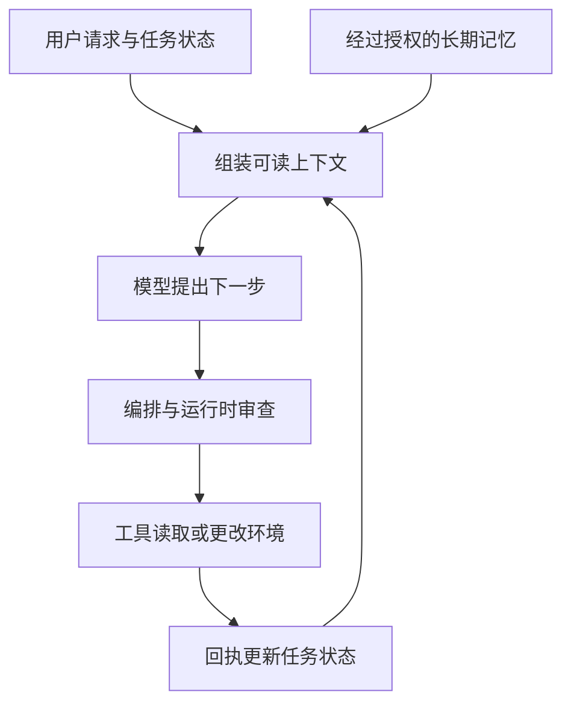

## 为什么一个巨大的对话历史不够用

一个企业差旅助手收到「沿用上次的城市，查最新报销上限」。它要知道「上次的城市」来自已保存偏好或历史事项，还需查询当前有效的政策。处理期间用户可能换城市，检索结果可能超时，任务也可能在之后恢复。仅从聊天记录推测一切，很难确定上次城市、这次选的城市、还有哪些证据，以及哪个动作已经成功。

## 架构里维护的是不同生命周期的数据

| 部件 | 它负责什么 | 典型例子 |
| --- | --- | --- |
| 模型 | 理解请求、组织答复、提出工具或分支 | 在缺日期时提出澄清 |
| Prompt 和 Context | 把指令与本次值得阅读的数据输入模型 | 用户问句、版本范围、候选证据 |
| Task State | 持久记录执行阶段、已完成动作、预算及下一步 | 已确认城市，待查政策，工具回执 ID |
| Memory | 在会话或任务间保存并选择可复用内容 | 用户已同意保存的出差偏好 |
| Planner | 表达目标、子任务、依赖和需要重规划的条件 | 查政策前先确定出差日期与地点 |
| Tool 与环境 | 环境承载当前真实状态，工具定义受控读写界面 | 政策数据库、查询工具和单据服务 |
| Orchestrator 与 Runtime | 前者组织分支和顺序，后者落实执行、状态和守卫 | 选择下一节点、做授权、执行、记录回执 |

同一代码库可能没有分成七个服务，职责界线仍可存在。模型只接收状态的一种投影，不必看到完整任务快照。环境可能在运行时之外，最后状态必须通过工具或业务回执获取。Memory 有写入策略、保留期和删除行为。知识库 RAG 通常提供组织材料。个人记忆则按用户和目的受控调取，即使它们共用向量索引，可信来源、作用域和更新周期也不同。

## 一次请求怎样穿过不同边界

宿主先创建本次 Task State，写入请求身份、目标、预算和政策时点。检查当前用户允许读取上次偏好，再作本次上下文快照。若本次问句省略了城市，能从所在任务识别明确的上次记录时可把城市作为待确认或有来源的参数。模型，或 deterministic router，选择调用政策检索。工具回填携带查询条件、文档版本、引用位置和状态。运行时更新证据索引，再为模型组装答案所需的少量材料。生成后，它可以核对是否引用当前版本与正确城市。

若工具查询已完成而 Worker 重启，任务状态可告诉调度下一步是生成或核对，不必依赖模型从聊天里推断。若政策服务有写操作，需要业务端幂等键与可信回执；模型提示和状态快照承担不同责任。上下文里出现了「审批成功」字样也不能单独更新外部业务事实。

## 设计时先问职责归谁

决定谁写入某种数据，谁可以读，哪一层有最后决定权。用户偏好、事实证据、模型建议和调度元数据可以使用同一数据库，却分别设读取范围、版本规则和验证方式。每次调用构造最小可用的 Context，并给外部来源标明确切身份。这样能让检索错误、影子状态和恢复缺陷被定位。

## 小结

Context 是一次模型调用的输入，State 是运行进度，Memory 是可跨任务选择的历史，Environment 提供外部真实状态。编排决定先后，运行时实现受控执行、反馈与恢复。

## 参考资料

- [Anthropic：Building effective agents](https://www.anthropic.com/research/building-effective-agents)
- [LangGraph 官方文档：Persistence](https://docs.langchain.com/oss/python/langgraph/persistence)
