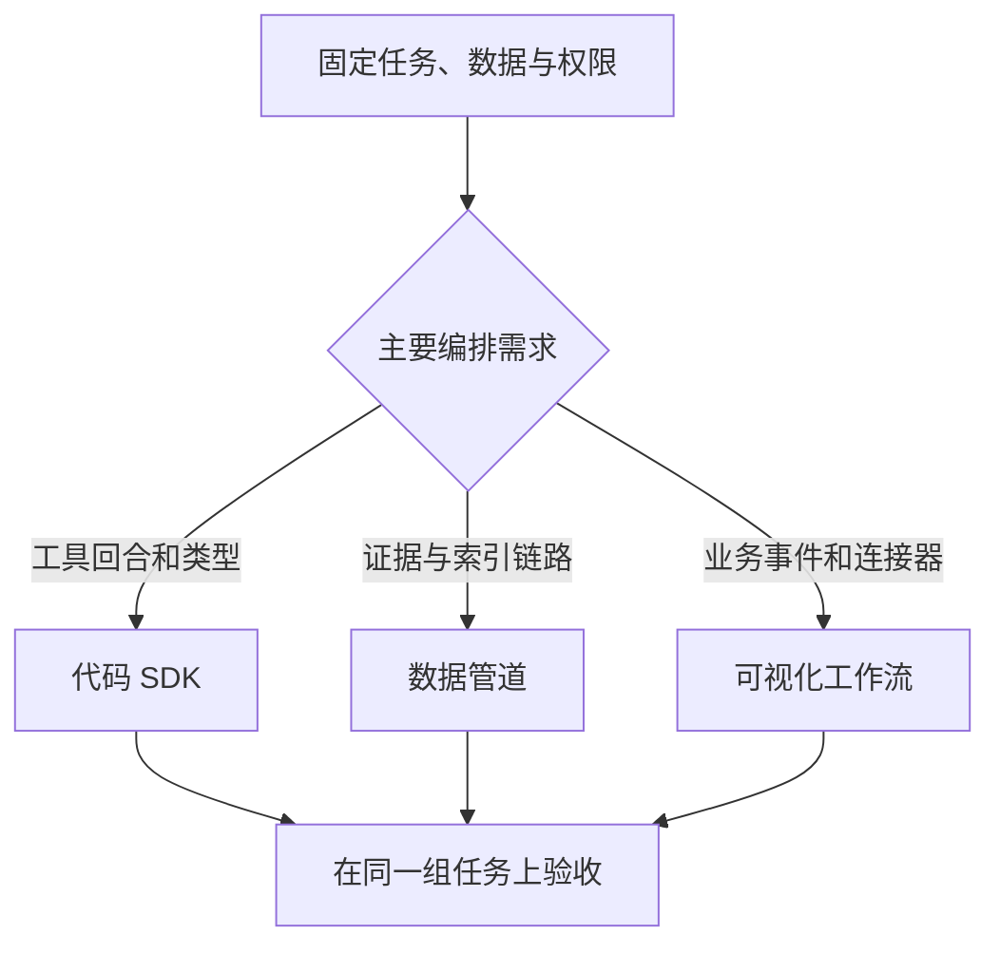

## 用一个任务看控制权落在哪里

企业内部助手要执行「用户提问、检索两类文档、有必要时请求补充、输出带引用说明」。对照方案前固定数据、模型、权限与验收条件。预先保存相同的 30 条样本和两条故障场景，例如工具超时和权限变化。分别测证据覆盖、恢复、延迟和二次调整成本。

| 生态 | 主要抽象 | 选择依据 |
| --- | --- | --- |
| OpenAI Agents SDK | Agent、Runner、Tools、Handoff 等 | 用代码组织模型回合、交接和会话，适合清晰的工具调用循环 |
| Google ADK | Agent 与工作流 Agent、会话和事件 | 在模型决策之外表达顺序、并行与循环 |
| Pydantic AI | Python Agent、依赖注入和类型化输出 | 业务已用 Python 类型与验证，重视输出契约 |
| Haystack | Component 与 Pipeline、文档和检索 | 需要调试、替换检索或生成管道组件 |
| Dify | Workflow / Chatflow、知识接入与可视化节点 | 适合产品与工程共建知识问答和会话流 |
| n8n | 触发器、节点、外部集成与 AI 组件 | 已有事件自动化或跨 SaaS 操作，模型承担其中的语义任务 |

## 用一个失败样本验证迁移成本

假设企业换了向量模型，召回命中但引用落在旧版本。先确认检索组件与生成组件是否有独立版本。代码 SDK 方案可以以检索工具契约返回 `source_id` 和 `revision`。Haystack 方案可对照流水线中候选与生成实际文档。Dify 或 n8n 要检查发布版本和节点输入输出，确认能够导出配置、回放事件并追踪凭据归属。所有方案都必须从真实证据检查引用。

模型接入、路由和本地推理可由独立适配器承担。比较项目固定接口、流式协议和资源占用，而不是假定某 SDK 都支持任意模型。把结构化回执、源 ID 和授权上下文设为独立契约，工作流可以在不同生态间选择或组合。若需要外部写入，使用明确的批准与业务回执。

## 小结

先选任务所需的控制边界，再比较工具循环、数据链路、类型验证和可视化编排成本。只有在同一输入和同一验收下，生态选型才可复查。

## 参考资料

- [OpenAI Agents SDK：Agents](https://openai.github.io/openai-agents-python/agents/)
- [Google ADK：Agents](https://google.github.io/adk-docs/agents/)
- [Pydantic AI：Output](https://pydantic.dev/docs/ai/core-concepts/output/)
- [Haystack：Pipelines](https://docs.haystack.deepset.ai/docs/pipelines)
- [Dify：Workflow Studio](https://www.dify.ai/workflows)
- [n8n：Integrate AI](https://docs.n8n.io/build/integrate-ai.md)
