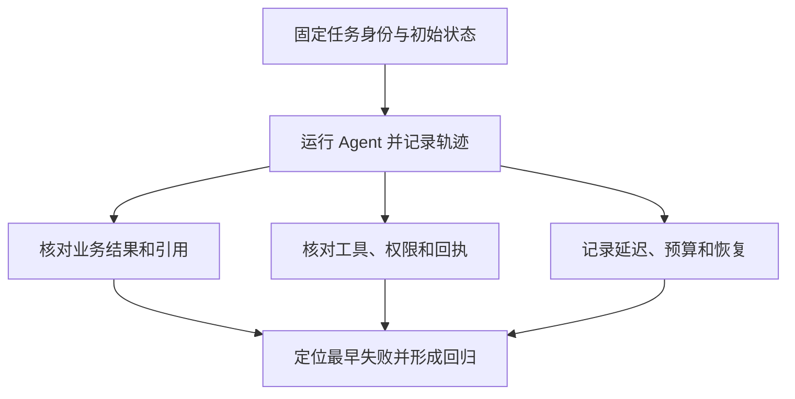

## 「答复不错」与「任务完成」可以相差一步写入

客服 Agent 被要求取消一个尚未发出的订单。它回复「已取消」，文风符合标准，但实际后台仍显示待处理。另一条任务要求解释规则，答复正确，却多调用了带有隐私信息的内部工具。用户看到了貌似合理的回复，两条轨迹的失败原因完全不同。Agent 评估要看任务完成、关键行为约束、恢复和效率，不应只对最终文本评分。

## 任务样本需要保存初始环境和验收条件

一条回归样本可以包含输入、用户身份、可用工具、初始业务状态、标准政策版本、允许的副作用、验收断言和时限。写入任务以真实或模拟服务的最终状态和可信回执为准。问答任务用出处与原子声明衡量。操作者意图模糊时，合理的终点可以是提出澄清并进入等待，而非猜测一个操作。允许不同策略完成同一目标，只对必须的业务行为强制顺序，例如没有授权就不能提交写入。

## 四组指标各回答一个问题

| 层次 | 示例 | 如何解释 |
| --- | --- | --- |
| 任务结果 | 合格任务比例、目标完成或正确澄清率 | 主要用户效果，分母要写清 |
| 工具行为 | 工具选择正确率、参数准确率、错误流程中的恢复 | 定位失败发生在选择、校验或执行 |
| 约束 | 越权尝试或执行、隐私回显、非预期写入 | 高影响事件单列，不靠平均结果掩盖 |
| 效率 | 完成时间、调用次数、Token、成本与 P95 | 固定负载和模型配置，按成功与失败分开看 |

工具调用准确率要说明是预测了哪一个名称、参数是否逐字段命中、是否应调用以及调用是否成功。对允许替代工具的任务，不能只按唯一参考轨迹判错。任务成功率的分母通常是这一批有效任务，超时或无法完成应按预设状态计入。多 Agent 测试还可记录交接信息缺失、重复工作和冲突处理。

## 评估器、样本和结果怎样控制

确定性项目优先用断言，例如回执存在、状态变化、报价等于规则结果。开放性文字可用人工量规或经校准的模型评估，记录评估器版本与输入。对拒绝、引用、金额边界和字数差异等样本做人工校准，抽查争议或高影响结论，避免评判器奖励长回复。比较新旧版本时用同一环境快照与相同任务，随机性要求多次运行，按样本成对比较并记录波动。可在环境里布置超时、无权限、目标变化和旧版本数据，覆盖正常任务之外的变体。

线上收到差评后，沿业务回执、模型决策、权限过滤和状态事件定位最早错误。以脱敏可重现的方式把例子加入回归集，避免只对某条模型输出做表面提示修补。

## 一次发布对照怎样计算指标

假设固定回归集有 120 个有效任务，按提交、查询、澄清与拒绝分别指定可接受的业务终态。候选版本有 102 个达到各自终态，任务成功率为 85%。其中 50 个任务预期至少调用一次特定类别的工具，候选在 46 个任务中提出了允许工具，任务级工具选择召回为 92%。这 46 个任务中有 42 个通过关键参数核验，条件参数准确率约为 91.3%。20 个应完全不调用工具的任务中有 2 个误调用，误调用率为 10%。这些分母不同，应并列展示。若讨论逐次调用或逐字段准确率，另外列出相应分母。

### 把质量变化写成能复查的发布判断

对同一批任务，基线和候选都成功的有 95 个，仅候选成功的有 7 个，仅基线成功的有 5 个，两者都失败的有 13 个。候选成功率比基线高约 1.7 个百分点。决策重点是这 12 个结果变化的任务分别发生在哪一层，以及 5 个回归中是否出现了关键安全失败。关键越权写入按业务规则单列门槛。记录有效样本数与重复运行结果，因为两个百分点的变化未必超过波动。发布回归应留输入和证据版本、判分记录、变更范围与判定理由。

## 小结

先写清任务成功和行为底线，再分层观察工具、状态、质量、耗时与成本。可核查的业务状态、固定数据和可复跑样本比单个综合分更有诊断价值。

## 参考资料

- [Yao 等：τ-bench](https://arxiv.org/abs/2406.12045)
- [Zheng 等：Judging LLM-as-a-Judge](https://arxiv.org/abs/2306.05685)
