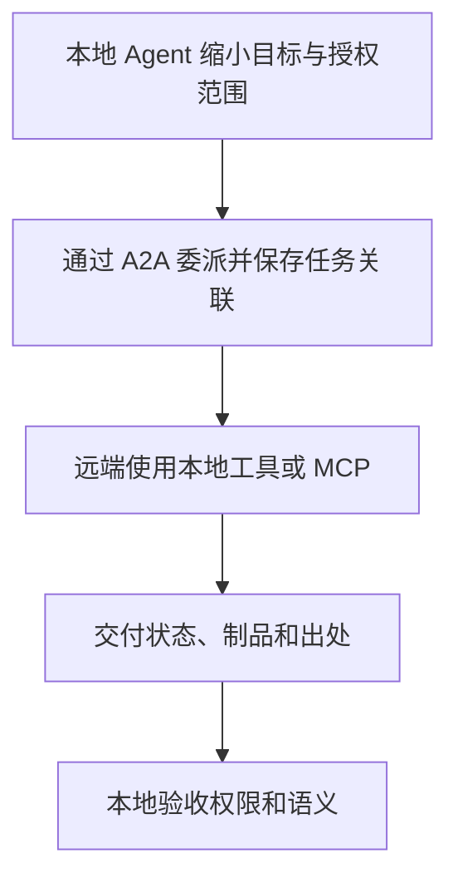

## 协议对接解决的是哪些层

采购 Agent 需要让异地服务核对一份虚构合同，只共享条款编号和必要范围。它读远端 Agent Card 并委派 A2A 任务。远端服务可通过 MCP 查当地政策。返回时用可访问的引用和明确状态表达结论。双方不共享完整会话或工具凭据。

## 把兼容拆成三种检查

先核对传输、协议版本和能力声明。再核对身份、数据用途与接收方。最后确定取消、缺证、失败、回执与可接受制品的业务语义。比如远端的「完成」可能只是找到一个引用，而本地要求两个地区均给出处。验收在本地对照原始目标，保留部分完成和冲突状态。

## 哪些互操作已经可用

MCP 和 A2A 已提供可引用规范，但具体实现支持的版本、鉴权、可选能力和事件查询语义需实测。准备双方版本矩阵，记录补问、取消、断开与重复交付的预期结果。协议适配层负责转换字段与状态，业务层仍有自己的证据、授权和审计。

## 小结

互操作同时依赖消息、身份和任务语义。协议让通信可组合，本地验收确认跨服务结果是否满足目标。

## 参考资料

- [MCP：2026-07-28 Specification](https://modelcontextprotocol.io/specification/2026-07-28)
- [A2A：v1.0.0 Specification](https://a2a-protocol.org/v1.0.0/specification/)
