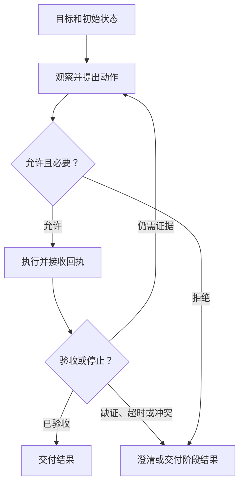

## 不能把一次生成误当成一次任务完成

售后请求是「订单 A 的物流两天没更新，看看能不能补发」。用户真正需要的是处理进展和可依据的下一步。系统首先应分清「查看状态和建议」与「实际补发」。前者需订单、承运商状态和政策，后者可能还需人工审批。任务启动时，将交付内容、允许的动作、截止时间、轮次与终点写入状态。若把用户需求直接交给模型并接受一句「已处理」，任何现实变化都没有可验证的依据。

## 运行循环内部如何推进

可以把每轮看成从任务状态 S 到下一状态的迁移。运行时构造本轮观测，包含当前任务事实、最近回执与仍缺的信息。模型根据观测提出候选动作，程序在执行前验证目标、参数、权限及剩余预算。外部工具返回成功、拒绝、超时、空结果等事件，再由运行时写入状态。若没有合适动作，询问用户或终止，仍然是合法迁移。可记录的是行动理由摘要、输入输出及证据，而不是依赖模型暴露内部思考过程。

## 把一条请求跑一遍

第一轮，已确认用户能查看 A，调用「查订单」。外部系统说包裹已交接给承运商，返回运单和时间。第二轮，使用该回执去查承运商。发现记录只有交接前扫描，接口观测的查询时间和缺口被保存。第三轮，检索当前适用的服务承诺条款。证据若只说明「72 小时无更新可人工处理」，两天不满足条件，系统交付可查记录和时间点。若政策允许提前申请，还需要确认请求动作的影响、业务规则和是否要授权。用户只问「能否」，答案评估应聚焦判断而非强行写入。

若承运商请求超时，系统只知道这次没有收到结果，不能据此称包裹没有更新。读操作可以按超时预算重试或标记缺证。写操作超时意味着结果未知，应先通过业务回执或幂等键查询是否已提交，再根据后端契约决定重试。不同失败绝不能都折叠成一句「工具错误」。

## 怎样证明循环应该停止

至少设三类出口。第一类是成功：关键事实和来源齐全，业务验收规则通过。第二类是需要外部输入：缺少用户确认、权限或业务必要字段，任务进入等待或澄清。第三类是有界失败：预算耗尽、同一动作无进展、工具持续不可用或观测冲突，交付已完成步骤和剩余未知。轮次上限是硬约束，还应监测语义重复、无新增证据和重复动作。可以把最后一个工具返回、状态版本与触发条件写入追踪，读者能核查系统为什么停。

## 与固定流程、工具及状态的关系

固定流程可用相同观测、回执和验收模型，只是下一步由预设条件决定。试点可先将身份判断、金额、写操作审批交给规则，把较不确定的查证路径交给 Agent。如果任务有多个确认过的依赖，可先规划，再在局部循环补齐。层次设计减少较低风险的探索对最终交付的影响。

## 小结

让任务循环显式保存「已知事实、可能动作、最新回执和验收状态」。每轮发生可追踪的状态迁移，才有能力处理恢复、无进展和部分完成。

## 参考资料

- [Yao 等：ReAct](https://arxiv.org/abs/2210.03629)
- [Anthropic：Building effective agents](https://www.anthropic.com/research/building-effective-agents)
