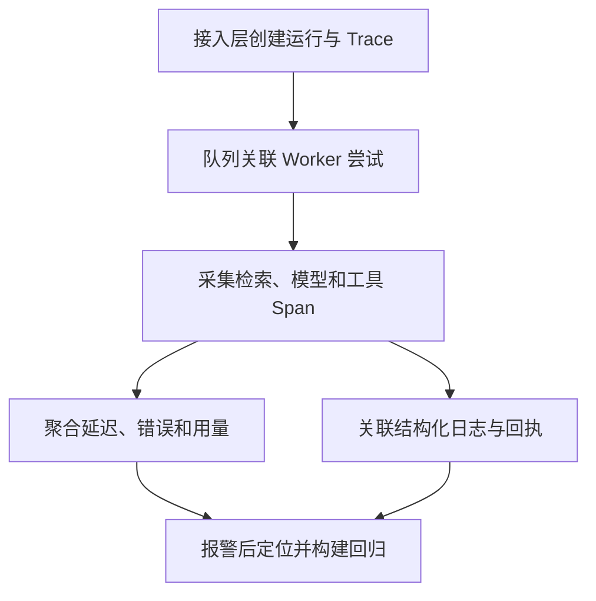

## 一个超时报警怎样找到实际瓶颈

政策助手的端到端 P95 从 1.2 秒变为 2.1 秒。仅查询模型 P95 不能判断原因。应用至少记录入队、领取、两路召回、合流、模型和验收的时间，并以统一 Trace 关联。若慢样本在领取前就等待 700 毫秒，应继续看 Worker 容量和裁剪策略。如果领取及时而重排请求积压，干预点则在下游或批处理。

## 三类信号各解释一部分事实

| 信号 | 回答的问题 | 适合保留 |
| --- | --- | --- |
| Metrics | 某类请求多久、失败多少、资源是否饱和 | 分布、计数、队列深度与低基数维度 |
| Traces | 某次运行的阶段、关键路径和故障位置 | Span 开始结束、父子或链接、响应类别与版本 |
| Logs | 具体错误、发布或恢复事件说明了什么 | 结构化类型、时间、关联 ID 与受控摘要 |

有异步任务时，生产者向消息系统传播可识别的追踪上下文。消费者根据任务与尝试建立 Span，可用 Span Links 表达跨批次或一对多关联。运行 ID 是业务键，Trace ID 是遥测关联键，历史采样或丢失 Span 时仍能用业务记录查终态。重试单独记录尝试，避免两次尝试被统计为两个成功任务。首 Token、生成结束与业务验收完成分别计时。

## 从采样、标签和权限约束观测成本

为 HTTP 路由、模型版本、工具类别和结果类型设有限维度。每个用户、提示全文、任务 ID 适合在受控诊断记录查询，避免形成高基数指标。指标汇总独立于 Trace 采样。若希望提高失败 Trace 保留率，可以在支持的后端基于完整跟踪信号做尾部采样，同时考虑缓冲开销和未到达的 Span。GenAI 语义约定随版本演进，记录采用版本并在升级时校验仪表盘维度。

演练时主动制造一次测试队列积压和一次受控工具超时。检查警报能否按版本、运行类型快速分层，团队是否能从 Trace 跳到真实回执。检查导出前敏感字段是否清除，以及审计记录与可观测信号的访问权限是否独立。

## 小结

先用指标发现变化，再用 Trace 定位一次运行，最后用日志和实际回执核对原因。用有限维度、采样与访问策略控制成本和隐私。

## 参考资料

- [OpenTelemetry：Traces](https://opentelemetry.io/docs/concepts/signals/traces/)
- [OpenTelemetry：GenAI 语义约定](https://opentelemetry.io/docs/specs/semconv/gen-ai/)
- [Prometheus：Histograms](https://prometheus.io/docs/practices/histograms/)
