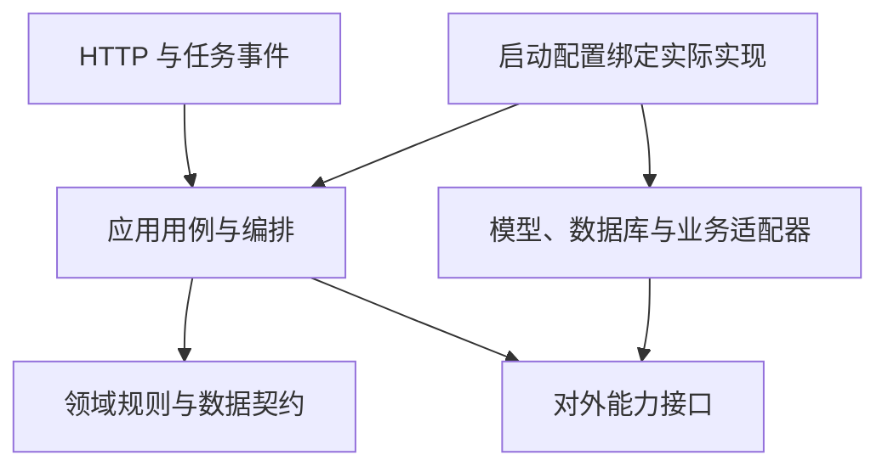

## 从一条真实请求寻找模块边界

政策核查服务接收地区、日期和事项，返回可核对的结论，必要时生成草稿。HTTP 入口验证用户身份并分配任务 ID。用例决定执行哪些业务阶段。领域规则判断证据是否在适用日期，草稿是否具备批准资格。搜索、模型、队列和工单 API 经适配器接入。

| 代码位置示例 | 职责 | 独立验证 |
| --- | --- | --- |
| `entrypoints/` | 身份、请求形状、序列化与路由 | 无权限或会话不存在时的响应 |
| `application/` | 编排、重试归属、任务输入输出 | 工具失败后进入正确的结果状态 |
| `domain/` | 证据适用性、操作准入等规则 | 时间边界、主体和金额阈值 |
| `adapters/` | 模型 SDK、索引、数据库和外部工具 | 协议、超时及真实回执转换 |
| `bootstrap/` | 按环境解析配置并注入依赖 | 错误配置在启动时明确失败 |

目录可以随规模合并。关键是依赖方向：应用定义需要的能力，适配器实现它。业务对象表达政策版本与证据坐标，模型消息只属于适配层。模型产生的候选引用进入应用后，经真实证据集核对再形成业务结果。

## 配置和版本也是任务输入

开发环境与生产使用不同凭据、数据集、限流和写权限。配置进入进程时检查格式、必要字段和相互冲突的值。依赖包锁定可复现版本。运行记录写下模型标识、提示版本、工具契约、索引代和工作流版本，恢复时不直接继承过时授权。结构化日志用任务 ID 串联阶段，保留错误类型和证据 ID。敏感参数留在受控系统，避免整段对话被默认复制到日志。

用一份固定的核查任务验证分层效果。切换模型适配器后，业务验收仍按相同证据和批准规则运行。模拟搜索返回过期政策时，用例转入补证。模拟草稿服务已写入却超时，工具适配器报告结果未知，由用例调度回执核对。

## 小结

项目分层的价值是能替换实现、独立验证规则，并为真实请求保留可追踪的运行版本。规模扩大时，再按容量和权限决定服务间的部署边界。

## 参考资料

- [Python Packaging：pyproject.toml](https://packaging.python.org/en/latest/guides/writing-pyproject-toml/)
- [LangGraph：Application structure](https://docs.langchain.com/oss/python/langgraph/application-structure)
