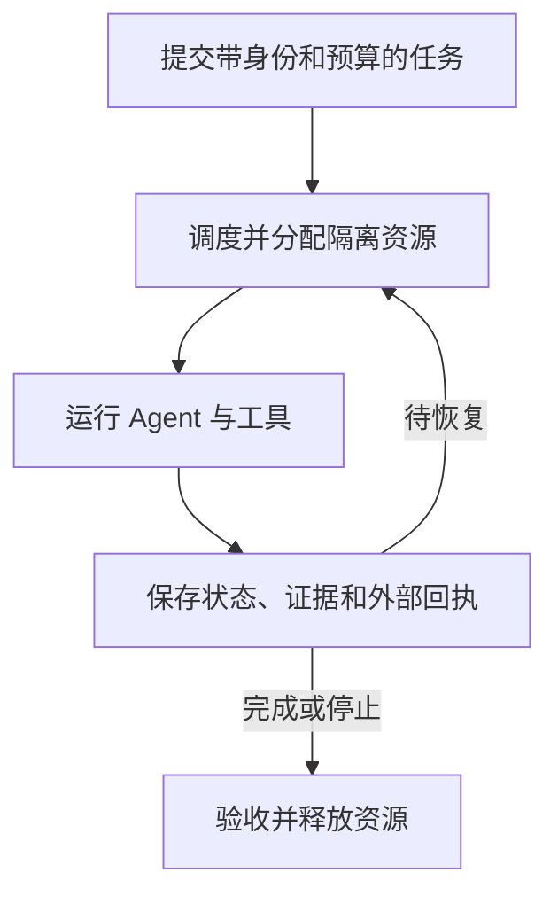

## 一个循环在什么时候变成运行时

三条报告任务并发执行，一条需要等人工批准，一条要回放，一条在同一租户预算内排队。单请求的模型循环无法解释谁持有资源、状态在哪里和失败是否重试。运行时将任务生命周期、调度、权限、工具调用与证据组织成可管理的系统。Agent OS 是描述这种抽象的一种类比。

## 状态迁移和资源调度的边界

新 Worker 可读取同一任务的持久状态和证据版本。跨部署迁移需要校验状态 Schema 与工具契约，恢复要重新验证身份和目标资源。CPU、文件访问和网络通常由进程、容器与平台安全设施约束。Agent Runtime 维护的还是应用层任务、预算、策略和动作。

一个旧任务已发起外部动作但未收到结果。运行时重启后先查原操作回执，再决定等待还是重试。若同一租户高负载，调度器也须保证其他授权任务能取得预算。保留版本、尝试次数、队列时间和失败类型用于解释行为。

## 成熟能力与研究假设

持久工作流、分租户调度和工具沙箱已有工程实现。跨框架完整迁移、自适应资源编排和通用长期记忆仍需针对业务验证。MemGPT 等工作借用分层内存解释有限上下文管理，不能从类比推断其具有操作系统的授权和隔离能力。

## 小结

将调度、状态、权限及业务回执组织成独立层次。评估重点是能否稳定恢复、分配资源并保留可核查结果。

## 参考资料

- [MemGPT：Towards LLMs as Operating Systems](https://arxiv.org/abs/2310.08560)
- [Temporal：What is Temporal?](https://docs.temporal.io/temporal)
