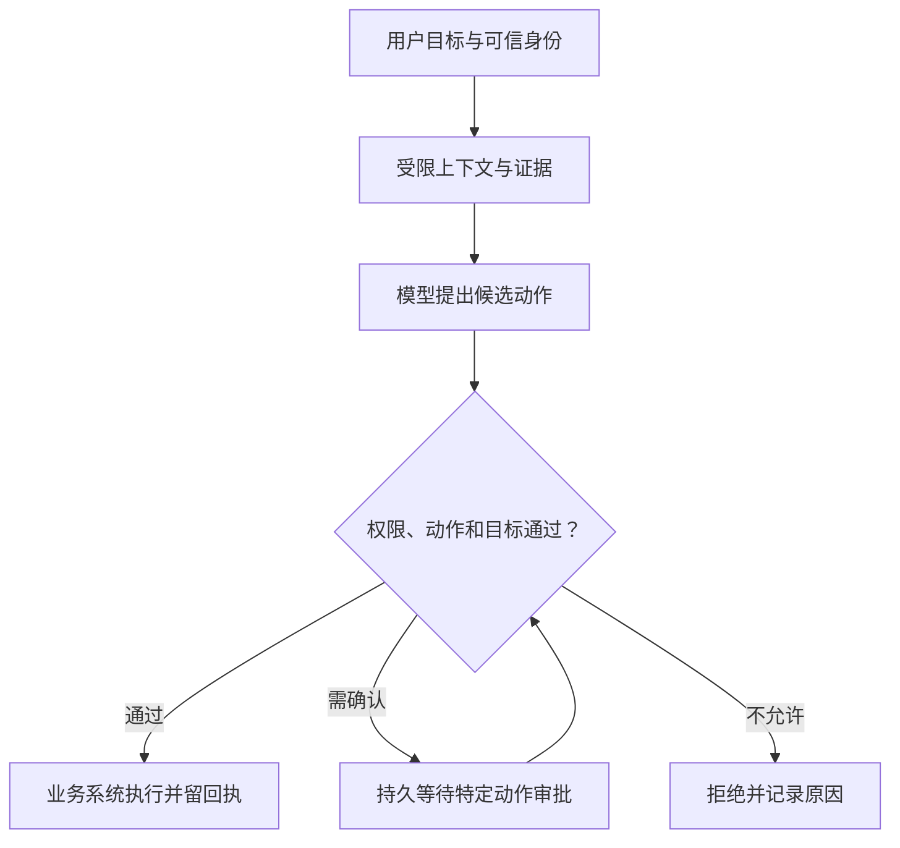

## 数据进入上下文，不会自动获得权限

员工请 Agent 对比两份合同。办公室文档、网页、工具响应和其他 Agent 的制品，可能包含看似命令的文字。若模型根据这些数据改变任务并提议跨租户读取或对外操作，就出现信任边界问题。间接提示注入指模型在处理外部内容时受到其中指令影响。开始设计前，区分可信身份和策略、用户本次意图、外部证据以及模型提议。

## 检查权限需要覆盖实际执行入口

| 边界 | 实施办法 | 验收方式 |
| --- | --- | --- |
| 资料与检索 | 根据可信身份过滤，裁剪无关字段，保留出处 | 同编号多租户与撤权后读回 |
| 模型和工具注册 | 隔离外部数据和应用策略，按任务暴露有限工具 | 同一输入只得到相关能力 |
| 实际执行 | 校验操作、资源、权限、参数及目标，向业务服务重验 | 拒绝时外部服务状态无变化 |
| 外部网络或文件 | 仅通过受控连接器和沙箱访问许可范围 | 使用无害替身验证拒绝和回收权限 |
| 审批与审计 | 明确展示动作和接收方，保存批准版本与真实回执 | 参数变更须重新验证，可解释谁批准什么 |

对有远程读取能力的 Agent，浏览器/HTTP 服务应使用平台受控出站策略。若产品允许用户提供 URL，由独立网络边界限制目标和读到的数据，拒绝不可授权的地址空间及配置。网络到达权限和业务数据读取权分别控制。模型输出需要在具体使用场景验证，例如写入数据库时使用类型与参数化调用。外部文本、引文及工具响应进入展示层前，也要按其用途安全渲染。

## 用审计证据验证拒绝和恢复

设计三个受控验收场景。普通合同核查能交付；外部材料出现与任务不相干的操作请求时，服务不产生外部动作且有清楚解释；暂停后撤回授权，原批准不能被重放。记录术语清晰的结构化原因、主体、工具与动作标识、版本和业务终态。审计存证设置访问控制和保留期，正文、凭据等数据避免默认进入日志。

## 小结

将证据、模型提议与执行权限分开。以独立工具授权、具体动作批准、网络与数据隔离、业务回执和审计组成闭环。

## 参考资料

- [OWASP：AI Agent Security Cheat Sheet](https://cheatsheetseries.owasp.org/cheatsheets/AI_Agent_Security_Cheat_Sheet.html)
- [OWASP：LLM Prompt Injection Prevention](https://cheatsheetseries.owasp.org/cheatsheets/LLM_Prompt_Injection_Prevention_Cheat_Sheet.html)
