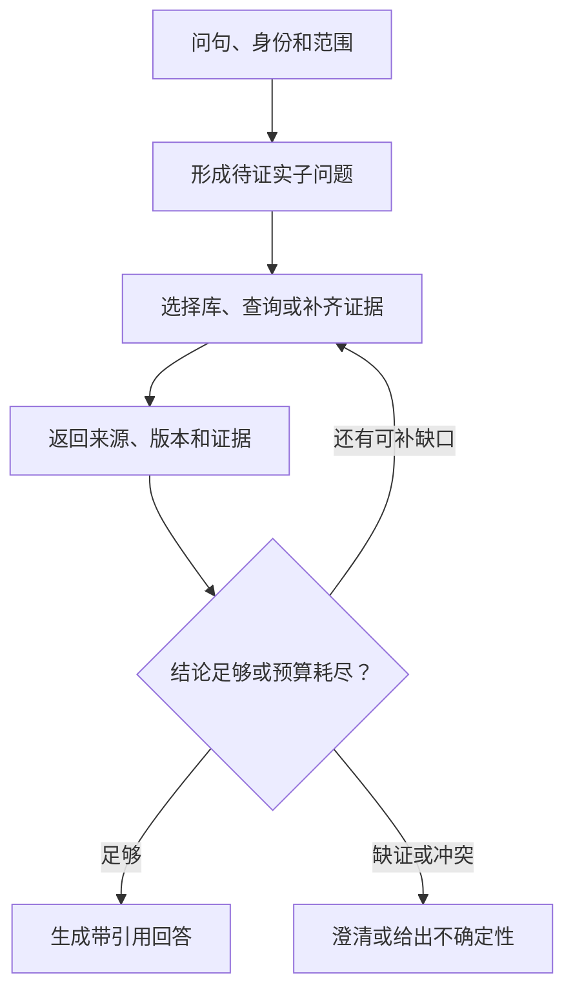

## 当第一轮搜索无法回答用户的全部问题

员工问「海外子公司的设备转给总部，是否要按固定资产流程，谁办跨境审批？」固定资产政策给出通用转移条件，却未覆盖跨境。系统必须识别缺口「跨境审批」，转到另一个知识库查找，并判断两份资料的适用范围是否一致。单轮 RAG 可以预先配置多库并行，Agentic RAG 的额外价值是依据观察决定下一步，诸如在已定位到通用制度后只补跨境材料。

## 路由、证据与控制权

把检索建模成受控动作。应用可以允许「查询政策」「查找已经授权的历史版本」「按证据 ID 展开相邻段落」，并根据用户身份在模型看到工具之前限定集合。证据状态包含子问题、已找到的独立来源、版本、支持与冲突、用过的查询、剩余预算及截止时间。每轮模型读取精简状态提出下一步，运行时验证工具和参数、执行并记入新状态。把所有旧搜索结果塞回对话会反复消耗上下文，还容易只看到相似重复。

第一轮查到「常规转移需接收部门批准」。第二轮查到跨境资料说「跨法人交易先由税务核对」。如果用户未说子公司和总部是否为不同法人，应问清，或者按两个条件分别回答并注明不同结论。增加一次几乎相同的「子公司调拨跨境」搜索不能补足缺失的业务事实。动态查询应该指向明确的子问题，而非仅在看见低分时机械换词。

## 验证和终止由什么驱动

停止条件可以分三类。**证据足够**表示每项高影响结论都有可核对来源，且版本、时间、作用对象符合。**信息不足**表示达到预算、没有新证据、可见语料无该范围、或存在须由用户补充的参数。**冲突或控制边界**表示两个在效制度冲突、身份无权查看材料或某动作需要人工处理。运行时可执行最大轮次、总时间、检索 Token、查询去重和连续无新证据阈值。语义上的充分性可用子问题的证据卡片核对，并为不确定性保留可见输出。

即使模型使用了检索评分，相关性高也不等于某结论成立。回执中的证据必须标记为待分析数据。检索结果里的命令或链接不能改变可用工具和检索范围。对跨库使用同一授权策略，并保证生成、引用和缓存都应用该范围。

## 什么时候使用固定 RAG

一库、单类问题、答案在一段内时，固定流程更容易评估和控制成本。若已知所有问题都要并查两个库，可以写固定并行链路。只有在信息缺口随观察变化且补查可提高质量时，多轮决策才有价值。实验以单轮和固定路由为对照，测额外轮次的证据增益、任务成功和每类停止原因。逐轮记录动作和原因，让「查两次后停止」有可解释的证据。

## 小结

Agentic RAG 将检索变成观察驱动的循环。业务范围、证据状态、可执行动作和退出条件共同决定什么时候继续、回答、澄清或停止。

## 参考资料

- [Yao 等：ReAct](https://arxiv.org/abs/2210.03629)
- [Asai 等：Self-RAG](https://arxiv.org/abs/2310.11511)
