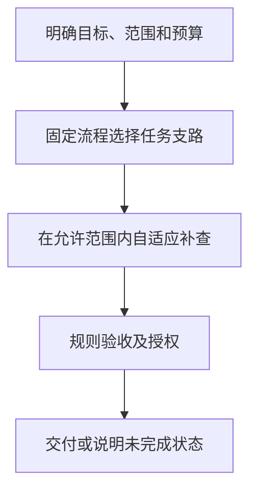

## 从一份合同核查流程看控制权

入库、核对权限、审查草稿和终止是可写成规则的部分。证据不足时如何补充查询，可能需要根据观察选择。系统可以用固定 Workflow 套一段带预算的工具循环。Agentic 设计要解释每一阶段由谁决定下一步、哪些状态可变、哪些动作必须走权限与批准。

| 控制方式 | 技术特点 | 合适的任务 |
| --- | --- | --- |
| 确定流程 | 代码或状态图决定次序 | 条款或批准标准稳定 |
| 单点模型路由 | 模型在有限路径中选 | 表达复杂但分支可明确定义 |
| 受控工具循环 | 依据观察补查或交付 | 环境结果不确定，查询需迭代 |
| 计划与动态编排 | 调整有依赖的子任务 | 目标复杂且可独立验证子产物 |

## 从评估判断是否值得增加自治

给 30 条相同样本运行两个版本。固定层提供相同证据和权限。若受控循环只在 6 条缺证任务明显提升覆盖，可以把它保留在该类分支。比较其在其他任务的成本、重复调用、提前停止和错误率。经验上，业务状态和高影响动作的可验证性决定哪些区域适合放权。把自治当成逐项选择，可在测得收益时局部扩展。

## 小结

Agentic Workflow 的实用价值在受控范围内根据观察调整。固定规则与自治节点可以组合，验收关注具体业务增益和边界。

## 参考资料

- [Anthropic：Building effective agents](https://www.anthropic.com/research/building-effective-agents)
