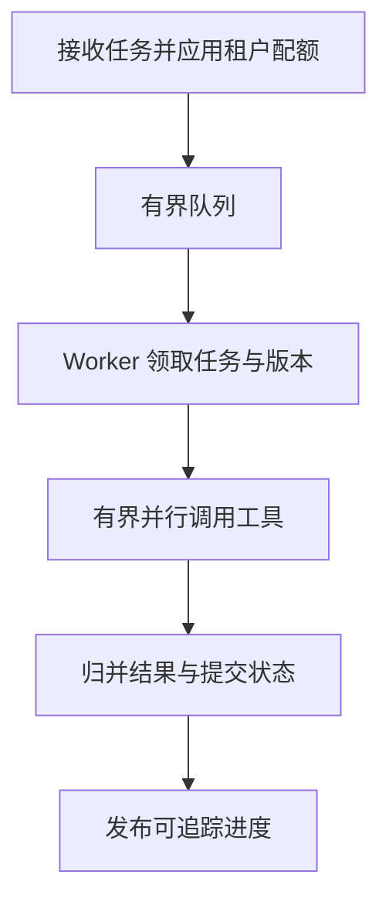

## 一条任务里的并行和多条任务的排队

地区政策可以并行读通用条款和例外，随后汇总。两路外部 I/O 可在一个运行中使用异步调度。多个用户同时提交任务时，任务队列决定哪些 Worker 领取工作。前者的状态属于一次运行，后者负责拥塞、租约和故障重投。不要从三条协程的并行推断系统就能处理任意数量的独立任务。

## Python 3.12 异步调度的失败契约

使用 `await` 时，异步客户端在等待 I/O 时可以让其他协程运行。同步 SDK、长时间 CPU 计算或阻塞文件操作会占用事件循环。执行层可将这类动作从事件循环分离，再根据它能否取消选择线程、进程或服务。在 `TaskGroup` 中，未处理的非取消异常会使剩余同组任务取消。只读检索常允许部分结果，可以把可预期的超时或无资料转换成状态，再让汇总决定是否交付。取消时释放资源，不吞掉框架的取消信号。

假设总预算 1.2 秒，当前已经消耗 500 毫秒，需保留汇总 200 毫秒。两路同时运行时，各自可用剩余预算最多 500 毫秒。若某路预期耗时 650 毫秒，改成明确的部分结果或后台继续路径。异步只能覆盖 I/O 等待，不能消除下游服务的延迟。

## 队列与慢消费者需要背压

Worker 设置租约与可处理数量，提交任务状态后再按消息系统语义确认。若处理完尚未确认便退出，队列可能重投。稳定工作项 ID、最新状态检查和真实副作用回执让恢复可以核对。限额不足时可拒绝新任务、告知等待或使用有界低优先级队列。

流式事件与任务执行分开。客户端缓慢时，可批合可替代进度，保留审计所需的状态变化和最终回执。应用内队列满时应触发背压或断开过慢订阅者，避免逐 Token 累积无限内存。分别观测队列等待、工具耗时、取消与重复派发。

## 小结

用结构化并发管理一次运行内的工作，用有界队列控制系统吞吐。围绕截止、背压、重投与回执设计失败路径。

## 参考资料

- [Python 3.12：Coroutines and Tasks](https://docs.python.org/3.12/library/asyncio-task.html)
- [Python 3.12：asyncio Queues](https://docs.python.org/3.12/library/asyncio-queue.html)
