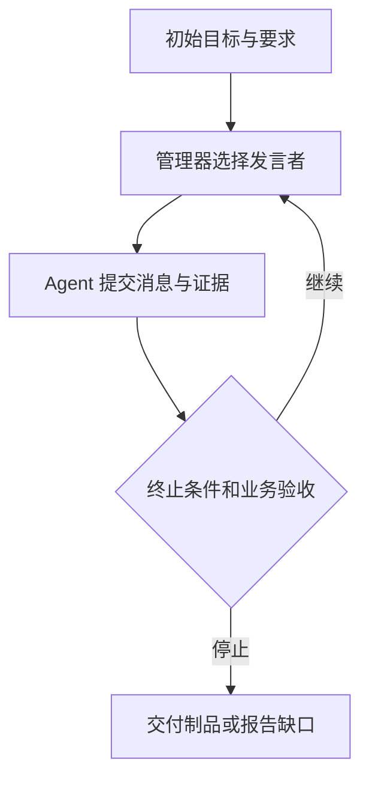

## 用消息组织三位核验角色

一个团队要交付合同差异摘要。研究员找条款、核验员查来源、写作者整理结果。AutoGen AgentChat 的 Team 编排谁何时处理消息。每位 Agent 有自己的能力和状态。消息可以包含用户任务、工具事件、交接和结果。跨角色传递来源 ID、时间和待解决问题，有助于避免重复搜索整段聊天。

## 轮流、模型选择和交接

| Team 机制 | 下一位如何决定 | 常见代价 |
| --- | --- | --- |
| RoundRobinGroupChat | 按预定顺序轮流 | 容易跟踪，缺证卡住时可能发生无效轮次 |
| SelectorGroupChat | 按会话消息和候选选择发言者 | 可动态调度，需限制重复选择和评估成本 |
| Swarm | 用 Handoff 消息表达接手者 | 适合显式责任转交，仍需确认接收者可用和权限 |

初次核验没有证据时，下一位可回到研究员，而不是让写作者先猜。消息上限、超时和人工停止用于保证控制，但得到足够证据还是另一个验收条件。可以同时记录工作项状态、消息和独立工件引用。团队暂停或恢复时按当前运行版本核对已有任务。对外写入的幂等与回执不能由团队的聊天历史代替。

## 怎样读不同代际的教程

0.2 的早期示例与后续 AgentChat 的接口不同。后者的 Core 支持低层消息运行，AgentChat 提供团队等高层抽象。向新版本迁移时用相同任务比较消息路由、流与终止行为，再单独验证角色权限和外部副作用。微软将 Microsoft Agent Framework 说明为 AutoGen 和 Semantic Kernel 的后续框架。存量维护以实际包与文档为准，新项目比较迁移成本和显式工作流需求。

## 小结

AutoGen 团队的核心机制是角色间消息、发言人选择和终止。把可验收制品与消息记录同时留下，以便定位谁拥有状态和责任。

## 参考资料

- [AutoGen AgentChat：Teams](https://microsoft.github.io/autogen/stable/user-guide/agentchat-user-guide/tutorial/teams.html)
- [Microsoft Agent Framework：Overview](https://learn.microsoft.com/en-us/agent-framework/overview/)
