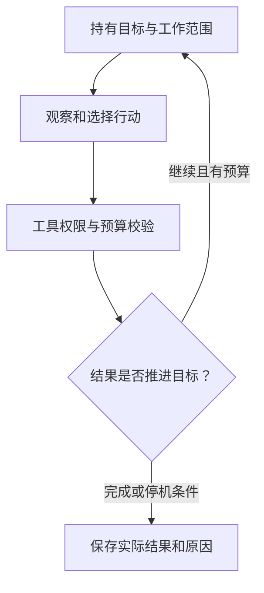

## 自主程度取决于可决定的动作

一个资料助手在完成当前目录清单前可以调整分类或查询顺序，但不能扩张访问范围或自行发布。自治程度由可修改的计划、可访问的环境、允许动作以及审批和退出条件决定。长时间运行还需要独立的状态、租约、恢复和取消。

## 给反馈循环设进展条件

资料版本检查的进展可以用已核对的文档数和已消解冲突数衡量。若连续几轮仅返回相同来源，停止并列出缺口。工具失败不要盲目改变目标。恢复时核对当前身份、任务版本和已有工作。即使模型提出「目标完成」，宿主仍验证实际产物和约束。

## 哪些能力已有基础，哪些仍要验证

持久运行、人工批准与有限工具循环已有成熟实现方式。开放目标、长期稳定决策和跨环境泛化仍依赖评估。按任务数、最长运行阶段、复现难度、未授权动作和人工接管成本比较自治版本。先在只读或可撤回的情境独立验证，再决定是否扩大范围。

## 小结

自主系统需要明确目标、可核查进展及停止规则。长时间存活和可控地推进任务是两种不同能力。

## 参考资料

- [Anthropic：Building effective agents](https://www.anthropic.com/research/building-effective-agents)
- [LangGraph：Persistence](https://docs.langchain.com/oss/python/langgraph/persistence)
