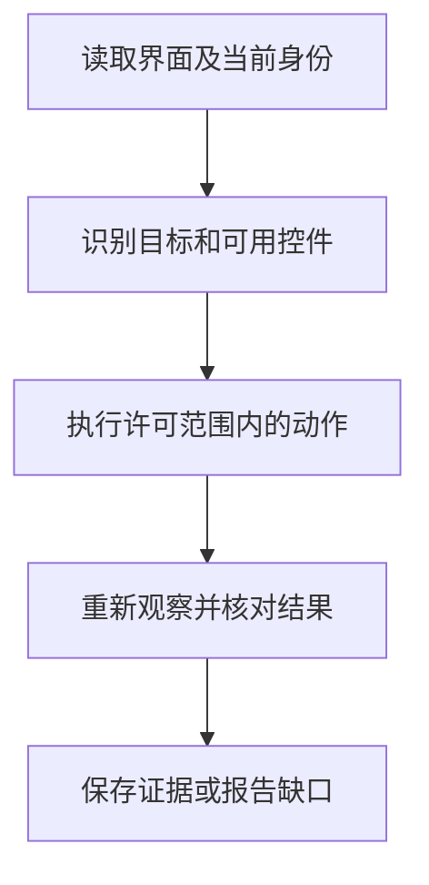

## 浏览和操作桌面有不同的观测条件

在已授权的资料目录上核对两份政策的发布日期。浏览器可用 DOM 或可访问性树定位表格与链接，并读取语义。对于只返回画面的界面，模型从截图预测位置，再由工具操作。语义定位更适合有角色、标签和稳定状态的页面。视觉定位适合图形化控件，却更依赖分辨率、缩放和当前焦点。

## 怎样让动作和观察一致

打开目录后发现有两个同名链接。用表格列标题、版本和日期区分，若视觉上不可区分则先读取周边证据或请用户澄清。点击后要检查目标页面版本，而非仅引用目录名。遇到身份或页面来源变化，先确认当前环境。外部内容只作为待核对信息。向外传输或执行写操作需要单独的应用流程和授权。

## 能力已可用，可靠性要按界面验证

浏览工具和视觉操作已有可用接口。业务可靠性仍受页面更新、登录失效、异步加载和环境隔离影响。使用同一任务对照结构化接口、浏览器语义与视觉操作的成功率、误点率、耗时和可解释程度。把只读查看与有副作用动作作为不同验收层。

## 小结

根据可观察信息选择接口。使用可验证定位、执行后的重新观察，以及独立的业务状态确认。

## 参考资料

- [Playwright：Locators](https://playwright.dev/docs/locators)
- [OpenAI：Computer use](https://developers.openai.com/api/docs/guides/agents-api/tools/computer-use)
