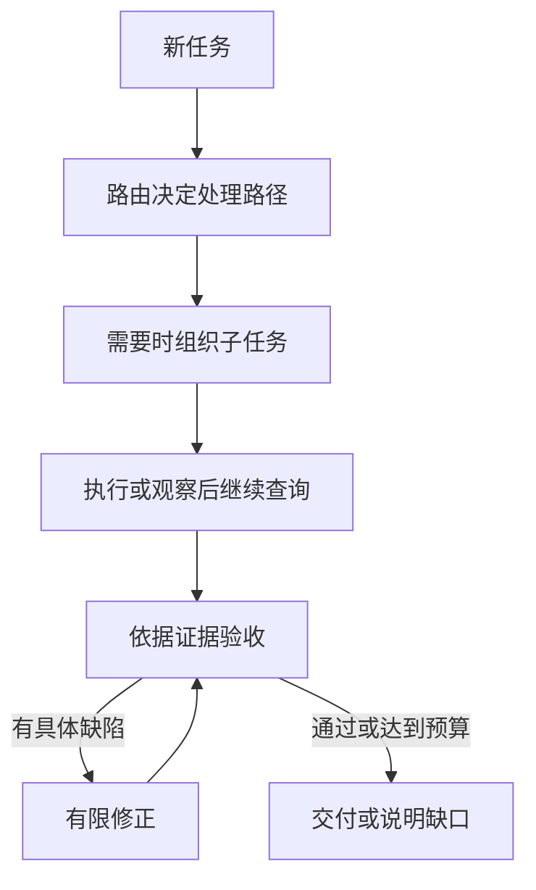

## 先区分任务的不确定性来自哪里

「查发票状态」通常只有一个明确的读工具。「根据故障现象查原因」需要观察当前结果，再决定要不要读另一份日志或询问用户。「汇总三个部门的审计证据」可以先列任务并安排依赖。三类任务都能用一种通用循环硬做，但其不确定性来自不同层。选择范式就是决定哪些步骤预先安排、哪些留给当前观察决定、哪些要求独立核对。

## 各范式控制什么

| 范式 | 关键控制点 | 适用与代价 |
| --- | --- | --- |
| Tool Calling | 用结构化请求提出一次或几次工具操作 | 适用于动作有限、前置条件明确的场景，依赖参数验证 |
| Router | 根据输入或状态把任务分给可选分支 | 适用于有清楚类别和不同流程的应用，需处理未知和误分类 |
| ReAct | 观察后反复选择动作，结合结果继续推理 | 适合下一步依据局部观测决定，需管理循环与探索成本 |
| Plan-and-Execute | 先产生可验证的子任务和依赖，再推进和重规划 | 适合子任务关系可预见的长任务，计划会随事实变化 |
| Reflection | 根据明确标准审查结果或过程，产生问题说明 | 适合一次结果能被后置验证的任务，要防同一模型重复偏差 |
| Self-Correction | 根据审查或环境报错修改结果，再验收 | 需要具体反馈与修改停止条件，不能将「再次生成」当成修正证据 |

调用工具是执行接口，也可被 ReAct、规划或固定路由共同使用。Router 决定任务交给谁，不一定反复行动。ReAct 论文用推理和外部行动交替缩小信息缺口，工程中可落为观测和受控动作。规划重视跨步骤依赖，有了全局草图仍需要响应失败。反思产生问题和评价，真正修正还要产生变化并再次核对。

## 一个流程可以组合几种范式

以审计证据整理为例。先按请求实体用 Router 选择法规库或内部制度库。规划器把「收集证据」「比对条款」「形成报告」表达为依赖图，收集不同部门证据可并行。只有某个部门缺最新资料时，该子任务启用有限 ReAct，通过回执调整搜索。报告生成后，核对器检查条款号、版本和来源，对明确问题发起修正。如果需拉取未经授权的证据，流程只能记录缺口或提交有权限的人处理。

这套设计比统一循环更易追踪耗时，也比全固定路径能适应缺证。它也引入了额外路由和验证成本，要观察路由错误是否无法补救、计划是否频繁失效、修正是否真的提高正确率。可从固定工作流开始复盘需要自治的错误，只有当真实样本证明需要才增加范式。

## 小结

工具调用负责提出动作，路由负责选择路径，ReAct 处理实时不确定性，规划处理跨步依赖，反思和修正处理可核验缺陷。围绕任务的信息结构组合它们，执行权、预算和验收由运行时负责。

## 参考资料

- [Anthropic：Building effective agents](https://www.anthropic.com/research/building-effective-agents)
- [Yao 等：ReAct](https://arxiv.org/abs/2210.03629)
- [Shinn 等：Reflexion](https://arxiv.org/abs/2303.11366)
