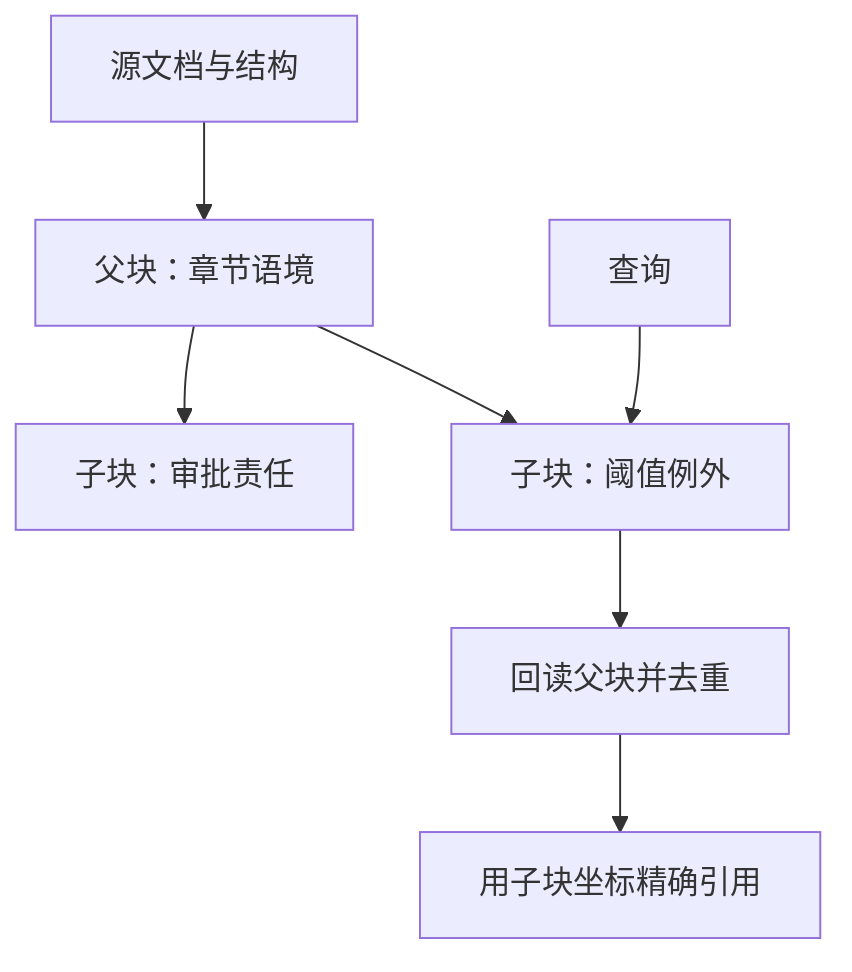

## 一个词搜到了，答案却还差半句

手册写着「跨部门转移由接收部门负责人审批。转移金额超过 5 万元或涉及固定资产折旧时，还应由财务复核。」按固定字数从「超过 5 万元」处刚好断开，检索可能只找到「由财务复核」而不知道它是例外。反过来，如果整本手册每节都作为一个大块，答案所在的两句话会被大量无关内容稀释，多个例外也会争抢上下文空间。

Chunking 决定索引接受的**证据单元**。应分清三个粒度：检索粒度决定模型比较什么，送入上下文的粒度决定模型阅读多少，引用粒度决定读者能定位到哪里。这三层可以分别使用句段、章节片段和原文坐标。

## 策略差异来自哪里

| 策略 | 怎样确定边界 | 适合的内容与代价 |
| --- | --- | --- |
| 固定窗口 | 根据字符或模型 Token 数切窗口 | 可作为可复现基线，容易切断句子、表格或例外 |
| 递归分块 | 先按节、段、行等自然分隔符切，再把过长内容继续拆 | 数据没有显式结构时较实用，分隔符质量决定效果 |
| 结构感知 | 从 DOM、Markdown 语法树或文档块获取标题、列表和表格单元 | 规则和协议文件利于溯源，依赖上游解析正确 |
| 语义分块 | 比较相邻句群的向量变化，寻找话题边界 | 对叙事型内容有价值，阈值会随语料和编码模型变化 |
| Parent–Child | 用短子块检索，再按子块链接回读父块或邻接内容 | 便于兼顾命中和理解，父块回填会占用上下文 |

重叠的主要作用是保留跨边界的词句。若窗口长 C，重叠长 O，相邻窗口起点相隔 C−O。当 O 接近 C 时，索引条目和重复候选会迅速上升。以 C=400、O=80 为例，步长是 320，长文中索引处理的文本量约为原文本的 1.25 倍，忽略首尾差异。增加重叠不一定补齐相隔多段的条件和例外。对这种依赖，更适合结构化链接或在检索时回填邻段。

## 检索命中之后要做什么

在例子中，可以将短子块「超过 5 万元需财务复核」放入索引，同时把标题「跨部门转移」保存在检索文本。因此询问「跨部门转移的财务阈值」同时匹配条件和语境。回读时补齐通用规则，但引用可以精确指向规则与阈值的两个原文坐标。多个子块指向同一父块时，先合并候选或取最高分，再控制回填量，避免一个长章节挤掉其他政策。

对于政策表格，按行切块前要携带表头和单位。对于代码，可按函数或类切，带上文件路径和符号名。成对的定义与限制适合一起放入同一检索单元，长规则可以切开，但需保存「例外于哪一条」的关系。

## 语义分块怎样确定一个可核对的边界

依次对句子或有重叠的句群编码，计算相邻表示的余弦距离，即 1 减余弦相似度。六句话的五个边界距离假设为 0.07、0.18、0.49、0.09、0.21。在阈值 0.35 的方案里，第三句和第四句之间是唯一初选切点。阈值可以根据固定训练样本的分位数选，也可在有人工边界的数据上校准。最小和最大块长还需另设，避免章节平均长度差异导致过短碎片或超出模型输入长度。

假如第三句是「一般调拨由接收方签字」，第四句是「超过五万元必须额外复核」，高距离可能反映术语变动，却不足以切断原文里的业务依赖。可由解析结构把例外关系挂回通用条款，召回时补齐必要父块。验收时对同一问题分别记录「召回哪条」与「能否拿到完整条件」，把跨段证据和单段证据作为独立切片比较。

## 怎样用样本选分块方案

准备有证据坐标的真实任务，覆盖短定义、跨段条件、表格、编号、版本和长章节。比较时先固定解析结果、编码器和候选数，避免把模型差异算到分块上。量出证据是否完整覆盖、至少多少候选才能找齐证据、送给模型时有多少重复 Token。多块都命中同一坐标只算命中一次。也要记录 P95 检索延迟、索引体积和问题类型间的失衡。最后再看端到端答案是否更具可引用性，一次偶然答对不能证明分块更好。

## 小结

好的分块保留回答所需的语境，也把候选和上下文成本控制在预算内。先按文档结构理解依赖，再用证据坐标比较固定窗口、语义边界和父子回填。

## 参考资料

- [TextTiling：Segmenting Text into Multi-paragraph Subtopic Passages](https://aclanthology.org/J97-1003/)
- [LangChain：Text splitters](https://docs.langchain.com/oss/python/integrations/splitters)
